# Mermaid Diagram Types Showcase

This document contains one example of each major Mermaid diagram type supported in MerMark Viewer.

---

## 1. Flowchart
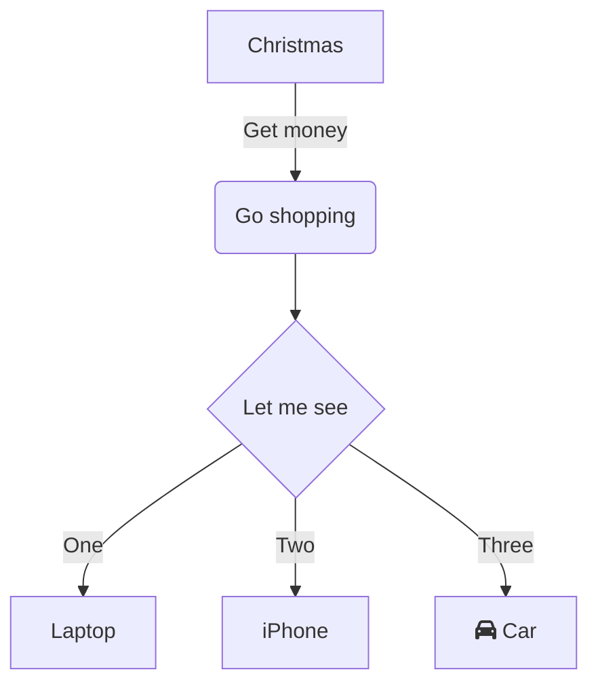

---

## 2. Sequence Diagram
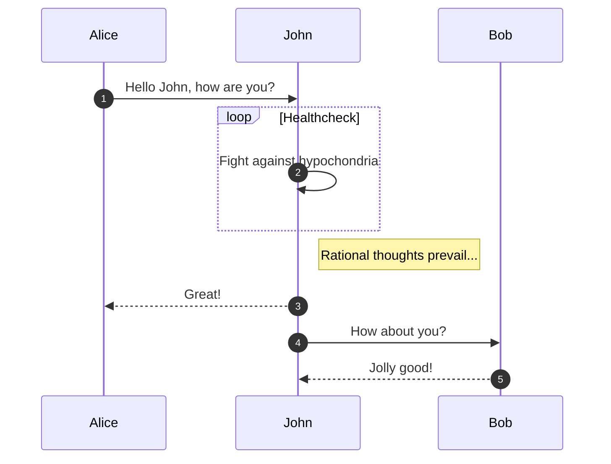

---

## 3. Class Diagram
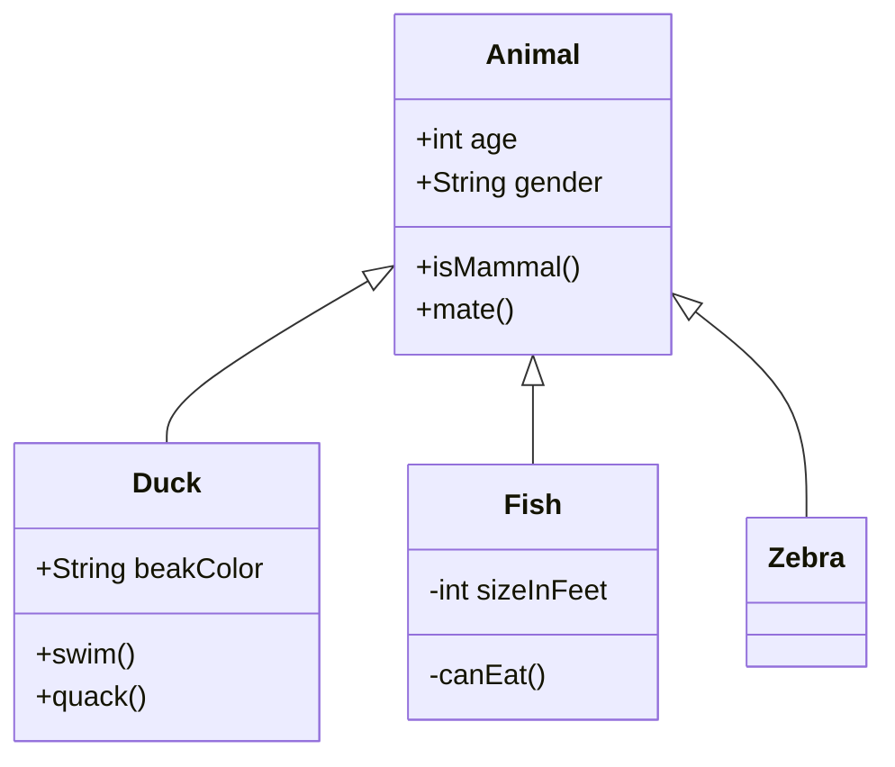

---

## 4. State Diagram
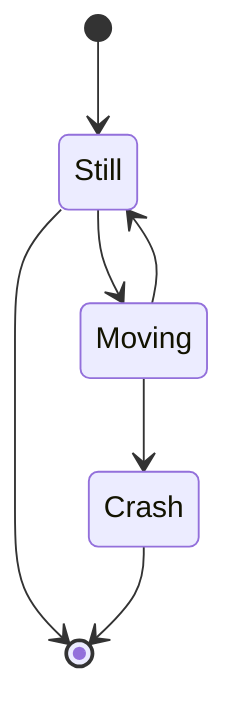

---

## 5. Entity Relationship (ER) Diagram
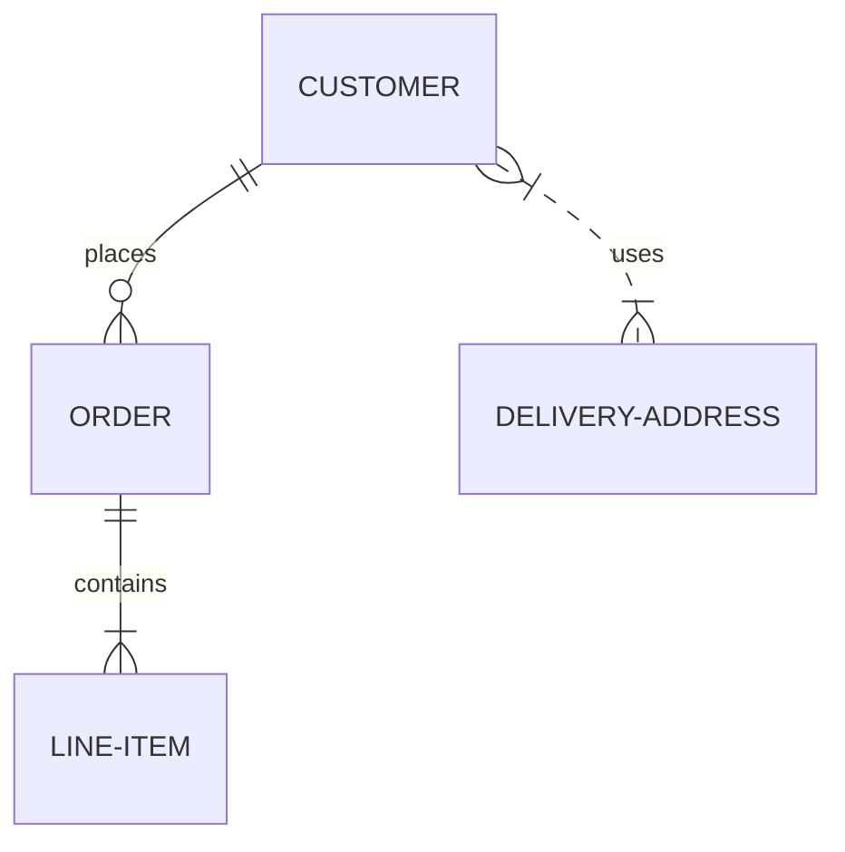

---

## 6. Gantt Chart
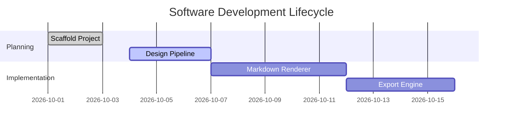

---

## 7. Pie Chart
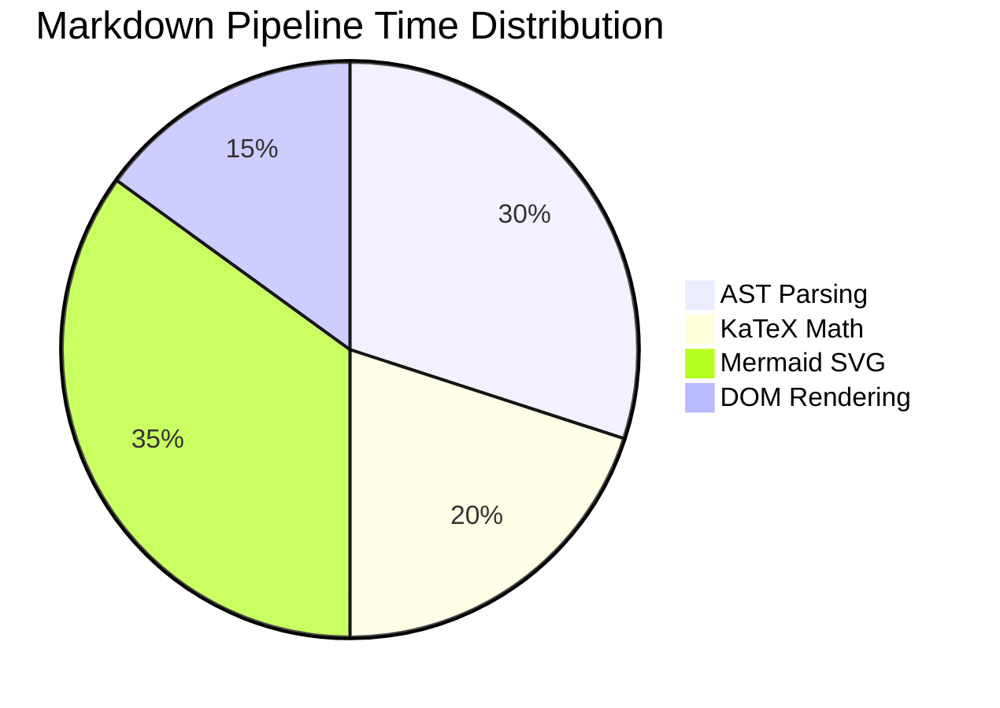

---

## 8. User Journey
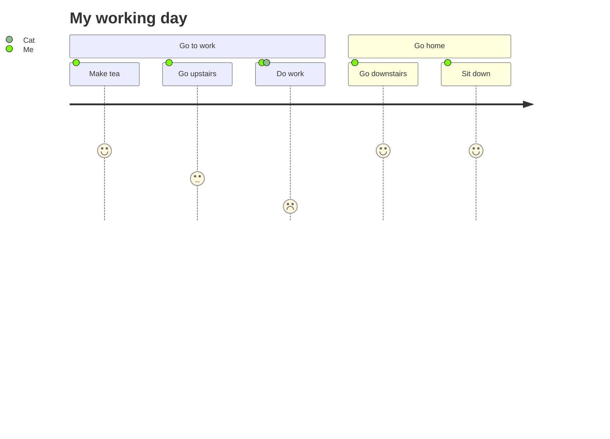

---

## 9. Git Graph
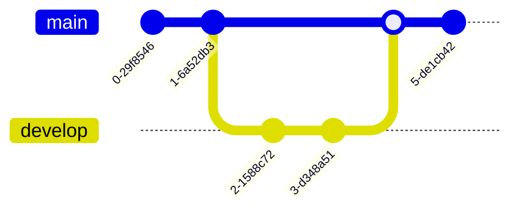

---

## 10. Mindmap
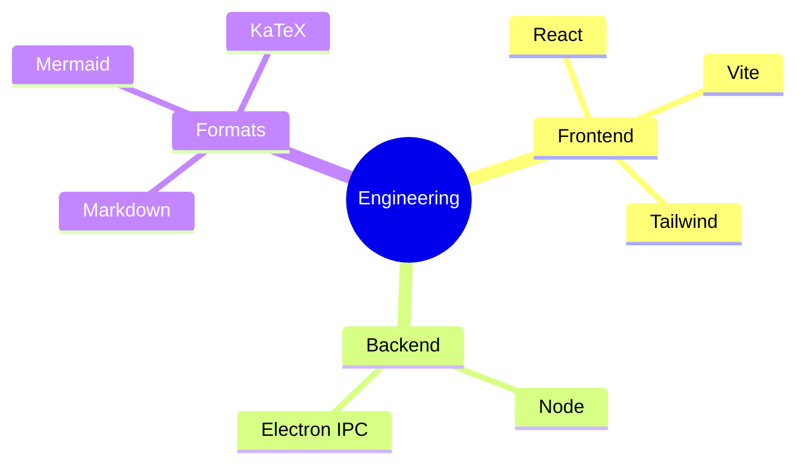

---

## 11. Timeline
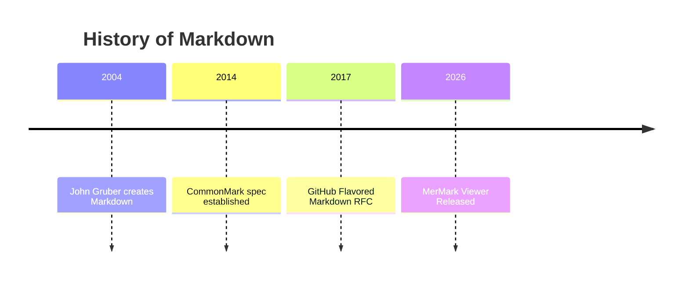

---

## 12. Quadrant Chart
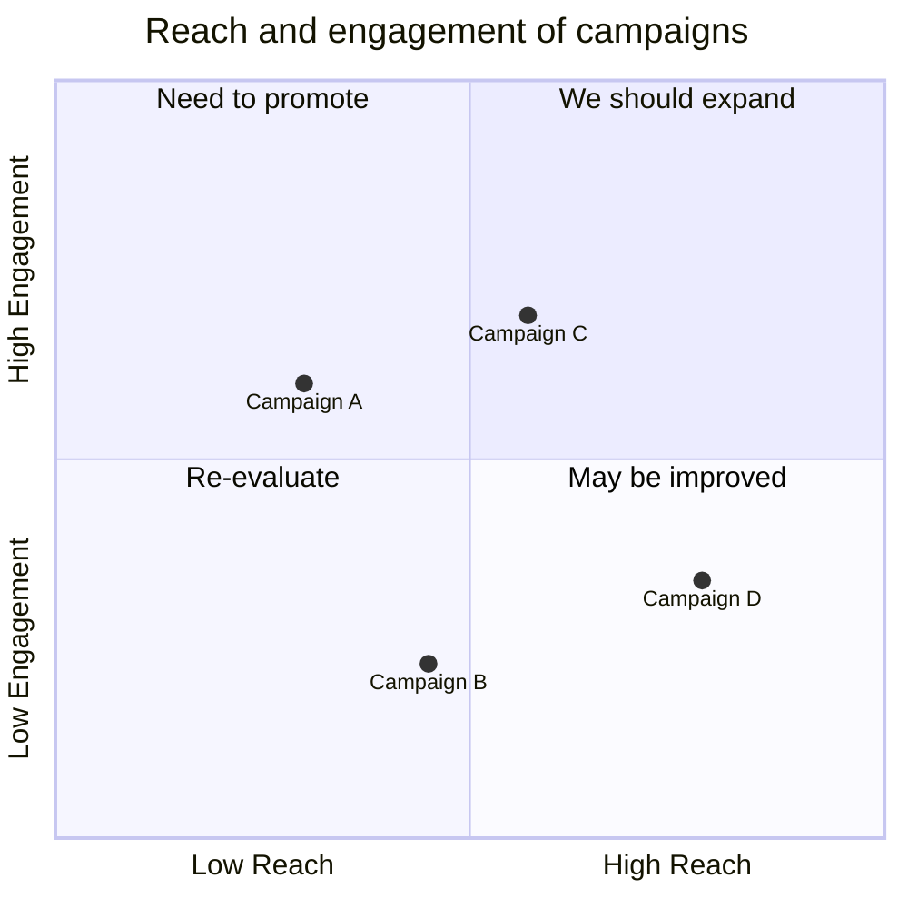

---

## 13. Kanban
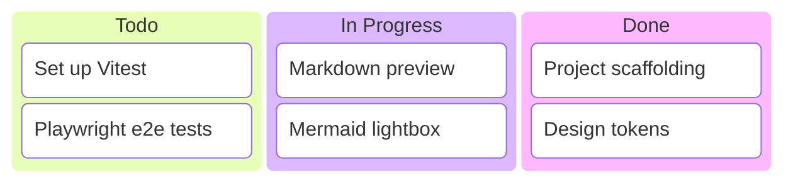
