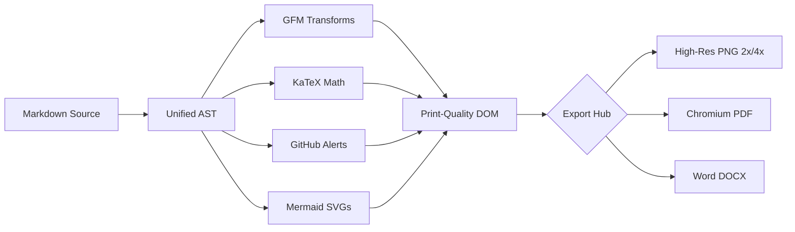

# MerMark Viewer — Full Feature Showcase

Welcome to the comprehensive kitchen-sink test document for **MerMark Viewer**. This document exercises every Markdown and Mermaid feature to guarantee pixel-perfect rendering across platforms.

---

## 1. GitHub-Flavored Markdown Alerts

> [!NOTE]
> Highlights information that users should take into account, even when skimming.

> [!TIP]
> Optional information to help a user be more successful or productive.

> [!IMPORTANT]
> Crucial information necessary for users to succeed with their task.

> [!WARNING]
> Critical content demanding immediate user attention to avoid serious consequences.

> [!CAUTION]
> Negative potential consequences of an action, advised against.

---

## 2. CommonMark & GFM Typography

Here is **bold text**, *italic text*, ***bold italic text***, and ~~strikethrough text~~.

Here is an autolink: https://github.com/rauleblanco/mdmmd-edit and a standard [GitHub Repository Link](https://github.com/rauleblanco/mdmmd-edit).

Emoji shortcodes: :rocket: :sparkles: :fire: :heart: :tada: :star:

### Lists (Nested, Ordered, Task Lists)

- Top-level unordered item
  - Nested unordered level 2
    - Nested unordered level 3 with `inline code`
- Another top-level item

Custom ordered list starting at 5:

5. First numbered step
6. Second numbered step
7. Third numbered step

Interactive GFM Task Lists:

- [x] Project Scaffolding with Electron & Vite 6
- [x] Unified Markdown & Rehype Pipeline
- [x] Native Mermaid Diagram Renderer
- [x] KaTeX Mathematical Formulas
- [ ] High-Resolution Image & PDF Export

---

## 3. Mathematical Formulas (KaTeX)

Inline math: Einstein's mass-energy equivalence $E = mc^2$ and the quadratic formula $x = \frac{-b \pm \sqrt{b^2 - 4ac}}{2a}$.

Block display equations:

$$\int_{-\infty}^{\infty} e^{-x^2} \, dx = \sqrt{\pi}$$

The Gaussian normal distribution function:

$$f(x) = \frac{1}{\sigma \sqrt{2\pi}} \exp\left( -\frac{(x - \mu)^2}{2\sigma^2} \right)$$

---

## 4. Tables with Column Alignment

| Component | Platform | Status | Performance |
| :--- | :---: | :---: | ---: |
| **Electron Shell** | macOS + Windows | Supported | < 50ms startup |
| **Markdown Pipeline** | Unified (AST) | Active | 60 FPS scroll |
| **Mermaid Engine** | Web Worker / SVG | Vector | Hardware accelerated |
| **DOCX Exporter** | docx npm | Ready | Print layout |

---

## 5. Collapsible HTML Details & Summary

<details>
<summary>Click to expand technical implementation details</summary>

### Deep Dive: Electron IPC & Security Model
- `contextIsolation: true`
- `nodeIntegration: false`
- `sandbox: true`
- Strict Content-Security-Policy header
- Input validation via typed preload channels

</details>

---

## 6. Footnotes

Here is a statement with a footnote reference[^1], and another detail mentioned here[^2].

[^1]: Footnotes are rendered at the bottom of the document with back-links.
[^2]: MerMark Viewer supports full GitHub Flavored Markdown footnote syntax.

---

## 7. Syntax-Highlighted Code Blocks

```typescript
// TypeScript example with interface and generics
export interface DiagramOptions {
  theme: 'default' | 'dark' | 'neutral';
  securityLevel: 'strict';
  fontFamily: string;
}

export async function renderDocument<T extends DiagramOptions>(
  source: string,
  options: T
): Promise<{ svg: string; durationMs: number }> {
  const start = performance.now();
  const svg = await mermaid.render('diagram-id', source);
  return { svg, durationMs: performance.now() - start };
}
```

```python
# Python data processing
import math

def gaussian(x: float, mu: float = 0.0, sigma: float = 1.0) -> float:
    """Calculate the probability density for a normal distribution."""
    coeff = 1.0 / (sigma * math.sqrt(2 * math.pi))
    exponent = -0.5 * ((x - mu) / sigma) ** 2
    return coeff * math.exp(exponent)
```

```rust
// Rust memory-safe concurrency
use std::sync::mpsc;
use std::thread;

fn main() {
    let (tx, rx) = mpsc::channel();
    thread::spawn(move || {
        tx.send("Render complete").unwrap();
    });
    println!("Received: {}", rx.recv().unwrap());
}
```

---

## 8. Embedded Mermaid Diagram


