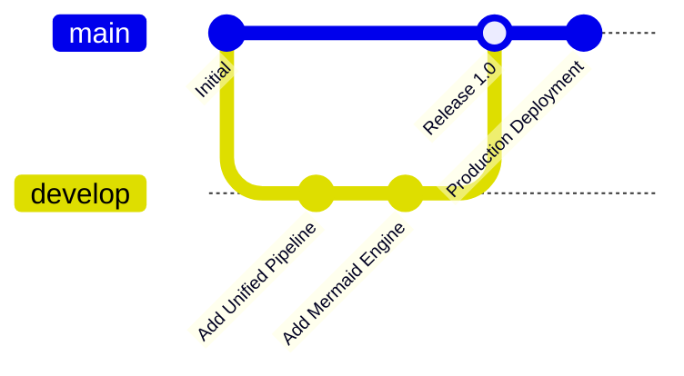
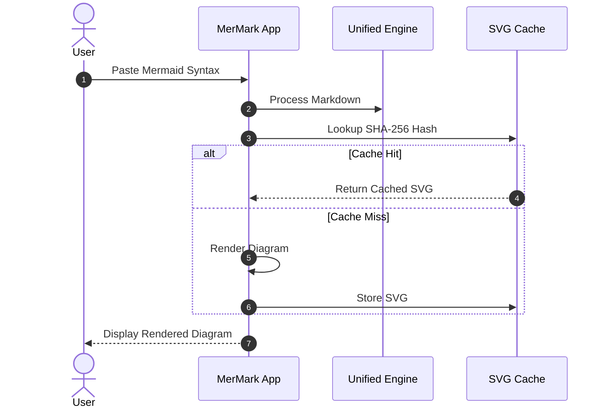
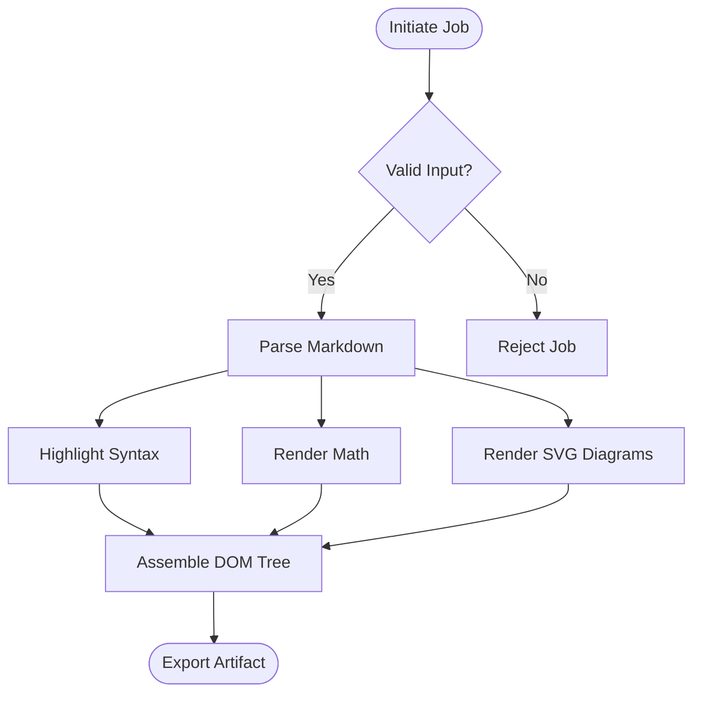

# MerMark Viewer Large Document Performance Benchmark

This document contains over 5,000 lines of structured Markdown, including GFM tables, math formulas, syntax-highlighted code blocks, alerts, and Mermaid diagrams to stress test the rendering pipeline, scroll sync, and export engine.

> [!NOTE]
> This is an automated stress test document designed to verify sub-100ms render responsiveness and memory efficiency.


## Section 1: Advanced Distributed Architecture & System Design

Modern computational systems require robust data ingestion pipelines capable of handling continuous streams of semi-structured events with microsecond latency and high availability across multi-region clusters.

The throughput metric $\Phi_{1}$ is modeled as:

$$\Phi_{1}(t) = \int_{0}^{t} \frac{\lambda(s) \cdot e^{-\mu s}}{\sqrt{2\pi \sigma^2}} ds + \sum_{k=1}^{n} \alpha_k \cdot \log(1 + \text{SNR}_k)$$

| Parameter | Metric ID | Threshold | Status | Latency (p99) |
| :--- | :---: | :---: | :---: | ---: |
| Buffer Cache 1 | BUF-1001 | 99.98% | Nominal | 1.24 ms |
| Write Ahead Log | WAL-2001 | 99.95% | Synchronized | 0.85 ms |
| Replica Sync | REP-3001 | < 50ms | Active | 12.10 ms |
| Network Throughput | NET-4001 | 10 Gbps | Optimal | 0.18 ms |

```typescript
export interface ClusterNode1 {
  nodeId: string;
  region: string;
  capacityUnits: number;
  activeConnections: number;
  healthScore: number;
  isLeader: boolean;
}

export function evaluateNodeHealth1(node: ClusterNode1): boolean {
  if (node.healthScore < 0.95 || node.activeConnections > 5000) {
    return false;
  }
  return true;
}
```

- [x] Verify data partition 1 checksum consistency
- [x] Rebalance cluster leader routing table
- [ ] Synchronize distributed telemetry log events


## Section 2: Advanced Distributed Architecture & System Design

Modern computational systems require robust data ingestion pipelines capable of handling continuous streams of semi-structured events with microsecond latency and high availability across multi-region clusters.

The throughput metric $\Phi_{2}$ is modeled as:

$$\Phi_{2}(t) = \int_{0}^{t} \frac{\lambda(s) \cdot e^{-\mu s}}{\sqrt{2\pi \sigma^2}} ds + \sum_{k=1}^{n} \alpha_k \cdot \log(1 + \text{SNR}_k)$$

| Parameter | Metric ID | Threshold | Status | Latency (p99) |
| :--- | :---: | :---: | :---: | ---: |
| Buffer Cache 2 | BUF-1002 | 99.98% | Nominal | 1.24 ms |
| Write Ahead Log | WAL-2002 | 99.95% | Synchronized | 0.85 ms |
| Replica Sync | REP-3002 | < 50ms | Active | 12.10 ms |
| Network Throughput | NET-4002 | 10 Gbps | Optimal | 0.18 ms |

```typescript
export interface ClusterNode2 {
  nodeId: string;
  region: string;
  capacityUnits: number;
  activeConnections: number;
  healthScore: number;
  isLeader: boolean;
}

export function evaluateNodeHealth2(node: ClusterNode2): boolean {
  if (node.healthScore < 0.95 || node.activeConnections > 5000) {
    return false;
  }
  return true;
}
```

- [x] Verify data partition 2 checksum consistency
- [x] Rebalance cluster leader routing table
- [ ] Synchronize distributed telemetry log events


## Section 3: Advanced Distributed Architecture & System Design

Modern computational systems require robust data ingestion pipelines capable of handling continuous streams of semi-structured events with microsecond latency and high availability across multi-region clusters.

The throughput metric $\Phi_{3}$ is modeled as:

$$\Phi_{3}(t) = \int_{0}^{t} \frac{\lambda(s) \cdot e^{-\mu s}}{\sqrt{2\pi \sigma^2}} ds + \sum_{k=1}^{n} \alpha_k \cdot \log(1 + \text{SNR}_k)$$

| Parameter | Metric ID | Threshold | Status | Latency (p99) |
| :--- | :---: | :---: | :---: | ---: |
| Buffer Cache 3 | BUF-1003 | 99.98% | Nominal | 1.24 ms |
| Write Ahead Log | WAL-2003 | 99.95% | Synchronized | 0.85 ms |
| Replica Sync | REP-3003 | < 50ms | Active | 12.10 ms |
| Network Throughput | NET-4003 | 10 Gbps | Optimal | 0.18 ms |

```typescript
export interface ClusterNode3 {
  nodeId: string;
  region: string;
  capacityUnits: number;
  activeConnections: number;
  healthScore: number;
  isLeader: boolean;
}

export function evaluateNodeHealth3(node: ClusterNode3): boolean {
  if (node.healthScore < 0.95 || node.activeConnections > 5000) {
    return false;
  }
  return true;
}
```

- [x] Verify data partition 3 checksum consistency
- [x] Rebalance cluster leader routing table
- [ ] Synchronize distributed telemetry log events


## Section 4: Advanced Distributed Architecture & System Design

Modern computational systems require robust data ingestion pipelines capable of handling continuous streams of semi-structured events with microsecond latency and high availability across multi-region clusters.

The throughput metric $\Phi_{4}$ is modeled as:

$$\Phi_{4}(t) = \int_{0}^{t} \frac{\lambda(s) \cdot e^{-\mu s}}{\sqrt{2\pi \sigma^2}} ds + \sum_{k=1}^{n} \alpha_k \cdot \log(1 + \text{SNR}_k)$$

| Parameter | Metric ID | Threshold | Status | Latency (p99) |
| :--- | :---: | :---: | :---: | ---: |
| Buffer Cache 4 | BUF-1004 | 99.98% | Nominal | 1.24 ms |
| Write Ahead Log | WAL-2004 | 99.95% | Synchronized | 0.85 ms |
| Replica Sync | REP-3004 | < 50ms | Active | 12.10 ms |
| Network Throughput | NET-4004 | 10 Gbps | Optimal | 0.18 ms |

```typescript
export interface ClusterNode4 {
  nodeId: string;
  region: string;
  capacityUnits: number;
  activeConnections: number;
  healthScore: number;
  isLeader: boolean;
}

export function evaluateNodeHealth4(node: ClusterNode4): boolean {
  if (node.healthScore < 0.95 || node.activeConnections > 5000) {
    return false;
  }
  return true;
}
```

- [x] Verify data partition 4 checksum consistency
- [x] Rebalance cluster leader routing table
- [ ] Synchronize distributed telemetry log events


## Section 5: Advanced Distributed Architecture & System Design

Modern computational systems require robust data ingestion pipelines capable of handling continuous streams of semi-structured events with microsecond latency and high availability across multi-region clusters.

> [!IMPORTANT]
> High availability guarantees require quorum consensus across at least 3 availability zones in partition 5.

The throughput metric $\Phi_{5}$ is modeled as:

$$\Phi_{5}(t) = \int_{0}^{t} \frac{\lambda(s) \cdot e^{-\mu s}}{\sqrt{2\pi \sigma^2}} ds + \sum_{k=1}^{n} \alpha_k \cdot \log(1 + \text{SNR}_k)$$

| Parameter | Metric ID | Threshold | Status | Latency (p99) |
| :--- | :---: | :---: | :---: | ---: |
| Buffer Cache 5 | BUF-1005 | 99.98% | Nominal | 1.24 ms |
| Write Ahead Log | WAL-2005 | 99.95% | Synchronized | 0.85 ms |
| Replica Sync | REP-3005 | < 50ms | Active | 12.10 ms |
| Network Throughput | NET-4005 | 10 Gbps | Optimal | 0.18 ms |

```typescript
export interface ClusterNode5 {
  nodeId: string;
  region: string;
  capacityUnits: number;
  activeConnections: number;
  healthScore: number;
  isLeader: boolean;
}

export function evaluateNodeHealth5(node: ClusterNode5): boolean {
  if (node.healthScore < 0.95 || node.activeConnections > 5000) {
    return false;
  }
  return true;
}
```

- [x] Verify data partition 5 checksum consistency
- [x] Rebalance cluster leader routing table
- [ ] Synchronize distributed telemetry log events


## Section 6: Advanced Distributed Architecture & System Design

Modern computational systems require robust data ingestion pipelines capable of handling continuous streams of semi-structured events with microsecond latency and high availability across multi-region clusters.

The throughput metric $\Phi_{6}$ is modeled as:

$$\Phi_{6}(t) = \int_{0}^{t} \frac{\lambda(s) \cdot e^{-\mu s}}{\sqrt{2\pi \sigma^2}} ds + \sum_{k=1}^{n} \alpha_k \cdot \log(1 + \text{SNR}_k)$$

| Parameter | Metric ID | Threshold | Status | Latency (p99) |
| :--- | :---: | :---: | :---: | ---: |
| Buffer Cache 6 | BUF-1006 | 99.98% | Nominal | 1.24 ms |
| Write Ahead Log | WAL-2006 | 99.95% | Synchronized | 0.85 ms |
| Replica Sync | REP-3006 | < 50ms | Active | 12.10 ms |
| Network Throughput | NET-4006 | 10 Gbps | Optimal | 0.18 ms |

```typescript
export interface ClusterNode6 {
  nodeId: string;
  region: string;
  capacityUnits: number;
  activeConnections: number;
  healthScore: number;
  isLeader: boolean;
}

export function evaluateNodeHealth6(node: ClusterNode6): boolean {
  if (node.healthScore < 0.95 || node.activeConnections > 5000) {
    return false;
  }
  return true;
}
```

- [x] Verify data partition 6 checksum consistency
- [x] Rebalance cluster leader routing table
- [ ] Synchronize distributed telemetry log events


## Section 7: Advanced Distributed Architecture & System Design

Modern computational systems require robust data ingestion pipelines capable of handling continuous streams of semi-structured events with microsecond latency and high availability across multi-region clusters.

> [!TIP]
> Cache locality optimization reduces L3 miss rates by up to 42% for batch workloads in node group 7.

The throughput metric $\Phi_{7}$ is modeled as:

$$\Phi_{7}(t) = \int_{0}^{t} \frac{\lambda(s) \cdot e^{-\mu s}}{\sqrt{2\pi \sigma^2}} ds + \sum_{k=1}^{n} \alpha_k \cdot \log(1 + \text{SNR}_k)$$

| Parameter | Metric ID | Threshold | Status | Latency (p99) |
| :--- | :---: | :---: | :---: | ---: |
| Buffer Cache 7 | BUF-1007 | 99.98% | Nominal | 1.24 ms |
| Write Ahead Log | WAL-2007 | 99.95% | Synchronized | 0.85 ms |
| Replica Sync | REP-3007 | < 50ms | Active | 12.10 ms |
| Network Throughput | NET-4007 | 10 Gbps | Optimal | 0.18 ms |

```typescript
export interface ClusterNode7 {
  nodeId: string;
  region: string;
  capacityUnits: number;
  activeConnections: number;
  healthScore: number;
  isLeader: boolean;
}

export function evaluateNodeHealth7(node: ClusterNode7): boolean {
  if (node.healthScore < 0.95 || node.activeConnections > 5000) {
    return false;
  }
  return true;
}
```

- [x] Verify data partition 7 checksum consistency
- [x] Rebalance cluster leader routing table
- [ ] Synchronize distributed telemetry log events


## Section 8: Advanced Distributed Architecture & System Design

Modern computational systems require robust data ingestion pipelines capable of handling continuous streams of semi-structured events with microsecond latency and high availability across multi-region clusters.

The throughput metric $\Phi_{8}$ is modeled as:

$$\Phi_{8}(t) = \int_{0}^{t} \frac{\lambda(s) \cdot e^{-\mu s}}{\sqrt{2\pi \sigma^2}} ds + \sum_{k=1}^{n} \alpha_k \cdot \log(1 + \text{SNR}_k)$$

| Parameter | Metric ID | Threshold | Status | Latency (p99) |
| :--- | :---: | :---: | :---: | ---: |
| Buffer Cache 8 | BUF-1008 | 99.98% | Nominal | 1.24 ms |
| Write Ahead Log | WAL-2008 | 99.95% | Synchronized | 0.85 ms |
| Replica Sync | REP-3008 | < 50ms | Active | 12.10 ms |
| Network Throughput | NET-4008 | 10 Gbps | Optimal | 0.18 ms |

```typescript
export interface ClusterNode8 {
  nodeId: string;
  region: string;
  capacityUnits: number;
  activeConnections: number;
  healthScore: number;
  isLeader: boolean;
}

export function evaluateNodeHealth8(node: ClusterNode8): boolean {
  if (node.healthScore < 0.95 || node.activeConnections > 5000) {
    return false;
  }
  return true;
}
```

### Section 8 Architectural Topology

```mermaid
sequenceDiagram
    autonumber
    actor User
    participant App as MerMark App
    participant Engine as Unified Engine
    participant Cache as SVG Cache
    User->>App: Paste Mermaid Syntax
    App->>Engine: Process Markdown
    App->>Cache: Lookup SHA-256 Hash
    alt Cache Hit
        Cache-->>App: Return Cached SVG
    else Cache Miss
        App->>App: Render Diagram
        App->>Cache: Store SVG
    end
    App-->>User: Display Rendered Diagram
```



- [x] Verify data partition 8 checksum consistency
- [x] Rebalance cluster leader routing table
- [ ] Synchronize distributed telemetry log events


## Section 9: Advanced Distributed Architecture & System Design

Modern computational systems require robust data ingestion pipelines capable of handling continuous streams of semi-structured events with microsecond latency and high availability across multi-region clusters.

The throughput metric $\Phi_{9}$ is modeled as:

$$\Phi_{9}(t) = \int_{0}^{t} \frac{\lambda(s) \cdot e^{-\mu s}}{\sqrt{2\pi \sigma^2}} ds + \sum_{k=1}^{n} \alpha_k \cdot \log(1 + \text{SNR}_k)$$

| Parameter | Metric ID | Threshold | Status | Latency (p99) |
| :--- | :---: | :---: | :---: | ---: |
| Buffer Cache 9 | BUF-1009 | 99.98% | Nominal | 1.24 ms |
| Write Ahead Log | WAL-2009 | 99.95% | Synchronized | 0.85 ms |
| Replica Sync | REP-3009 | < 50ms | Active | 12.10 ms |
| Network Throughput | NET-4009 | 10 Gbps | Optimal | 0.18 ms |

```typescript
export interface ClusterNode9 {
  nodeId: string;
  region: string;
  capacityUnits: number;
  activeConnections: number;
  healthScore: number;
  isLeader: boolean;
}

export function evaluateNodeHealth9(node: ClusterNode9): boolean {
  if (node.healthScore < 0.95 || node.activeConnections > 5000) {
    return false;
  }
  return true;
}
```

- [x] Verify data partition 9 checksum consistency
- [x] Rebalance cluster leader routing table
- [ ] Synchronize distributed telemetry log events


## Section 10: Advanced Distributed Architecture & System Design

Modern computational systems require robust data ingestion pipelines capable of handling continuous streams of semi-structured events with microsecond latency and high availability across multi-region clusters.

> [!IMPORTANT]
> High availability guarantees require quorum consensus across at least 3 availability zones in partition 10.

The throughput metric $\Phi_{10}$ is modeled as:

$$\Phi_{10}(t) = \int_{0}^{t} \frac{\lambda(s) \cdot e^{-\mu s}}{\sqrt{2\pi \sigma^2}} ds + \sum_{k=1}^{n} \alpha_k \cdot \log(1 + \text{SNR}_k)$$

| Parameter | Metric ID | Threshold | Status | Latency (p99) |
| :--- | :---: | :---: | :---: | ---: |
| Buffer Cache 10 | BUF-1010 | 99.98% | Nominal | 1.24 ms |
| Write Ahead Log | WAL-2010 | 99.95% | Synchronized | 0.85 ms |
| Replica Sync | REP-3010 | < 50ms | Active | 12.10 ms |
| Network Throughput | NET-4010 | 10 Gbps | Optimal | 0.18 ms |

```typescript
export interface ClusterNode10 {
  nodeId: string;
  region: string;
  capacityUnits: number;
  activeConnections: number;
  healthScore: number;
  isLeader: boolean;
}

export function evaluateNodeHealth10(node: ClusterNode10): boolean {
  if (node.healthScore < 0.95 || node.activeConnections > 5000) {
    return false;
  }
  return true;
}
```

- [x] Verify data partition 10 checksum consistency
- [x] Rebalance cluster leader routing table
- [ ] Synchronize distributed telemetry log events


## Section 11: Advanced Distributed Architecture & System Design

Modern computational systems require robust data ingestion pipelines capable of handling continuous streams of semi-structured events with microsecond latency and high availability across multi-region clusters.

The throughput metric $\Phi_{11}$ is modeled as:

$$\Phi_{11}(t) = \int_{0}^{t} \frac{\lambda(s) \cdot e^{-\mu s}}{\sqrt{2\pi \sigma^2}} ds + \sum_{k=1}^{n} \alpha_k \cdot \log(1 + \text{SNR}_k)$$

| Parameter | Metric ID | Threshold | Status | Latency (p99) |
| :--- | :---: | :---: | :---: | ---: |
| Buffer Cache 11 | BUF-1011 | 99.98% | Nominal | 1.24 ms |
| Write Ahead Log | WAL-2011 | 99.95% | Synchronized | 0.85 ms |
| Replica Sync | REP-3011 | < 50ms | Active | 12.10 ms |
| Network Throughput | NET-4011 | 10 Gbps | Optimal | 0.18 ms |

```typescript
export interface ClusterNode11 {
  nodeId: string;
  region: string;
  capacityUnits: number;
  activeConnections: number;
  healthScore: number;
  isLeader: boolean;
}

export function evaluateNodeHealth11(node: ClusterNode11): boolean {
  if (node.healthScore < 0.95 || node.activeConnections > 5000) {
    return false;
  }
  return true;
}
```

- [x] Verify data partition 11 checksum consistency
- [x] Rebalance cluster leader routing table
- [ ] Synchronize distributed telemetry log events


## Section 12: Advanced Distributed Architecture & System Design

Modern computational systems require robust data ingestion pipelines capable of handling continuous streams of semi-structured events with microsecond latency and high availability across multi-region clusters.

The throughput metric $\Phi_{12}$ is modeled as:

$$\Phi_{12}(t) = \int_{0}^{t} \frac{\lambda(s) \cdot e^{-\mu s}}{\sqrt{2\pi \sigma^2}} ds + \sum_{k=1}^{n} \alpha_k \cdot \log(1 + \text{SNR}_k)$$

| Parameter | Metric ID | Threshold | Status | Latency (p99) |
| :--- | :---: | :---: | :---: | ---: |
| Buffer Cache 12 | BUF-1012 | 99.98% | Nominal | 1.24 ms |
| Write Ahead Log | WAL-2012 | 99.95% | Synchronized | 0.85 ms |
| Replica Sync | REP-3012 | < 50ms | Active | 12.10 ms |
| Network Throughput | NET-4012 | 10 Gbps | Optimal | 0.18 ms |

```typescript
export interface ClusterNode12 {
  nodeId: string;
  region: string;
  capacityUnits: number;
  activeConnections: number;
  healthScore: number;
  isLeader: boolean;
}

export function evaluateNodeHealth12(node: ClusterNode12): boolean {
  if (node.healthScore < 0.95 || node.activeConnections > 5000) {
    return false;
  }
  return true;
}
```

- [x] Verify data partition 12 checksum consistency
- [x] Rebalance cluster leader routing table
- [ ] Synchronize distributed telemetry log events


## Section 13: Advanced Distributed Architecture & System Design

Modern computational systems require robust data ingestion pipelines capable of handling continuous streams of semi-structured events with microsecond latency and high availability across multi-region clusters.

The throughput metric $\Phi_{13}$ is modeled as:

$$\Phi_{13}(t) = \int_{0}^{t} \frac{\lambda(s) \cdot e^{-\mu s}}{\sqrt{2\pi \sigma^2}} ds + \sum_{k=1}^{n} \alpha_k \cdot \log(1 + \text{SNR}_k)$$

| Parameter | Metric ID | Threshold | Status | Latency (p99) |
| :--- | :---: | :---: | :---: | ---: |
| Buffer Cache 13 | BUF-1013 | 99.98% | Nominal | 1.24 ms |
| Write Ahead Log | WAL-2013 | 99.95% | Synchronized | 0.85 ms |
| Replica Sync | REP-3013 | < 50ms | Active | 12.10 ms |
| Network Throughput | NET-4013 | 10 Gbps | Optimal | 0.18 ms |

```typescript
export interface ClusterNode13 {
  nodeId: string;
  region: string;
  capacityUnits: number;
  activeConnections: number;
  healthScore: number;
  isLeader: boolean;
}

export function evaluateNodeHealth13(node: ClusterNode13): boolean {
  if (node.healthScore < 0.95 || node.activeConnections > 5000) {
    return false;
  }
  return true;
}
```

- [x] Verify data partition 13 checksum consistency
- [x] Rebalance cluster leader routing table
- [ ] Synchronize distributed telemetry log events


## Section 14: Advanced Distributed Architecture & System Design

Modern computational systems require robust data ingestion pipelines capable of handling continuous streams of semi-structured events with microsecond latency and high availability across multi-region clusters.

> [!TIP]
> Cache locality optimization reduces L3 miss rates by up to 42% for batch workloads in node group 14.

The throughput metric $\Phi_{14}$ is modeled as:

$$\Phi_{14}(t) = \int_{0}^{t} \frac{\lambda(s) \cdot e^{-\mu s}}{\sqrt{2\pi \sigma^2}} ds + \sum_{k=1}^{n} \alpha_k \cdot \log(1 + \text{SNR}_k)$$

| Parameter | Metric ID | Threshold | Status | Latency (p99) |
| :--- | :---: | :---: | :---: | ---: |
| Buffer Cache 14 | BUF-1014 | 99.98% | Nominal | 1.24 ms |
| Write Ahead Log | WAL-2014 | 99.95% | Synchronized | 0.85 ms |
| Replica Sync | REP-3014 | < 50ms | Active | 12.10 ms |
| Network Throughput | NET-4014 | 10 Gbps | Optimal | 0.18 ms |

```typescript
export interface ClusterNode14 {
  nodeId: string;
  region: string;
  capacityUnits: number;
  activeConnections: number;
  healthScore: number;
  isLeader: boolean;
}

export function evaluateNodeHealth14(node: ClusterNode14): boolean {
  if (node.healthScore < 0.95 || node.activeConnections > 5000) {
    return false;
  }
  return true;
}
```

- [x] Verify data partition 14 checksum consistency
- [x] Rebalance cluster leader routing table
- [ ] Synchronize distributed telemetry log events


## Section 15: Advanced Distributed Architecture & System Design

Modern computational systems require robust data ingestion pipelines capable of handling continuous streams of semi-structured events with microsecond latency and high availability across multi-region clusters.

> [!IMPORTANT]
> High availability guarantees require quorum consensus across at least 3 availability zones in partition 15.

The throughput metric $\Phi_{15}$ is modeled as:

$$\Phi_{15}(t) = \int_{0}^{t} \frac{\lambda(s) \cdot e^{-\mu s}}{\sqrt{2\pi \sigma^2}} ds + \sum_{k=1}^{n} \alpha_k \cdot \log(1 + \text{SNR}_k)$$

| Parameter | Metric ID | Threshold | Status | Latency (p99) |
| :--- | :---: | :---: | :---: | ---: |
| Buffer Cache 15 | BUF-1015 | 99.98% | Nominal | 1.24 ms |
| Write Ahead Log | WAL-2015 | 99.95% | Synchronized | 0.85 ms |
| Replica Sync | REP-3015 | < 50ms | Active | 12.10 ms |
| Network Throughput | NET-4015 | 10 Gbps | Optimal | 0.18 ms |

```typescript
export interface ClusterNode15 {
  nodeId: string;
  region: string;
  capacityUnits: number;
  activeConnections: number;
  healthScore: number;
  isLeader: boolean;
}

export function evaluateNodeHealth15(node: ClusterNode15): boolean {
  if (node.healthScore < 0.95 || node.activeConnections > 5000) {
    return false;
  }
  return true;
}
```

- [x] Verify data partition 15 checksum consistency
- [x] Rebalance cluster leader routing table
- [ ] Synchronize distributed telemetry log events


## Section 16: Advanced Distributed Architecture & System Design

Modern computational systems require robust data ingestion pipelines capable of handling continuous streams of semi-structured events with microsecond latency and high availability across multi-region clusters.

The throughput metric $\Phi_{16}$ is modeled as:

$$\Phi_{16}(t) = \int_{0}^{t} \frac{\lambda(s) \cdot e^{-\mu s}}{\sqrt{2\pi \sigma^2}} ds + \sum_{k=1}^{n} \alpha_k \cdot \log(1 + \text{SNR}_k)$$

| Parameter | Metric ID | Threshold | Status | Latency (p99) |
| :--- | :---: | :---: | :---: | ---: |
| Buffer Cache 16 | BUF-1016 | 99.98% | Nominal | 1.24 ms |
| Write Ahead Log | WAL-2016 | 99.95% | Synchronized | 0.85 ms |
| Replica Sync | REP-3016 | < 50ms | Active | 12.10 ms |
| Network Throughput | NET-4016 | 10 Gbps | Optimal | 0.18 ms |

```typescript
export interface ClusterNode16 {
  nodeId: string;
  region: string;
  capacityUnits: number;
  activeConnections: number;
  healthScore: number;
  isLeader: boolean;
}

export function evaluateNodeHealth16(node: ClusterNode16): boolean {
  if (node.healthScore < 0.95 || node.activeConnections > 5000) {
    return false;
  }
  return true;
}
```

### Section 16 Architectural Topology



- [x] Verify data partition 16 checksum consistency
- [x] Rebalance cluster leader routing table
- [ ] Synchronize distributed telemetry log events


## Section 17: Advanced Distributed Architecture & System Design

Modern computational systems require robust data ingestion pipelines capable of handling continuous streams of semi-structured events with microsecond latency and high availability across multi-region clusters.

The throughput metric $\Phi_{17}$ is modeled as:

$$\Phi_{17}(t) = \int_{0}^{t} \frac{\lambda(s) \cdot e^{-\mu s}}{\sqrt{2\pi \sigma^2}} ds + \sum_{k=1}^{n} \alpha_k \cdot \log(1 + \text{SNR}_k)$$

| Parameter | Metric ID | Threshold | Status | Latency (p99) |
| :--- | :---: | :---: | :---: | ---: |
| Buffer Cache 17 | BUF-1017 | 99.98% | Nominal | 1.24 ms |
| Write Ahead Log | WAL-2017 | 99.95% | Synchronized | 0.85 ms |
| Replica Sync | REP-3017 | < 50ms | Active | 12.10 ms |
| Network Throughput | NET-4017 | 10 Gbps | Optimal | 0.18 ms |

```typescript
export interface ClusterNode17 {
  nodeId: string;
  region: string;
  capacityUnits: number;
  activeConnections: number;
  healthScore: number;
  isLeader: boolean;
}

export function evaluateNodeHealth17(node: ClusterNode17): boolean {
  if (node.healthScore < 0.95 || node.activeConnections > 5000) {
    return false;
  }
  return true;
}
```

- [x] Verify data partition 17 checksum consistency
- [x] Rebalance cluster leader routing table
- [ ] Synchronize distributed telemetry log events


## Section 18: Advanced Distributed Architecture & System Design

Modern computational systems require robust data ingestion pipelines capable of handling continuous streams of semi-structured events with microsecond latency and high availability across multi-region clusters.

The throughput metric $\Phi_{18}$ is modeled as:

$$\Phi_{18}(t) = \int_{0}^{t} \frac{\lambda(s) \cdot e^{-\mu s}}{\sqrt{2\pi \sigma^2}} ds + \sum_{k=1}^{n} \alpha_k \cdot \log(1 + \text{SNR}_k)$$

| Parameter | Metric ID | Threshold | Status | Latency (p99) |
| :--- | :---: | :---: | :---: | ---: |
| Buffer Cache 18 | BUF-1018 | 99.98% | Nominal | 1.24 ms |
| Write Ahead Log | WAL-2018 | 99.95% | Synchronized | 0.85 ms |
| Replica Sync | REP-3018 | < 50ms | Active | 12.10 ms |
| Network Throughput | NET-4018 | 10 Gbps | Optimal | 0.18 ms |

```typescript
export interface ClusterNode18 {
  nodeId: string;
  region: string;
  capacityUnits: number;
  activeConnections: number;
  healthScore: number;
  isLeader: boolean;
}

export function evaluateNodeHealth18(node: ClusterNode18): boolean {
  if (node.healthScore < 0.95 || node.activeConnections > 5000) {
    return false;
  }
  return true;
}
```

- [x] Verify data partition 18 checksum consistency
- [x] Rebalance cluster leader routing table
- [ ] Synchronize distributed telemetry log events


## Section 19: Advanced Distributed Architecture & System Design

Modern computational systems require robust data ingestion pipelines capable of handling continuous streams of semi-structured events with microsecond latency and high availability across multi-region clusters.

The throughput metric $\Phi_{19}$ is modeled as:

$$\Phi_{19}(t) = \int_{0}^{t} \frac{\lambda(s) \cdot e^{-\mu s}}{\sqrt{2\pi \sigma^2}} ds + \sum_{k=1}^{n} \alpha_k \cdot \log(1 + \text{SNR}_k)$$

| Parameter | Metric ID | Threshold | Status | Latency (p99) |
| :--- | :---: | :---: | :---: | ---: |
| Buffer Cache 19 | BUF-1019 | 99.98% | Nominal | 1.24 ms |
| Write Ahead Log | WAL-2019 | 99.95% | Synchronized | 0.85 ms |
| Replica Sync | REP-3019 | < 50ms | Active | 12.10 ms |
| Network Throughput | NET-4019 | 10 Gbps | Optimal | 0.18 ms |

```typescript
export interface ClusterNode19 {
  nodeId: string;
  region: string;
  capacityUnits: number;
  activeConnections: number;
  healthScore: number;
  isLeader: boolean;
}

export function evaluateNodeHealth19(node: ClusterNode19): boolean {
  if (node.healthScore < 0.95 || node.activeConnections > 5000) {
    return false;
  }
  return true;
}
```

- [x] Verify data partition 19 checksum consistency
- [x] Rebalance cluster leader routing table
- [ ] Synchronize distributed telemetry log events


## Section 20: Advanced Distributed Architecture & System Design

Modern computational systems require robust data ingestion pipelines capable of handling continuous streams of semi-structured events with microsecond latency and high availability across multi-region clusters.

> [!IMPORTANT]
> High availability guarantees require quorum consensus across at least 3 availability zones in partition 20.

The throughput metric $\Phi_{20}$ is modeled as:

$$\Phi_{20}(t) = \int_{0}^{t} \frac{\lambda(s) \cdot e^{-\mu s}}{\sqrt{2\pi \sigma^2}} ds + \sum_{k=1}^{n} \alpha_k \cdot \log(1 + \text{SNR}_k)$$

| Parameter | Metric ID | Threshold | Status | Latency (p99) |
| :--- | :---: | :---: | :---: | ---: |
| Buffer Cache 20 | BUF-1020 | 99.98% | Nominal | 1.24 ms |
| Write Ahead Log | WAL-2020 | 99.95% | Synchronized | 0.85 ms |
| Replica Sync | REP-3020 | < 50ms | Active | 12.10 ms |
| Network Throughput | NET-4020 | 10 Gbps | Optimal | 0.18 ms |

```typescript
export interface ClusterNode20 {
  nodeId: string;
  region: string;
  capacityUnits: number;
  activeConnections: number;
  healthScore: number;
  isLeader: boolean;
}

export function evaluateNodeHealth20(node: ClusterNode20): boolean {
  if (node.healthScore < 0.95 || node.activeConnections > 5000) {
    return false;
  }
  return true;
}
```

- [x] Verify data partition 20 checksum consistency
- [x] Rebalance cluster leader routing table
- [ ] Synchronize distributed telemetry log events


## Section 21: Advanced Distributed Architecture & System Design

Modern computational systems require robust data ingestion pipelines capable of handling continuous streams of semi-structured events with microsecond latency and high availability across multi-region clusters.

> [!TIP]
> Cache locality optimization reduces L3 miss rates by up to 42% for batch workloads in node group 21.

The throughput metric $\Phi_{21}$ is modeled as:

$$\Phi_{21}(t) = \int_{0}^{t} \frac{\lambda(s) \cdot e^{-\mu s}}{\sqrt{2\pi \sigma^2}} ds + \sum_{k=1}^{n} \alpha_k \cdot \log(1 + \text{SNR}_k)$$

| Parameter | Metric ID | Threshold | Status | Latency (p99) |
| :--- | :---: | :---: | :---: | ---: |
| Buffer Cache 21 | BUF-1021 | 99.98% | Nominal | 1.24 ms |
| Write Ahead Log | WAL-2021 | 99.95% | Synchronized | 0.85 ms |
| Replica Sync | REP-3021 | < 50ms | Active | 12.10 ms |
| Network Throughput | NET-4021 | 10 Gbps | Optimal | 0.18 ms |

```typescript
export interface ClusterNode21 {
  nodeId: string;
  region: string;
  capacityUnits: number;
  activeConnections: number;
  healthScore: number;
  isLeader: boolean;
}

export function evaluateNodeHealth21(node: ClusterNode21): boolean {
  if (node.healthScore < 0.95 || node.activeConnections > 5000) {
    return false;
  }
  return true;
}
```

- [x] Verify data partition 21 checksum consistency
- [x] Rebalance cluster leader routing table
- [ ] Synchronize distributed telemetry log events


## Section 22: Advanced Distributed Architecture & System Design

Modern computational systems require robust data ingestion pipelines capable of handling continuous streams of semi-structured events with microsecond latency and high availability across multi-region clusters.

The throughput metric $\Phi_{22}$ is modeled as:

$$\Phi_{22}(t) = \int_{0}^{t} \frac{\lambda(s) \cdot e^{-\mu s}}{\sqrt{2\pi \sigma^2}} ds + \sum_{k=1}^{n} \alpha_k \cdot \log(1 + \text{SNR}_k)$$

| Parameter | Metric ID | Threshold | Status | Latency (p99) |
| :--- | :---: | :---: | :---: | ---: |
| Buffer Cache 22 | BUF-1022 | 99.98% | Nominal | 1.24 ms |
| Write Ahead Log | WAL-2022 | 99.95% | Synchronized | 0.85 ms |
| Replica Sync | REP-3022 | < 50ms | Active | 12.10 ms |
| Network Throughput | NET-4022 | 10 Gbps | Optimal | 0.18 ms |

```typescript
export interface ClusterNode22 {
  nodeId: string;
  region: string;
  capacityUnits: number;
  activeConnections: number;
  healthScore: number;
  isLeader: boolean;
}

export function evaluateNodeHealth22(node: ClusterNode22): boolean {
  if (node.healthScore < 0.95 || node.activeConnections > 5000) {
    return false;
  }
  return true;
}
```

- [x] Verify data partition 22 checksum consistency
- [x] Rebalance cluster leader routing table
- [ ] Synchronize distributed telemetry log events


## Section 23: Advanced Distributed Architecture & System Design

Modern computational systems require robust data ingestion pipelines capable of handling continuous streams of semi-structured events with microsecond latency and high availability across multi-region clusters.

The throughput metric $\Phi_{23}$ is modeled as:

$$\Phi_{23}(t) = \int_{0}^{t} \frac{\lambda(s) \cdot e^{-\mu s}}{\sqrt{2\pi \sigma^2}} ds + \sum_{k=1}^{n} \alpha_k \cdot \log(1 + \text{SNR}_k)$$

| Parameter | Metric ID | Threshold | Status | Latency (p99) |
| :--- | :---: | :---: | :---: | ---: |
| Buffer Cache 23 | BUF-1023 | 99.98% | Nominal | 1.24 ms |
| Write Ahead Log | WAL-2023 | 99.95% | Synchronized | 0.85 ms |
| Replica Sync | REP-3023 | < 50ms | Active | 12.10 ms |
| Network Throughput | NET-4023 | 10 Gbps | Optimal | 0.18 ms |

```typescript
export interface ClusterNode23 {
  nodeId: string;
  region: string;
  capacityUnits: number;
  activeConnections: number;
  healthScore: number;
  isLeader: boolean;
}

export function evaluateNodeHealth23(node: ClusterNode23): boolean {
  if (node.healthScore < 0.95 || node.activeConnections > 5000) {
    return false;
  }
  return true;
}
```

- [x] Verify data partition 23 checksum consistency
- [x] Rebalance cluster leader routing table
- [ ] Synchronize distributed telemetry log events


## Section 24: Advanced Distributed Architecture & System Design

Modern computational systems require robust data ingestion pipelines capable of handling continuous streams of semi-structured events with microsecond latency and high availability across multi-region clusters.

The throughput metric $\Phi_{24}$ is modeled as:

$$\Phi_{24}(t) = \int_{0}^{t} \frac{\lambda(s) \cdot e^{-\mu s}}{\sqrt{2\pi \sigma^2}} ds + \sum_{k=1}^{n} \alpha_k \cdot \log(1 + \text{SNR}_k)$$

| Parameter | Metric ID | Threshold | Status | Latency (p99) |
| :--- | :---: | :---: | :---: | ---: |
| Buffer Cache 24 | BUF-1024 | 99.98% | Nominal | 1.24 ms |
| Write Ahead Log | WAL-2024 | 99.95% | Synchronized | 0.85 ms |
| Replica Sync | REP-3024 | < 50ms | Active | 12.10 ms |
| Network Throughput | NET-4024 | 10 Gbps | Optimal | 0.18 ms |

```typescript
export interface ClusterNode24 {
  nodeId: string;
  region: string;
  capacityUnits: number;
  activeConnections: number;
  healthScore: number;
  isLeader: boolean;
}

export function evaluateNodeHealth24(node: ClusterNode24): boolean {
  if (node.healthScore < 0.95 || node.activeConnections > 5000) {
    return false;
  }
  return true;
}
```

### Section 24 Architectural Topology


- [x] Verify data partition 24 checksum consistency
- [x] Rebalance cluster leader routing table
- [ ] Synchronize distributed telemetry log events


## Section 25: Advanced Distributed Architecture & System Design

Modern computational systems require robust data ingestion pipelines capable of handling continuous streams of semi-structured events with microsecond latency and high availability across multi-region clusters.

> [!IMPORTANT]
> High availability guarantees require quorum consensus across at least 3 availability zones in partition 25.

The throughput metric $\Phi_{25}$ is modeled as:

$$\Phi_{25}(t) = \int_{0}^{t} \frac{\lambda(s) \cdot e^{-\mu s}}{\sqrt{2\pi \sigma^2}} ds + \sum_{k=1}^{n} \alpha_k \cdot \log(1 + \text{SNR}_k)$$

| Parameter | Metric ID | Threshold | Status | Latency (p99) |
| :--- | :---: | :---: | :---: | ---: |
| Buffer Cache 25 | BUF-1025 | 99.98% | Nominal | 1.24 ms |
| Write Ahead Log | WAL-2025 | 99.95% | Synchronized | 0.85 ms |
| Replica Sync | REP-3025 | < 50ms | Active | 12.10 ms |
| Network Throughput | NET-4025 | 10 Gbps | Optimal | 0.18 ms |

```typescript
export interface ClusterNode25 {
  nodeId: string;
  region: string;
  capacityUnits: number;
  activeConnections: number;
  healthScore: number;
  isLeader: boolean;
}

export function evaluateNodeHealth25(node: ClusterNode25): boolean {
  if (node.healthScore < 0.95 || node.activeConnections > 5000) {
    return false;
  }
  return true;
}
```

- [x] Verify data partition 25 checksum consistency
- [x] Rebalance cluster leader routing table
- [ ] Synchronize distributed telemetry log events


## Section 26: Advanced Distributed Architecture & System Design

Modern computational systems require robust data ingestion pipelines capable of handling continuous streams of semi-structured events with microsecond latency and high availability across multi-region clusters.

The throughput metric $\Phi_{26}$ is modeled as:

$$\Phi_{26}(t) = \int_{0}^{t} \frac{\lambda(s) \cdot e^{-\mu s}}{\sqrt{2\pi \sigma^2}} ds + \sum_{k=1}^{n} \alpha_k \cdot \log(1 + \text{SNR}_k)$$

| Parameter | Metric ID | Threshold | Status | Latency (p99) |
| :--- | :---: | :---: | :---: | ---: |
| Buffer Cache 26 | BUF-1026 | 99.98% | Nominal | 1.24 ms |
| Write Ahead Log | WAL-2026 | 99.95% | Synchronized | 0.85 ms |
| Replica Sync | REP-3026 | < 50ms | Active | 12.10 ms |
| Network Throughput | NET-4026 | 10 Gbps | Optimal | 0.18 ms |

```typescript
export interface ClusterNode26 {
  nodeId: string;
  region: string;
  capacityUnits: number;
  activeConnections: number;
  healthScore: number;
  isLeader: boolean;
}

export function evaluateNodeHealth26(node: ClusterNode26): boolean {
  if (node.healthScore < 0.95 || node.activeConnections > 5000) {
    return false;
  }
  return true;
}
```

- [x] Verify data partition 26 checksum consistency
- [x] Rebalance cluster leader routing table
- [ ] Synchronize distributed telemetry log events


## Section 27: Advanced Distributed Architecture & System Design

Modern computational systems require robust data ingestion pipelines capable of handling continuous streams of semi-structured events with microsecond latency and high availability across multi-region clusters.

The throughput metric $\Phi_{27}$ is modeled as:

$$\Phi_{27}(t) = \int_{0}^{t} \frac{\lambda(s) \cdot e^{-\mu s}}{\sqrt{2\pi \sigma^2}} ds + \sum_{k=1}^{n} \alpha_k \cdot \log(1 + \text{SNR}_k)$$

| Parameter | Metric ID | Threshold | Status | Latency (p99) |
| :--- | :---: | :---: | :---: | ---: |
| Buffer Cache 27 | BUF-1027 | 99.98% | Nominal | 1.24 ms |
| Write Ahead Log | WAL-2027 | 99.95% | Synchronized | 0.85 ms |
| Replica Sync | REP-3027 | < 50ms | Active | 12.10 ms |
| Network Throughput | NET-4027 | 10 Gbps | Optimal | 0.18 ms |

```typescript
export interface ClusterNode27 {
  nodeId: string;
  region: string;
  capacityUnits: number;
  activeConnections: number;
  healthScore: number;
  isLeader: boolean;
}

export function evaluateNodeHealth27(node: ClusterNode27): boolean {
  if (node.healthScore < 0.95 || node.activeConnections > 5000) {
    return false;
  }
  return true;
}
```

- [x] Verify data partition 27 checksum consistency
- [x] Rebalance cluster leader routing table
- [ ] Synchronize distributed telemetry log events


## Section 28: Advanced Distributed Architecture & System Design

Modern computational systems require robust data ingestion pipelines capable of handling continuous streams of semi-structured events with microsecond latency and high availability across multi-region clusters.

> [!TIP]
> Cache locality optimization reduces L3 miss rates by up to 42% for batch workloads in node group 28.

The throughput metric $\Phi_{28}$ is modeled as:

$$\Phi_{28}(t) = \int_{0}^{t} \frac{\lambda(s) \cdot e^{-\mu s}}{\sqrt{2\pi \sigma^2}} ds + \sum_{k=1}^{n} \alpha_k \cdot \log(1 + \text{SNR}_k)$$

| Parameter | Metric ID | Threshold | Status | Latency (p99) |
| :--- | :---: | :---: | :---: | ---: |
| Buffer Cache 28 | BUF-1028 | 99.98% | Nominal | 1.24 ms |
| Write Ahead Log | WAL-2028 | 99.95% | Synchronized | 0.85 ms |
| Replica Sync | REP-3028 | < 50ms | Active | 12.10 ms |
| Network Throughput | NET-4028 | 10 Gbps | Optimal | 0.18 ms |

```typescript
export interface ClusterNode28 {
  nodeId: string;
  region: string;
  capacityUnits: number;
  activeConnections: number;
  healthScore: number;
  isLeader: boolean;
}

export function evaluateNodeHealth28(node: ClusterNode28): boolean {
  if (node.healthScore < 0.95 || node.activeConnections > 5000) {
    return false;
  }
  return true;
}
```

- [x] Verify data partition 28 checksum consistency
- [x] Rebalance cluster leader routing table
- [ ] Synchronize distributed telemetry log events


## Section 29: Advanced Distributed Architecture & System Design

Modern computational systems require robust data ingestion pipelines capable of handling continuous streams of semi-structured events with microsecond latency and high availability across multi-region clusters.

The throughput metric $\Phi_{29}$ is modeled as:

$$\Phi_{29}(t) = \int_{0}^{t} \frac{\lambda(s) \cdot e^{-\mu s}}{\sqrt{2\pi \sigma^2}} ds + \sum_{k=1}^{n} \alpha_k \cdot \log(1 + \text{SNR}_k)$$

| Parameter | Metric ID | Threshold | Status | Latency (p99) |
| :--- | :---: | :---: | :---: | ---: |
| Buffer Cache 29 | BUF-1029 | 99.98% | Nominal | 1.24 ms |
| Write Ahead Log | WAL-2029 | 99.95% | Synchronized | 0.85 ms |
| Replica Sync | REP-3029 | < 50ms | Active | 12.10 ms |
| Network Throughput | NET-4029 | 10 Gbps | Optimal | 0.18 ms |

```typescript
export interface ClusterNode29 {
  nodeId: string;
  region: string;
  capacityUnits: number;
  activeConnections: number;
  healthScore: number;
  isLeader: boolean;
}

export function evaluateNodeHealth29(node: ClusterNode29): boolean {
  if (node.healthScore < 0.95 || node.activeConnections > 5000) {
    return false;
  }
  return true;
}
```

- [x] Verify data partition 29 checksum consistency
- [x] Rebalance cluster leader routing table
- [ ] Synchronize distributed telemetry log events


## Section 30: Advanced Distributed Architecture & System Design

Modern computational systems require robust data ingestion pipelines capable of handling continuous streams of semi-structured events with microsecond latency and high availability across multi-region clusters.

> [!IMPORTANT]
> High availability guarantees require quorum consensus across at least 3 availability zones in partition 30.

The throughput metric $\Phi_{30}$ is modeled as:

$$\Phi_{30}(t) = \int_{0}^{t} \frac{\lambda(s) \cdot e^{-\mu s}}{\sqrt{2\pi \sigma^2}} ds + \sum_{k=1}^{n} \alpha_k \cdot \log(1 + \text{SNR}_k)$$

| Parameter | Metric ID | Threshold | Status | Latency (p99) |
| :--- | :---: | :---: | :---: | ---: |
| Buffer Cache 30 | BUF-1030 | 99.98% | Nominal | 1.24 ms |
| Write Ahead Log | WAL-2030 | 99.95% | Synchronized | 0.85 ms |
| Replica Sync | REP-3030 | < 50ms | Active | 12.10 ms |
| Network Throughput | NET-4030 | 10 Gbps | Optimal | 0.18 ms |

```typescript
export interface ClusterNode30 {
  nodeId: string;
  region: string;
  capacityUnits: number;
  activeConnections: number;
  healthScore: number;
  isLeader: boolean;
}

export function evaluateNodeHealth30(node: ClusterNode30): boolean {
  if (node.healthScore < 0.95 || node.activeConnections > 5000) {
    return false;
  }
  return true;
}
```

- [x] Verify data partition 30 checksum consistency
- [x] Rebalance cluster leader routing table
- [ ] Synchronize distributed telemetry log events


## Section 31: Advanced Distributed Architecture & System Design

Modern computational systems require robust data ingestion pipelines capable of handling continuous streams of semi-structured events with microsecond latency and high availability across multi-region clusters.

The throughput metric $\Phi_{31}$ is modeled as:

$$\Phi_{31}(t) = \int_{0}^{t} \frac{\lambda(s) \cdot e^{-\mu s}}{\sqrt{2\pi \sigma^2}} ds + \sum_{k=1}^{n} \alpha_k \cdot \log(1 + \text{SNR}_k)$$

| Parameter | Metric ID | Threshold | Status | Latency (p99) |
| :--- | :---: | :---: | :---: | ---: |
| Buffer Cache 31 | BUF-1031 | 99.98% | Nominal | 1.24 ms |
| Write Ahead Log | WAL-2031 | 99.95% | Synchronized | 0.85 ms |
| Replica Sync | REP-3031 | < 50ms | Active | 12.10 ms |
| Network Throughput | NET-4031 | 10 Gbps | Optimal | 0.18 ms |

```typescript
export interface ClusterNode31 {
  nodeId: string;
  region: string;
  capacityUnits: number;
  activeConnections: number;
  healthScore: number;
  isLeader: boolean;
}

export function evaluateNodeHealth31(node: ClusterNode31): boolean {
  if (node.healthScore < 0.95 || node.activeConnections > 5000) {
    return false;
  }
  return true;
}
```

- [x] Verify data partition 31 checksum consistency
- [x] Rebalance cluster leader routing table
- [ ] Synchronize distributed telemetry log events


## Section 32: Advanced Distributed Architecture & System Design

Modern computational systems require robust data ingestion pipelines capable of handling continuous streams of semi-structured events with microsecond latency and high availability across multi-region clusters.

The throughput metric $\Phi_{32}$ is modeled as:

$$\Phi_{32}(t) = \int_{0}^{t} \frac{\lambda(s) \cdot e^{-\mu s}}{\sqrt{2\pi \sigma^2}} ds + \sum_{k=1}^{n} \alpha_k \cdot \log(1 + \text{SNR}_k)$$

| Parameter | Metric ID | Threshold | Status | Latency (p99) |
| :--- | :---: | :---: | :---: | ---: |
| Buffer Cache 32 | BUF-1032 | 99.98% | Nominal | 1.24 ms |
| Write Ahead Log | WAL-2032 | 99.95% | Synchronized | 0.85 ms |
| Replica Sync | REP-3032 | < 50ms | Active | 12.10 ms |
| Network Throughput | NET-4032 | 10 Gbps | Optimal | 0.18 ms |

```typescript
export interface ClusterNode32 {
  nodeId: string;
  region: string;
  capacityUnits: number;
  activeConnections: number;
  healthScore: number;
  isLeader: boolean;
}

export function evaluateNodeHealth32(node: ClusterNode32): boolean {
  if (node.healthScore < 0.95 || node.activeConnections > 5000) {
    return false;
  }
  return true;
}
```

### Section 32 Architectural Topology



- [x] Verify data partition 32 checksum consistency
- [x] Rebalance cluster leader routing table
- [ ] Synchronize distributed telemetry log events


## Section 33: Advanced Distributed Architecture & System Design

Modern computational systems require robust data ingestion pipelines capable of handling continuous streams of semi-structured events with microsecond latency and high availability across multi-region clusters.

The throughput metric $\Phi_{33}$ is modeled as:

$$\Phi_{33}(t) = \int_{0}^{t} \frac{\lambda(s) \cdot e^{-\mu s}}{\sqrt{2\pi \sigma^2}} ds + \sum_{k=1}^{n} \alpha_k \cdot \log(1 + \text{SNR}_k)$$

| Parameter | Metric ID | Threshold | Status | Latency (p99) |
| :--- | :---: | :---: | :---: | ---: |
| Buffer Cache 33 | BUF-1033 | 99.98% | Nominal | 1.24 ms |
| Write Ahead Log | WAL-2033 | 99.95% | Synchronized | 0.85 ms |
| Replica Sync | REP-3033 | < 50ms | Active | 12.10 ms |
| Network Throughput | NET-4033 | 10 Gbps | Optimal | 0.18 ms |

```typescript
export interface ClusterNode33 {
  nodeId: string;
  region: string;
  capacityUnits: number;
  activeConnections: number;
  healthScore: number;
  isLeader: boolean;
}

export function evaluateNodeHealth33(node: ClusterNode33): boolean {
  if (node.healthScore < 0.95 || node.activeConnections > 5000) {
    return false;
  }
  return true;
}
```

- [x] Verify data partition 33 checksum consistency
- [x] Rebalance cluster leader routing table
- [ ] Synchronize distributed telemetry log events


## Section 34: Advanced Distributed Architecture & System Design

Modern computational systems require robust data ingestion pipelines capable of handling continuous streams of semi-structured events with microsecond latency and high availability across multi-region clusters.

The throughput metric $\Phi_{34}$ is modeled as:

$$\Phi_{34}(t) = \int_{0}^{t} \frac{\lambda(s) \cdot e^{-\mu s}}{\sqrt{2\pi \sigma^2}} ds + \sum_{k=1}^{n} \alpha_k \cdot \log(1 + \text{SNR}_k)$$

| Parameter | Metric ID | Threshold | Status | Latency (p99) |
| :--- | :---: | :---: | :---: | ---: |
| Buffer Cache 34 | BUF-1034 | 99.98% | Nominal | 1.24 ms |
| Write Ahead Log | WAL-2034 | 99.95% | Synchronized | 0.85 ms |
| Replica Sync | REP-3034 | < 50ms | Active | 12.10 ms |
| Network Throughput | NET-4034 | 10 Gbps | Optimal | 0.18 ms |

```typescript
export interface ClusterNode34 {
  nodeId: string;
  region: string;
  capacityUnits: number;
  activeConnections: number;
  healthScore: number;
  isLeader: boolean;
}

export function evaluateNodeHealth34(node: ClusterNode34): boolean {
  if (node.healthScore < 0.95 || node.activeConnections > 5000) {
    return false;
  }
  return true;
}
```

- [x] Verify data partition 34 checksum consistency
- [x] Rebalance cluster leader routing table
- [ ] Synchronize distributed telemetry log events


## Section 35: Advanced Distributed Architecture & System Design

Modern computational systems require robust data ingestion pipelines capable of handling continuous streams of semi-structured events with microsecond latency and high availability across multi-region clusters.

> [!IMPORTANT]
> High availability guarantees require quorum consensus across at least 3 availability zones in partition 35.

The throughput metric $\Phi_{35}$ is modeled as:

$$\Phi_{35}(t) = \int_{0}^{t} \frac{\lambda(s) \cdot e^{-\mu s}}{\sqrt{2\pi \sigma^2}} ds + \sum_{k=1}^{n} \alpha_k \cdot \log(1 + \text{SNR}_k)$$

| Parameter | Metric ID | Threshold | Status | Latency (p99) |
| :--- | :---: | :---: | :---: | ---: |
| Buffer Cache 35 | BUF-1035 | 99.98% | Nominal | 1.24 ms |
| Write Ahead Log | WAL-2035 | 99.95% | Synchronized | 0.85 ms |
| Replica Sync | REP-3035 | < 50ms | Active | 12.10 ms |
| Network Throughput | NET-4035 | 10 Gbps | Optimal | 0.18 ms |

```typescript
export interface ClusterNode35 {
  nodeId: string;
  region: string;
  capacityUnits: number;
  activeConnections: number;
  healthScore: number;
  isLeader: boolean;
}

export function evaluateNodeHealth35(node: ClusterNode35): boolean {
  if (node.healthScore < 0.95 || node.activeConnections > 5000) {
    return false;
  }
  return true;
}
```

- [x] Verify data partition 35 checksum consistency
- [x] Rebalance cluster leader routing table
- [ ] Synchronize distributed telemetry log events


## Section 36: Advanced Distributed Architecture & System Design

Modern computational systems require robust data ingestion pipelines capable of handling continuous streams of semi-structured events with microsecond latency and high availability across multi-region clusters.

The throughput metric $\Phi_{36}$ is modeled as:

$$\Phi_{36}(t) = \int_{0}^{t} \frac{\lambda(s) \cdot e^{-\mu s}}{\sqrt{2\pi \sigma^2}} ds + \sum_{k=1}^{n} \alpha_k \cdot \log(1 + \text{SNR}_k)$$

| Parameter | Metric ID | Threshold | Status | Latency (p99) |
| :--- | :---: | :---: | :---: | ---: |
| Buffer Cache 36 | BUF-1036 | 99.98% | Nominal | 1.24 ms |
| Write Ahead Log | WAL-2036 | 99.95% | Synchronized | 0.85 ms |
| Replica Sync | REP-3036 | < 50ms | Active | 12.10 ms |
| Network Throughput | NET-4036 | 10 Gbps | Optimal | 0.18 ms |

```typescript
export interface ClusterNode36 {
  nodeId: string;
  region: string;
  capacityUnits: number;
  activeConnections: number;
  healthScore: number;
  isLeader: boolean;
}

export function evaluateNodeHealth36(node: ClusterNode36): boolean {
  if (node.healthScore < 0.95 || node.activeConnections > 5000) {
    return false;
  }
  return true;
}
```

- [x] Verify data partition 36 checksum consistency
- [x] Rebalance cluster leader routing table
- [ ] Synchronize distributed telemetry log events


## Section 37: Advanced Distributed Architecture & System Design

Modern computational systems require robust data ingestion pipelines capable of handling continuous streams of semi-structured events with microsecond latency and high availability across multi-region clusters.

The throughput metric $\Phi_{37}$ is modeled as:

$$\Phi_{37}(t) = \int_{0}^{t} \frac{\lambda(s) \cdot e^{-\mu s}}{\sqrt{2\pi \sigma^2}} ds + \sum_{k=1}^{n} \alpha_k \cdot \log(1 + \text{SNR}_k)$$

| Parameter | Metric ID | Threshold | Status | Latency (p99) |
| :--- | :---: | :---: | :---: | ---: |
| Buffer Cache 37 | BUF-1037 | 99.98% | Nominal | 1.24 ms |
| Write Ahead Log | WAL-2037 | 99.95% | Synchronized | 0.85 ms |
| Replica Sync | REP-3037 | < 50ms | Active | 12.10 ms |
| Network Throughput | NET-4037 | 10 Gbps | Optimal | 0.18 ms |

```typescript
export interface ClusterNode37 {
  nodeId: string;
  region: string;
  capacityUnits: number;
  activeConnections: number;
  healthScore: number;
  isLeader: boolean;
}

export function evaluateNodeHealth37(node: ClusterNode37): boolean {
  if (node.healthScore < 0.95 || node.activeConnections > 5000) {
    return false;
  }
  return true;
}
```

- [x] Verify data partition 37 checksum consistency
- [x] Rebalance cluster leader routing table
- [ ] Synchronize distributed telemetry log events


## Section 38: Advanced Distributed Architecture & System Design

Modern computational systems require robust data ingestion pipelines capable of handling continuous streams of semi-structured events with microsecond latency and high availability across multi-region clusters.

The throughput metric $\Phi_{38}$ is modeled as:

$$\Phi_{38}(t) = \int_{0}^{t} \frac{\lambda(s) \cdot e^{-\mu s}}{\sqrt{2\pi \sigma^2}} ds + \sum_{k=1}^{n} \alpha_k \cdot \log(1 + \text{SNR}_k)$$

| Parameter | Metric ID | Threshold | Status | Latency (p99) |
| :--- | :---: | :---: | :---: | ---: |
| Buffer Cache 38 | BUF-1038 | 99.98% | Nominal | 1.24 ms |
| Write Ahead Log | WAL-2038 | 99.95% | Synchronized | 0.85 ms |
| Replica Sync | REP-3038 | < 50ms | Active | 12.10 ms |
| Network Throughput | NET-4038 | 10 Gbps | Optimal | 0.18 ms |

```typescript
export interface ClusterNode38 {
  nodeId: string;
  region: string;
  capacityUnits: number;
  activeConnections: number;
  healthScore: number;
  isLeader: boolean;
}

export function evaluateNodeHealth38(node: ClusterNode38): boolean {
  if (node.healthScore < 0.95 || node.activeConnections > 5000) {
    return false;
  }
  return true;
}
```

- [x] Verify data partition 38 checksum consistency
- [x] Rebalance cluster leader routing table
- [ ] Synchronize distributed telemetry log events


## Section 39: Advanced Distributed Architecture & System Design

Modern computational systems require robust data ingestion pipelines capable of handling continuous streams of semi-structured events with microsecond latency and high availability across multi-region clusters.

The throughput metric $\Phi_{39}$ is modeled as:

$$\Phi_{39}(t) = \int_{0}^{t} \frac{\lambda(s) \cdot e^{-\mu s}}{\sqrt{2\pi \sigma^2}} ds + \sum_{k=1}^{n} \alpha_k \cdot \log(1 + \text{SNR}_k)$$

| Parameter | Metric ID | Threshold | Status | Latency (p99) |
| :--- | :---: | :---: | :---: | ---: |
| Buffer Cache 39 | BUF-1039 | 99.98% | Nominal | 1.24 ms |
| Write Ahead Log | WAL-2039 | 99.95% | Synchronized | 0.85 ms |
| Replica Sync | REP-3039 | < 50ms | Active | 12.10 ms |
| Network Throughput | NET-4039 | 10 Gbps | Optimal | 0.18 ms |

```typescript
export interface ClusterNode39 {
  nodeId: string;
  region: string;
  capacityUnits: number;
  activeConnections: number;
  healthScore: number;
  isLeader: boolean;
}

export function evaluateNodeHealth39(node: ClusterNode39): boolean {
  if (node.healthScore < 0.95 || node.activeConnections > 5000) {
    return false;
  }
  return true;
}
```

- [x] Verify data partition 39 checksum consistency
- [x] Rebalance cluster leader routing table
- [ ] Synchronize distributed telemetry log events


## Section 40: Advanced Distributed Architecture & System Design

Modern computational systems require robust data ingestion pipelines capable of handling continuous streams of semi-structured events with microsecond latency and high availability across multi-region clusters.

> [!IMPORTANT]
> High availability guarantees require quorum consensus across at least 3 availability zones in partition 40.

The throughput metric $\Phi_{40}$ is modeled as:

$$\Phi_{40}(t) = \int_{0}^{t} \frac{\lambda(s) \cdot e^{-\mu s}}{\sqrt{2\pi \sigma^2}} ds + \sum_{k=1}^{n} \alpha_k \cdot \log(1 + \text{SNR}_k)$$

| Parameter | Metric ID | Threshold | Status | Latency (p99) |
| :--- | :---: | :---: | :---: | ---: |
| Buffer Cache 40 | BUF-1040 | 99.98% | Nominal | 1.24 ms |
| Write Ahead Log | WAL-2040 | 99.95% | Synchronized | 0.85 ms |
| Replica Sync | REP-3040 | < 50ms | Active | 12.10 ms |
| Network Throughput | NET-4040 | 10 Gbps | Optimal | 0.18 ms |

```typescript
export interface ClusterNode40 {
  nodeId: string;
  region: string;
  capacityUnits: number;
  activeConnections: number;
  healthScore: number;
  isLeader: boolean;
}

export function evaluateNodeHealth40(node: ClusterNode40): boolean {
  if (node.healthScore < 0.95 || node.activeConnections > 5000) {
    return false;
  }
  return true;
}
```

### Section 40 Architectural Topology


- [x] Verify data partition 40 checksum consistency
- [x] Rebalance cluster leader routing table
- [ ] Synchronize distributed telemetry log events


## Section 41: Advanced Distributed Architecture & System Design

Modern computational systems require robust data ingestion pipelines capable of handling continuous streams of semi-structured events with microsecond latency and high availability across multi-region clusters.

The throughput metric $\Phi_{41}$ is modeled as:

$$\Phi_{41}(t) = \int_{0}^{t} \frac{\lambda(s) \cdot e^{-\mu s}}{\sqrt{2\pi \sigma^2}} ds + \sum_{k=1}^{n} \alpha_k \cdot \log(1 + \text{SNR}_k)$$

| Parameter | Metric ID | Threshold | Status | Latency (p99) |
| :--- | :---: | :---: | :---: | ---: |
| Buffer Cache 41 | BUF-1041 | 99.98% | Nominal | 1.24 ms |
| Write Ahead Log | WAL-2041 | 99.95% | Synchronized | 0.85 ms |
| Replica Sync | REP-3041 | < 50ms | Active | 12.10 ms |
| Network Throughput | NET-4041 | 10 Gbps | Optimal | 0.18 ms |

```typescript
export interface ClusterNode41 {
  nodeId: string;
  region: string;
  capacityUnits: number;
  activeConnections: number;
  healthScore: number;
  isLeader: boolean;
}

export function evaluateNodeHealth41(node: ClusterNode41): boolean {
  if (node.healthScore < 0.95 || node.activeConnections > 5000) {
    return false;
  }
  return true;
}
```

- [x] Verify data partition 41 checksum consistency
- [x] Rebalance cluster leader routing table
- [ ] Synchronize distributed telemetry log events


## Section 42: Advanced Distributed Architecture & System Design

Modern computational systems require robust data ingestion pipelines capable of handling continuous streams of semi-structured events with microsecond latency and high availability across multi-region clusters.

> [!TIP]
> Cache locality optimization reduces L3 miss rates by up to 42% for batch workloads in node group 42.

The throughput metric $\Phi_{42}$ is modeled as:

$$\Phi_{42}(t) = \int_{0}^{t} \frac{\lambda(s) \cdot e^{-\mu s}}{\sqrt{2\pi \sigma^2}} ds + \sum_{k=1}^{n} \alpha_k \cdot \log(1 + \text{SNR}_k)$$

| Parameter | Metric ID | Threshold | Status | Latency (p99) |
| :--- | :---: | :---: | :---: | ---: |
| Buffer Cache 42 | BUF-1042 | 99.98% | Nominal | 1.24 ms |
| Write Ahead Log | WAL-2042 | 99.95% | Synchronized | 0.85 ms |
| Replica Sync | REP-3042 | < 50ms | Active | 12.10 ms |
| Network Throughput | NET-4042 | 10 Gbps | Optimal | 0.18 ms |

```typescript
export interface ClusterNode42 {
  nodeId: string;
  region: string;
  capacityUnits: number;
  activeConnections: number;
  healthScore: number;
  isLeader: boolean;
}

export function evaluateNodeHealth42(node: ClusterNode42): boolean {
  if (node.healthScore < 0.95 || node.activeConnections > 5000) {
    return false;
  }
  return true;
}
```

- [x] Verify data partition 42 checksum consistency
- [x] Rebalance cluster leader routing table
- [ ] Synchronize distributed telemetry log events


## Section 43: Advanced Distributed Architecture & System Design

Modern computational systems require robust data ingestion pipelines capable of handling continuous streams of semi-structured events with microsecond latency and high availability across multi-region clusters.

The throughput metric $\Phi_{43}$ is modeled as:

$$\Phi_{43}(t) = \int_{0}^{t} \frac{\lambda(s) \cdot e^{-\mu s}}{\sqrt{2\pi \sigma^2}} ds + \sum_{k=1}^{n} \alpha_k \cdot \log(1 + \text{SNR}_k)$$

| Parameter | Metric ID | Threshold | Status | Latency (p99) |
| :--- | :---: | :---: | :---: | ---: |
| Buffer Cache 43 | BUF-1043 | 99.98% | Nominal | 1.24 ms |
| Write Ahead Log | WAL-2043 | 99.95% | Synchronized | 0.85 ms |
| Replica Sync | REP-3043 | < 50ms | Active | 12.10 ms |
| Network Throughput | NET-4043 | 10 Gbps | Optimal | 0.18 ms |

```typescript
export interface ClusterNode43 {
  nodeId: string;
  region: string;
  capacityUnits: number;
  activeConnections: number;
  healthScore: number;
  isLeader: boolean;
}

export function evaluateNodeHealth43(node: ClusterNode43): boolean {
  if (node.healthScore < 0.95 || node.activeConnections > 5000) {
    return false;
  }
  return true;
}
```

- [x] Verify data partition 43 checksum consistency
- [x] Rebalance cluster leader routing table
- [ ] Synchronize distributed telemetry log events


## Section 44: Advanced Distributed Architecture & System Design

Modern computational systems require robust data ingestion pipelines capable of handling continuous streams of semi-structured events with microsecond latency and high availability across multi-region clusters.

The throughput metric $\Phi_{44}$ is modeled as:

$$\Phi_{44}(t) = \int_{0}^{t} \frac{\lambda(s) \cdot e^{-\mu s}}{\sqrt{2\pi \sigma^2}} ds + \sum_{k=1}^{n} \alpha_k \cdot \log(1 + \text{SNR}_k)$$

| Parameter | Metric ID | Threshold | Status | Latency (p99) |
| :--- | :---: | :---: | :---: | ---: |
| Buffer Cache 44 | BUF-1044 | 99.98% | Nominal | 1.24 ms |
| Write Ahead Log | WAL-2044 | 99.95% | Synchronized | 0.85 ms |
| Replica Sync | REP-3044 | < 50ms | Active | 12.10 ms |
| Network Throughput | NET-4044 | 10 Gbps | Optimal | 0.18 ms |

```typescript
export interface ClusterNode44 {
  nodeId: string;
  region: string;
  capacityUnits: number;
  activeConnections: number;
  healthScore: number;
  isLeader: boolean;
}

export function evaluateNodeHealth44(node: ClusterNode44): boolean {
  if (node.healthScore < 0.95 || node.activeConnections > 5000) {
    return false;
  }
  return true;
}
```

- [x] Verify data partition 44 checksum consistency
- [x] Rebalance cluster leader routing table
- [ ] Synchronize distributed telemetry log events


## Section 45: Advanced Distributed Architecture & System Design

Modern computational systems require robust data ingestion pipelines capable of handling continuous streams of semi-structured events with microsecond latency and high availability across multi-region clusters.

> [!IMPORTANT]
> High availability guarantees require quorum consensus across at least 3 availability zones in partition 45.

The throughput metric $\Phi_{45}$ is modeled as:

$$\Phi_{45}(t) = \int_{0}^{t} \frac{\lambda(s) \cdot e^{-\mu s}}{\sqrt{2\pi \sigma^2}} ds + \sum_{k=1}^{n} \alpha_k \cdot \log(1 + \text{SNR}_k)$$

| Parameter | Metric ID | Threshold | Status | Latency (p99) |
| :--- | :---: | :---: | :---: | ---: |
| Buffer Cache 45 | BUF-1045 | 99.98% | Nominal | 1.24 ms |
| Write Ahead Log | WAL-2045 | 99.95% | Synchronized | 0.85 ms |
| Replica Sync | REP-3045 | < 50ms | Active | 12.10 ms |
| Network Throughput | NET-4045 | 10 Gbps | Optimal | 0.18 ms |

```typescript
export interface ClusterNode45 {
  nodeId: string;
  region: string;
  capacityUnits: number;
  activeConnections: number;
  healthScore: number;
  isLeader: boolean;
}

export function evaluateNodeHealth45(node: ClusterNode45): boolean {
  if (node.healthScore < 0.95 || node.activeConnections > 5000) {
    return false;
  }
  return true;
}
```

- [x] Verify data partition 45 checksum consistency
- [x] Rebalance cluster leader routing table
- [ ] Synchronize distributed telemetry log events


## Section 46: Advanced Distributed Architecture & System Design

Modern computational systems require robust data ingestion pipelines capable of handling continuous streams of semi-structured events with microsecond latency and high availability across multi-region clusters.

The throughput metric $\Phi_{46}$ is modeled as:

$$\Phi_{46}(t) = \int_{0}^{t} \frac{\lambda(s) \cdot e^{-\mu s}}{\sqrt{2\pi \sigma^2}} ds + \sum_{k=1}^{n} \alpha_k \cdot \log(1 + \text{SNR}_k)$$

| Parameter | Metric ID | Threshold | Status | Latency (p99) |
| :--- | :---: | :---: | :---: | ---: |
| Buffer Cache 46 | BUF-1046 | 99.98% | Nominal | 1.24 ms |
| Write Ahead Log | WAL-2046 | 99.95% | Synchronized | 0.85 ms |
| Replica Sync | REP-3046 | < 50ms | Active | 12.10 ms |
| Network Throughput | NET-4046 | 10 Gbps | Optimal | 0.18 ms |

```typescript
export interface ClusterNode46 {
  nodeId: string;
  region: string;
  capacityUnits: number;
  activeConnections: number;
  healthScore: number;
  isLeader: boolean;
}

export function evaluateNodeHealth46(node: ClusterNode46): boolean {
  if (node.healthScore < 0.95 || node.activeConnections > 5000) {
    return false;
  }
  return true;
}
```

- [x] Verify data partition 46 checksum consistency
- [x] Rebalance cluster leader routing table
- [ ] Synchronize distributed telemetry log events


## Section 47: Advanced Distributed Architecture & System Design

Modern computational systems require robust data ingestion pipelines capable of handling continuous streams of semi-structured events with microsecond latency and high availability across multi-region clusters.

The throughput metric $\Phi_{47}$ is modeled as:

$$\Phi_{47}(t) = \int_{0}^{t} \frac{\lambda(s) \cdot e^{-\mu s}}{\sqrt{2\pi \sigma^2}} ds + \sum_{k=1}^{n} \alpha_k \cdot \log(1 + \text{SNR}_k)$$

| Parameter | Metric ID | Threshold | Status | Latency (p99) |
| :--- | :---: | :---: | :---: | ---: |
| Buffer Cache 47 | BUF-1047 | 99.98% | Nominal | 1.24 ms |
| Write Ahead Log | WAL-2047 | 99.95% | Synchronized | 0.85 ms |
| Replica Sync | REP-3047 | < 50ms | Active | 12.10 ms |
| Network Throughput | NET-4047 | 10 Gbps | Optimal | 0.18 ms |

```typescript
export interface ClusterNode47 {
  nodeId: string;
  region: string;
  capacityUnits: number;
  activeConnections: number;
  healthScore: number;
  isLeader: boolean;
}

export function evaluateNodeHealth47(node: ClusterNode47): boolean {
  if (node.healthScore < 0.95 || node.activeConnections > 5000) {
    return false;
  }
  return true;
}
```

- [x] Verify data partition 47 checksum consistency
- [x] Rebalance cluster leader routing table
- [ ] Synchronize distributed telemetry log events


## Section 48: Advanced Distributed Architecture & System Design

Modern computational systems require robust data ingestion pipelines capable of handling continuous streams of semi-structured events with microsecond latency and high availability across multi-region clusters.

The throughput metric $\Phi_{48}$ is modeled as:

$$\Phi_{48}(t) = \int_{0}^{t} \frac{\lambda(s) \cdot e^{-\mu s}}{\sqrt{2\pi \sigma^2}} ds + \sum_{k=1}^{n} \alpha_k \cdot \log(1 + \text{SNR}_k)$$

| Parameter | Metric ID | Threshold | Status | Latency (p99) |
| :--- | :---: | :---: | :---: | ---: |
| Buffer Cache 48 | BUF-1048 | 99.98% | Nominal | 1.24 ms |
| Write Ahead Log | WAL-2048 | 99.95% | Synchronized | 0.85 ms |
| Replica Sync | REP-3048 | < 50ms | Active | 12.10 ms |
| Network Throughput | NET-4048 | 10 Gbps | Optimal | 0.18 ms |

```typescript
export interface ClusterNode48 {
  nodeId: string;
  region: string;
  capacityUnits: number;
  activeConnections: number;
  healthScore: number;
  isLeader: boolean;
}

export function evaluateNodeHealth48(node: ClusterNode48): boolean {
  if (node.healthScore < 0.95 || node.activeConnections > 5000) {
    return false;
  }
  return true;
}
```

### Section 48 Architectural Topology


- [x] Verify data partition 48 checksum consistency
- [x] Rebalance cluster leader routing table
- [ ] Synchronize distributed telemetry log events


## Section 49: Advanced Distributed Architecture & System Design

Modern computational systems require robust data ingestion pipelines capable of handling continuous streams of semi-structured events with microsecond latency and high availability across multi-region clusters.

> [!TIP]
> Cache locality optimization reduces L3 miss rates by up to 42% for batch workloads in node group 49.

The throughput metric $\Phi_{49}$ is modeled as:

$$\Phi_{49}(t) = \int_{0}^{t} \frac{\lambda(s) \cdot e^{-\mu s}}{\sqrt{2\pi \sigma^2}} ds + \sum_{k=1}^{n} \alpha_k \cdot \log(1 + \text{SNR}_k)$$

| Parameter | Metric ID | Threshold | Status | Latency (p99) |
| :--- | :---: | :---: | :---: | ---: |
| Buffer Cache 49 | BUF-1049 | 99.98% | Nominal | 1.24 ms |
| Write Ahead Log | WAL-2049 | 99.95% | Synchronized | 0.85 ms |
| Replica Sync | REP-3049 | < 50ms | Active | 12.10 ms |
| Network Throughput | NET-4049 | 10 Gbps | Optimal | 0.18 ms |

```typescript
export interface ClusterNode49 {
  nodeId: string;
  region: string;
  capacityUnits: number;
  activeConnections: number;
  healthScore: number;
  isLeader: boolean;
}

export function evaluateNodeHealth49(node: ClusterNode49): boolean {
  if (node.healthScore < 0.95 || node.activeConnections > 5000) {
    return false;
  }
  return true;
}
```

- [x] Verify data partition 49 checksum consistency
- [x] Rebalance cluster leader routing table
- [ ] Synchronize distributed telemetry log events


## Section 50: Advanced Distributed Architecture & System Design

Modern computational systems require robust data ingestion pipelines capable of handling continuous streams of semi-structured events with microsecond latency and high availability across multi-region clusters.

> [!IMPORTANT]
> High availability guarantees require quorum consensus across at least 3 availability zones in partition 50.

The throughput metric $\Phi_{50}$ is modeled as:

$$\Phi_{50}(t) = \int_{0}^{t} \frac{\lambda(s) \cdot e^{-\mu s}}{\sqrt{2\pi \sigma^2}} ds + \sum_{k=1}^{n} \alpha_k \cdot \log(1 + \text{SNR}_k)$$

| Parameter | Metric ID | Threshold | Status | Latency (p99) |
| :--- | :---: | :---: | :---: | ---: |
| Buffer Cache 50 | BUF-1050 | 99.98% | Nominal | 1.24 ms |
| Write Ahead Log | WAL-2050 | 99.95% | Synchronized | 0.85 ms |
| Replica Sync | REP-3050 | < 50ms | Active | 12.10 ms |
| Network Throughput | NET-4050 | 10 Gbps | Optimal | 0.18 ms |

```typescript
export interface ClusterNode50 {
  nodeId: string;
  region: string;
  capacityUnits: number;
  activeConnections: number;
  healthScore: number;
  isLeader: boolean;
}

export function evaluateNodeHealth50(node: ClusterNode50): boolean {
  if (node.healthScore < 0.95 || node.activeConnections > 5000) {
    return false;
  }
  return true;
}
```

- [x] Verify data partition 50 checksum consistency
- [x] Rebalance cluster leader routing table
- [ ] Synchronize distributed telemetry log events


## Section 51: Advanced Distributed Architecture & System Design

Modern computational systems require robust data ingestion pipelines capable of handling continuous streams of semi-structured events with microsecond latency and high availability across multi-region clusters.

The throughput metric $\Phi_{51}$ is modeled as:

$$\Phi_{51}(t) = \int_{0}^{t} \frac{\lambda(s) \cdot e^{-\mu s}}{\sqrt{2\pi \sigma^2}} ds + \sum_{k=1}^{n} \alpha_k \cdot \log(1 + \text{SNR}_k)$$

| Parameter | Metric ID | Threshold | Status | Latency (p99) |
| :--- | :---: | :---: | :---: | ---: |
| Buffer Cache 51 | BUF-1051 | 99.98% | Nominal | 1.24 ms |
| Write Ahead Log | WAL-2051 | 99.95% | Synchronized | 0.85 ms |
| Replica Sync | REP-3051 | < 50ms | Active | 12.10 ms |
| Network Throughput | NET-4051 | 10 Gbps | Optimal | 0.18 ms |

```typescript
export interface ClusterNode51 {
  nodeId: string;
  region: string;
  capacityUnits: number;
  activeConnections: number;
  healthScore: number;
  isLeader: boolean;
}

export function evaluateNodeHealth51(node: ClusterNode51): boolean {
  if (node.healthScore < 0.95 || node.activeConnections > 5000) {
    return false;
  }
  return true;
}
```

- [x] Verify data partition 51 checksum consistency
- [x] Rebalance cluster leader routing table
- [ ] Synchronize distributed telemetry log events


## Section 52: Advanced Distributed Architecture & System Design

Modern computational systems require robust data ingestion pipelines capable of handling continuous streams of semi-structured events with microsecond latency and high availability across multi-region clusters.

The throughput metric $\Phi_{52}$ is modeled as:

$$\Phi_{52}(t) = \int_{0}^{t} \frac{\lambda(s) \cdot e^{-\mu s}}{\sqrt{2\pi \sigma^2}} ds + \sum_{k=1}^{n} \alpha_k \cdot \log(1 + \text{SNR}_k)$$

| Parameter | Metric ID | Threshold | Status | Latency (p99) |
| :--- | :---: | :---: | :---: | ---: |
| Buffer Cache 52 | BUF-1052 | 99.98% | Nominal | 1.24 ms |
| Write Ahead Log | WAL-2052 | 99.95% | Synchronized | 0.85 ms |
| Replica Sync | REP-3052 | < 50ms | Active | 12.10 ms |
| Network Throughput | NET-4052 | 10 Gbps | Optimal | 0.18 ms |

```typescript
export interface ClusterNode52 {
  nodeId: string;
  region: string;
  capacityUnits: number;
  activeConnections: number;
  healthScore: number;
  isLeader: boolean;
}

export function evaluateNodeHealth52(node: ClusterNode52): boolean {
  if (node.healthScore < 0.95 || node.activeConnections > 5000) {
    return false;
  }
  return true;
}
```

- [x] Verify data partition 52 checksum consistency
- [x] Rebalance cluster leader routing table
- [ ] Synchronize distributed telemetry log events


## Section 53: Advanced Distributed Architecture & System Design

Modern computational systems require robust data ingestion pipelines capable of handling continuous streams of semi-structured events with microsecond latency and high availability across multi-region clusters.

The throughput metric $\Phi_{53}$ is modeled as:

$$\Phi_{53}(t) = \int_{0}^{t} \frac{\lambda(s) \cdot e^{-\mu s}}{\sqrt{2\pi \sigma^2}} ds + \sum_{k=1}^{n} \alpha_k \cdot \log(1 + \text{SNR}_k)$$

| Parameter | Metric ID | Threshold | Status | Latency (p99) |
| :--- | :---: | :---: | :---: | ---: |
| Buffer Cache 53 | BUF-1053 | 99.98% | Nominal | 1.24 ms |
| Write Ahead Log | WAL-2053 | 99.95% | Synchronized | 0.85 ms |
| Replica Sync | REP-3053 | < 50ms | Active | 12.10 ms |
| Network Throughput | NET-4053 | 10 Gbps | Optimal | 0.18 ms |

```typescript
export interface ClusterNode53 {
  nodeId: string;
  region: string;
  capacityUnits: number;
  activeConnections: number;
  healthScore: number;
  isLeader: boolean;
}

export function evaluateNodeHealth53(node: ClusterNode53): boolean {
  if (node.healthScore < 0.95 || node.activeConnections > 5000) {
    return false;
  }
  return true;
}
```

- [x] Verify data partition 53 checksum consistency
- [x] Rebalance cluster leader routing table
- [ ] Synchronize distributed telemetry log events


## Section 54: Advanced Distributed Architecture & System Design

Modern computational systems require robust data ingestion pipelines capable of handling continuous streams of semi-structured events with microsecond latency and high availability across multi-region clusters.

The throughput metric $\Phi_{54}$ is modeled as:

$$\Phi_{54}(t) = \int_{0}^{t} \frac{\lambda(s) \cdot e^{-\mu s}}{\sqrt{2\pi \sigma^2}} ds + \sum_{k=1}^{n} \alpha_k \cdot \log(1 + \text{SNR}_k)$$

| Parameter | Metric ID | Threshold | Status | Latency (p99) |
| :--- | :---: | :---: | :---: | ---: |
| Buffer Cache 54 | BUF-1054 | 99.98% | Nominal | 1.24 ms |
| Write Ahead Log | WAL-2054 | 99.95% | Synchronized | 0.85 ms |
| Replica Sync | REP-3054 | < 50ms | Active | 12.10 ms |
| Network Throughput | NET-4054 | 10 Gbps | Optimal | 0.18 ms |

```typescript
export interface ClusterNode54 {
  nodeId: string;
  region: string;
  capacityUnits: number;
  activeConnections: number;
  healthScore: number;
  isLeader: boolean;
}

export function evaluateNodeHealth54(node: ClusterNode54): boolean {
  if (node.healthScore < 0.95 || node.activeConnections > 5000) {
    return false;
  }
  return true;
}
```

- [x] Verify data partition 54 checksum consistency
- [x] Rebalance cluster leader routing table
- [ ] Synchronize distributed telemetry log events


## Section 55: Advanced Distributed Architecture & System Design

Modern computational systems require robust data ingestion pipelines capable of handling continuous streams of semi-structured events with microsecond latency and high availability across multi-region clusters.

> [!IMPORTANT]
> High availability guarantees require quorum consensus across at least 3 availability zones in partition 55.

The throughput metric $\Phi_{55}$ is modeled as:

$$\Phi_{55}(t) = \int_{0}^{t} \frac{\lambda(s) \cdot e^{-\mu s}}{\sqrt{2\pi \sigma^2}} ds + \sum_{k=1}^{n} \alpha_k \cdot \log(1 + \text{SNR}_k)$$

| Parameter | Metric ID | Threshold | Status | Latency (p99) |
| :--- | :---: | :---: | :---: | ---: |
| Buffer Cache 55 | BUF-1055 | 99.98% | Nominal | 1.24 ms |
| Write Ahead Log | WAL-2055 | 99.95% | Synchronized | 0.85 ms |
| Replica Sync | REP-3055 | < 50ms | Active | 12.10 ms |
| Network Throughput | NET-4055 | 10 Gbps | Optimal | 0.18 ms |

```typescript
export interface ClusterNode55 {
  nodeId: string;
  region: string;
  capacityUnits: number;
  activeConnections: number;
  healthScore: number;
  isLeader: boolean;
}

export function evaluateNodeHealth55(node: ClusterNode55): boolean {
  if (node.healthScore < 0.95 || node.activeConnections > 5000) {
    return false;
  }
  return true;
}
```

- [x] Verify data partition 55 checksum consistency
- [x] Rebalance cluster leader routing table
- [ ] Synchronize distributed telemetry log events


## Section 56: Advanced Distributed Architecture & System Design

Modern computational systems require robust data ingestion pipelines capable of handling continuous streams of semi-structured events with microsecond latency and high availability across multi-region clusters.

> [!TIP]
> Cache locality optimization reduces L3 miss rates by up to 42% for batch workloads in node group 56.

The throughput metric $\Phi_{56}$ is modeled as:

$$\Phi_{56}(t) = \int_{0}^{t} \frac{\lambda(s) \cdot e^{-\mu s}}{\sqrt{2\pi \sigma^2}} ds + \sum_{k=1}^{n} \alpha_k \cdot \log(1 + \text{SNR}_k)$$

| Parameter | Metric ID | Threshold | Status | Latency (p99) |
| :--- | :---: | :---: | :---: | ---: |
| Buffer Cache 56 | BUF-1056 | 99.98% | Nominal | 1.24 ms |
| Write Ahead Log | WAL-2056 | 99.95% | Synchronized | 0.85 ms |
| Replica Sync | REP-3056 | < 50ms | Active | 12.10 ms |
| Network Throughput | NET-4056 | 10 Gbps | Optimal | 0.18 ms |

```typescript
export interface ClusterNode56 {
  nodeId: string;
  region: string;
  capacityUnits: number;
  activeConnections: number;
  healthScore: number;
  isLeader: boolean;
}

export function evaluateNodeHealth56(node: ClusterNode56): boolean {
  if (node.healthScore < 0.95 || node.activeConnections > 5000) {
    return false;
  }
  return true;
}
```

### Section 56 Architectural Topology


- [x] Verify data partition 56 checksum consistency
- [x] Rebalance cluster leader routing table
- [ ] Synchronize distributed telemetry log events


## Section 57: Advanced Distributed Architecture & System Design

Modern computational systems require robust data ingestion pipelines capable of handling continuous streams of semi-structured events with microsecond latency and high availability across multi-region clusters.

The throughput metric $\Phi_{57}$ is modeled as:

$$\Phi_{57}(t) = \int_{0}^{t} \frac{\lambda(s) \cdot e^{-\mu s}}{\sqrt{2\pi \sigma^2}} ds + \sum_{k=1}^{n} \alpha_k \cdot \log(1 + \text{SNR}_k)$$

| Parameter | Metric ID | Threshold | Status | Latency (p99) |
| :--- | :---: | :---: | :---: | ---: |
| Buffer Cache 57 | BUF-1057 | 99.98% | Nominal | 1.24 ms |
| Write Ahead Log | WAL-2057 | 99.95% | Synchronized | 0.85 ms |
| Replica Sync | REP-3057 | < 50ms | Active | 12.10 ms |
| Network Throughput | NET-4057 | 10 Gbps | Optimal | 0.18 ms |

```typescript
export interface ClusterNode57 {
  nodeId: string;
  region: string;
  capacityUnits: number;
  activeConnections: number;
  healthScore: number;
  isLeader: boolean;
}

export function evaluateNodeHealth57(node: ClusterNode57): boolean {
  if (node.healthScore < 0.95 || node.activeConnections > 5000) {
    return false;
  }
  return true;
}
```

- [x] Verify data partition 57 checksum consistency
- [x] Rebalance cluster leader routing table
- [ ] Synchronize distributed telemetry log events


## Section 58: Advanced Distributed Architecture & System Design

Modern computational systems require robust data ingestion pipelines capable of handling continuous streams of semi-structured events with microsecond latency and high availability across multi-region clusters.

The throughput metric $\Phi_{58}$ is modeled as:

$$\Phi_{58}(t) = \int_{0}^{t} \frac{\lambda(s) \cdot e^{-\mu s}}{\sqrt{2\pi \sigma^2}} ds + \sum_{k=1}^{n} \alpha_k \cdot \log(1 + \text{SNR}_k)$$

| Parameter | Metric ID | Threshold | Status | Latency (p99) |
| :--- | :---: | :---: | :---: | ---: |
| Buffer Cache 58 | BUF-1058 | 99.98% | Nominal | 1.24 ms |
| Write Ahead Log | WAL-2058 | 99.95% | Synchronized | 0.85 ms |
| Replica Sync | REP-3058 | < 50ms | Active | 12.10 ms |
| Network Throughput | NET-4058 | 10 Gbps | Optimal | 0.18 ms |

```typescript
export interface ClusterNode58 {
  nodeId: string;
  region: string;
  capacityUnits: number;
  activeConnections: number;
  healthScore: number;
  isLeader: boolean;
}

export function evaluateNodeHealth58(node: ClusterNode58): boolean {
  if (node.healthScore < 0.95 || node.activeConnections > 5000) {
    return false;
  }
  return true;
}
```

- [x] Verify data partition 58 checksum consistency
- [x] Rebalance cluster leader routing table
- [ ] Synchronize distributed telemetry log events


## Section 59: Advanced Distributed Architecture & System Design

Modern computational systems require robust data ingestion pipelines capable of handling continuous streams of semi-structured events with microsecond latency and high availability across multi-region clusters.

The throughput metric $\Phi_{59}$ is modeled as:

$$\Phi_{59}(t) = \int_{0}^{t} \frac{\lambda(s) \cdot e^{-\mu s}}{\sqrt{2\pi \sigma^2}} ds + \sum_{k=1}^{n} \alpha_k \cdot \log(1 + \text{SNR}_k)$$

| Parameter | Metric ID | Threshold | Status | Latency (p99) |
| :--- | :---: | :---: | :---: | ---: |
| Buffer Cache 59 | BUF-1059 | 99.98% | Nominal | 1.24 ms |
| Write Ahead Log | WAL-2059 | 99.95% | Synchronized | 0.85 ms |
| Replica Sync | REP-3059 | < 50ms | Active | 12.10 ms |
| Network Throughput | NET-4059 | 10 Gbps | Optimal | 0.18 ms |

```typescript
export interface ClusterNode59 {
  nodeId: string;
  region: string;
  capacityUnits: number;
  activeConnections: number;
  healthScore: number;
  isLeader: boolean;
}

export function evaluateNodeHealth59(node: ClusterNode59): boolean {
  if (node.healthScore < 0.95 || node.activeConnections > 5000) {
    return false;
  }
  return true;
}
```

- [x] Verify data partition 59 checksum consistency
- [x] Rebalance cluster leader routing table
- [ ] Synchronize distributed telemetry log events


## Section 60: Advanced Distributed Architecture & System Design

Modern computational systems require robust data ingestion pipelines capable of handling continuous streams of semi-structured events with microsecond latency and high availability across multi-region clusters.

> [!IMPORTANT]
> High availability guarantees require quorum consensus across at least 3 availability zones in partition 60.

The throughput metric $\Phi_{60}$ is modeled as:

$$\Phi_{60}(t) = \int_{0}^{t} \frac{\lambda(s) \cdot e^{-\mu s}}{\sqrt{2\pi \sigma^2}} ds + \sum_{k=1}^{n} \alpha_k \cdot \log(1 + \text{SNR}_k)$$

| Parameter | Metric ID | Threshold | Status | Latency (p99) |
| :--- | :---: | :---: | :---: | ---: |
| Buffer Cache 60 | BUF-1060 | 99.98% | Nominal | 1.24 ms |
| Write Ahead Log | WAL-2060 | 99.95% | Synchronized | 0.85 ms |
| Replica Sync | REP-3060 | < 50ms | Active | 12.10 ms |
| Network Throughput | NET-4060 | 10 Gbps | Optimal | 0.18 ms |

```typescript
export interface ClusterNode60 {
  nodeId: string;
  region: string;
  capacityUnits: number;
  activeConnections: number;
  healthScore: number;
  isLeader: boolean;
}

export function evaluateNodeHealth60(node: ClusterNode60): boolean {
  if (node.healthScore < 0.95 || node.activeConnections > 5000) {
    return false;
  }
  return true;
}
```

- [x] Verify data partition 60 checksum consistency
- [x] Rebalance cluster leader routing table
- [ ] Synchronize distributed telemetry log events


## Section 61: Advanced Distributed Architecture & System Design

Modern computational systems require robust data ingestion pipelines capable of handling continuous streams of semi-structured events with microsecond latency and high availability across multi-region clusters.

The throughput metric $\Phi_{61}$ is modeled as:

$$\Phi_{61}(t) = \int_{0}^{t} \frac{\lambda(s) \cdot e^{-\mu s}}{\sqrt{2\pi \sigma^2}} ds + \sum_{k=1}^{n} \alpha_k \cdot \log(1 + \text{SNR}_k)$$

| Parameter | Metric ID | Threshold | Status | Latency (p99) |
| :--- | :---: | :---: | :---: | ---: |
| Buffer Cache 61 | BUF-1061 | 99.98% | Nominal | 1.24 ms |
| Write Ahead Log | WAL-2061 | 99.95% | Synchronized | 0.85 ms |
| Replica Sync | REP-3061 | < 50ms | Active | 12.10 ms |
| Network Throughput | NET-4061 | 10 Gbps | Optimal | 0.18 ms |

```typescript
export interface ClusterNode61 {
  nodeId: string;
  region: string;
  capacityUnits: number;
  activeConnections: number;
  healthScore: number;
  isLeader: boolean;
}

export function evaluateNodeHealth61(node: ClusterNode61): boolean {
  if (node.healthScore < 0.95 || node.activeConnections > 5000) {
    return false;
  }
  return true;
}
```

- [x] Verify data partition 61 checksum consistency
- [x] Rebalance cluster leader routing table
- [ ] Synchronize distributed telemetry log events


## Section 62: Advanced Distributed Architecture & System Design

Modern computational systems require robust data ingestion pipelines capable of handling continuous streams of semi-structured events with microsecond latency and high availability across multi-region clusters.

The throughput metric $\Phi_{62}$ is modeled as:

$$\Phi_{62}(t) = \int_{0}^{t} \frac{\lambda(s) \cdot e^{-\mu s}}{\sqrt{2\pi \sigma^2}} ds + \sum_{k=1}^{n} \alpha_k \cdot \log(1 + \text{SNR}_k)$$

| Parameter | Metric ID | Threshold | Status | Latency (p99) |
| :--- | :---: | :---: | :---: | ---: |
| Buffer Cache 62 | BUF-1062 | 99.98% | Nominal | 1.24 ms |
| Write Ahead Log | WAL-2062 | 99.95% | Synchronized | 0.85 ms |
| Replica Sync | REP-3062 | < 50ms | Active | 12.10 ms |
| Network Throughput | NET-4062 | 10 Gbps | Optimal | 0.18 ms |

```typescript
export interface ClusterNode62 {
  nodeId: string;
  region: string;
  capacityUnits: number;
  activeConnections: number;
  healthScore: number;
  isLeader: boolean;
}

export function evaluateNodeHealth62(node: ClusterNode62): boolean {
  if (node.healthScore < 0.95 || node.activeConnections > 5000) {
    return false;
  }
  return true;
}
```

- [x] Verify data partition 62 checksum consistency
- [x] Rebalance cluster leader routing table
- [ ] Synchronize distributed telemetry log events


## Section 63: Advanced Distributed Architecture & System Design

Modern computational systems require robust data ingestion pipelines capable of handling continuous streams of semi-structured events with microsecond latency and high availability across multi-region clusters.

> [!TIP]
> Cache locality optimization reduces L3 miss rates by up to 42% for batch workloads in node group 63.

The throughput metric $\Phi_{63}$ is modeled as:

$$\Phi_{63}(t) = \int_{0}^{t} \frac{\lambda(s) \cdot e^{-\mu s}}{\sqrt{2\pi \sigma^2}} ds + \sum_{k=1}^{n} \alpha_k \cdot \log(1 + \text{SNR}_k)$$

| Parameter | Metric ID | Threshold | Status | Latency (p99) |
| :--- | :---: | :---: | :---: | ---: |
| Buffer Cache 63 | BUF-1063 | 99.98% | Nominal | 1.24 ms |
| Write Ahead Log | WAL-2063 | 99.95% | Synchronized | 0.85 ms |
| Replica Sync | REP-3063 | < 50ms | Active | 12.10 ms |
| Network Throughput | NET-4063 | 10 Gbps | Optimal | 0.18 ms |

```typescript
export interface ClusterNode63 {
  nodeId: string;
  region: string;
  capacityUnits: number;
  activeConnections: number;
  healthScore: number;
  isLeader: boolean;
}

export function evaluateNodeHealth63(node: ClusterNode63): boolean {
  if (node.healthScore < 0.95 || node.activeConnections > 5000) {
    return false;
  }
  return true;
}
```

- [x] Verify data partition 63 checksum consistency
- [x] Rebalance cluster leader routing table
- [ ] Synchronize distributed telemetry log events


## Section 64: Advanced Distributed Architecture & System Design

Modern computational systems require robust data ingestion pipelines capable of handling continuous streams of semi-structured events with microsecond latency and high availability across multi-region clusters.

The throughput metric $\Phi_{64}$ is modeled as:

$$\Phi_{64}(t) = \int_{0}^{t} \frac{\lambda(s) \cdot e^{-\mu s}}{\sqrt{2\pi \sigma^2}} ds + \sum_{k=1}^{n} \alpha_k \cdot \log(1 + \text{SNR}_k)$$

| Parameter | Metric ID | Threshold | Status | Latency (p99) |
| :--- | :---: | :---: | :---: | ---: |
| Buffer Cache 64 | BUF-1064 | 99.98% | Nominal | 1.24 ms |
| Write Ahead Log | WAL-2064 | 99.95% | Synchronized | 0.85 ms |
| Replica Sync | REP-3064 | < 50ms | Active | 12.10 ms |
| Network Throughput | NET-4064 | 10 Gbps | Optimal | 0.18 ms |

```typescript
export interface ClusterNode64 {
  nodeId: string;
  region: string;
  capacityUnits: number;
  activeConnections: number;
  healthScore: number;
  isLeader: boolean;
}

export function evaluateNodeHealth64(node: ClusterNode64): boolean {
  if (node.healthScore < 0.95 || node.activeConnections > 5000) {
    return false;
  }
  return true;
}
```

### Section 64 Architectural Topology


- [x] Verify data partition 64 checksum consistency
- [x] Rebalance cluster leader routing table
- [ ] Synchronize distributed telemetry log events


## Section 65: Advanced Distributed Architecture & System Design

Modern computational systems require robust data ingestion pipelines capable of handling continuous streams of semi-structured events with microsecond latency and high availability across multi-region clusters.

> [!IMPORTANT]
> High availability guarantees require quorum consensus across at least 3 availability zones in partition 65.

The throughput metric $\Phi_{65}$ is modeled as:

$$\Phi_{65}(t) = \int_{0}^{t} \frac{\lambda(s) \cdot e^{-\mu s}}{\sqrt{2\pi \sigma^2}} ds + \sum_{k=1}^{n} \alpha_k \cdot \log(1 + \text{SNR}_k)$$

| Parameter | Metric ID | Threshold | Status | Latency (p99) |
| :--- | :---: | :---: | :---: | ---: |
| Buffer Cache 65 | BUF-1065 | 99.98% | Nominal | 1.24 ms |
| Write Ahead Log | WAL-2065 | 99.95% | Synchronized | 0.85 ms |
| Replica Sync | REP-3065 | < 50ms | Active | 12.10 ms |
| Network Throughput | NET-4065 | 10 Gbps | Optimal | 0.18 ms |

```typescript
export interface ClusterNode65 {
  nodeId: string;
  region: string;
  capacityUnits: number;
  activeConnections: number;
  healthScore: number;
  isLeader: boolean;
}

export function evaluateNodeHealth65(node: ClusterNode65): boolean {
  if (node.healthScore < 0.95 || node.activeConnections > 5000) {
    return false;
  }
  return true;
}
```

- [x] Verify data partition 65 checksum consistency
- [x] Rebalance cluster leader routing table
- [ ] Synchronize distributed telemetry log events


## Section 66: Advanced Distributed Architecture & System Design

Modern computational systems require robust data ingestion pipelines capable of handling continuous streams of semi-structured events with microsecond latency and high availability across multi-region clusters.

The throughput metric $\Phi_{66}$ is modeled as:

$$\Phi_{66}(t) = \int_{0}^{t} \frac{\lambda(s) \cdot e^{-\mu s}}{\sqrt{2\pi \sigma^2}} ds + \sum_{k=1}^{n} \alpha_k \cdot \log(1 + \text{SNR}_k)$$

| Parameter | Metric ID | Threshold | Status | Latency (p99) |
| :--- | :---: | :---: | :---: | ---: |
| Buffer Cache 66 | BUF-1066 | 99.98% | Nominal | 1.24 ms |
| Write Ahead Log | WAL-2066 | 99.95% | Synchronized | 0.85 ms |
| Replica Sync | REP-3066 | < 50ms | Active | 12.10 ms |
| Network Throughput | NET-4066 | 10 Gbps | Optimal | 0.18 ms |

```typescript
export interface ClusterNode66 {
  nodeId: string;
  region: string;
  capacityUnits: number;
  activeConnections: number;
  healthScore: number;
  isLeader: boolean;
}

export function evaluateNodeHealth66(node: ClusterNode66): boolean {
  if (node.healthScore < 0.95 || node.activeConnections > 5000) {
    return false;
  }
  return true;
}
```

- [x] Verify data partition 66 checksum consistency
- [x] Rebalance cluster leader routing table
- [ ] Synchronize distributed telemetry log events


## Section 67: Advanced Distributed Architecture & System Design

Modern computational systems require robust data ingestion pipelines capable of handling continuous streams of semi-structured events with microsecond latency and high availability across multi-region clusters.

The throughput metric $\Phi_{67}$ is modeled as:

$$\Phi_{67}(t) = \int_{0}^{t} \frac{\lambda(s) \cdot e^{-\mu s}}{\sqrt{2\pi \sigma^2}} ds + \sum_{k=1}^{n} \alpha_k \cdot \log(1 + \text{SNR}_k)$$

| Parameter | Metric ID | Threshold | Status | Latency (p99) |
| :--- | :---: | :---: | :---: | ---: |
| Buffer Cache 67 | BUF-1067 | 99.98% | Nominal | 1.24 ms |
| Write Ahead Log | WAL-2067 | 99.95% | Synchronized | 0.85 ms |
| Replica Sync | REP-3067 | < 50ms | Active | 12.10 ms |
| Network Throughput | NET-4067 | 10 Gbps | Optimal | 0.18 ms |

```typescript
export interface ClusterNode67 {
  nodeId: string;
  region: string;
  capacityUnits: number;
  activeConnections: number;
  healthScore: number;
  isLeader: boolean;
}

export function evaluateNodeHealth67(node: ClusterNode67): boolean {
  if (node.healthScore < 0.95 || node.activeConnections > 5000) {
    return false;
  }
  return true;
}
```

- [x] Verify data partition 67 checksum consistency
- [x] Rebalance cluster leader routing table
- [ ] Synchronize distributed telemetry log events


## Section 68: Advanced Distributed Architecture & System Design

Modern computational systems require robust data ingestion pipelines capable of handling continuous streams of semi-structured events with microsecond latency and high availability across multi-region clusters.

The throughput metric $\Phi_{68}$ is modeled as:

$$\Phi_{68}(t) = \int_{0}^{t} \frac{\lambda(s) \cdot e^{-\mu s}}{\sqrt{2\pi \sigma^2}} ds + \sum_{k=1}^{n} \alpha_k \cdot \log(1 + \text{SNR}_k)$$

| Parameter | Metric ID | Threshold | Status | Latency (p99) |
| :--- | :---: | :---: | :---: | ---: |
| Buffer Cache 68 | BUF-1068 | 99.98% | Nominal | 1.24 ms |
| Write Ahead Log | WAL-2068 | 99.95% | Synchronized | 0.85 ms |
| Replica Sync | REP-3068 | < 50ms | Active | 12.10 ms |
| Network Throughput | NET-4068 | 10 Gbps | Optimal | 0.18 ms |

```typescript
export interface ClusterNode68 {
  nodeId: string;
  region: string;
  capacityUnits: number;
  activeConnections: number;
  healthScore: number;
  isLeader: boolean;
}

export function evaluateNodeHealth68(node: ClusterNode68): boolean {
  if (node.healthScore < 0.95 || node.activeConnections > 5000) {
    return false;
  }
  return true;
}
```

- [x] Verify data partition 68 checksum consistency
- [x] Rebalance cluster leader routing table
- [ ] Synchronize distributed telemetry log events


## Section 69: Advanced Distributed Architecture & System Design

Modern computational systems require robust data ingestion pipelines capable of handling continuous streams of semi-structured events with microsecond latency and high availability across multi-region clusters.

The throughput metric $\Phi_{69}$ is modeled as:

$$\Phi_{69}(t) = \int_{0}^{t} \frac{\lambda(s) \cdot e^{-\mu s}}{\sqrt{2\pi \sigma^2}} ds + \sum_{k=1}^{n} \alpha_k \cdot \log(1 + \text{SNR}_k)$$

| Parameter | Metric ID | Threshold | Status | Latency (p99) |
| :--- | :---: | :---: | :---: | ---: |
| Buffer Cache 69 | BUF-1069 | 99.98% | Nominal | 1.24 ms |
| Write Ahead Log | WAL-2069 | 99.95% | Synchronized | 0.85 ms |
| Replica Sync | REP-3069 | < 50ms | Active | 12.10 ms |
| Network Throughput | NET-4069 | 10 Gbps | Optimal | 0.18 ms |

```typescript
export interface ClusterNode69 {
  nodeId: string;
  region: string;
  capacityUnits: number;
  activeConnections: number;
  healthScore: number;
  isLeader: boolean;
}

export function evaluateNodeHealth69(node: ClusterNode69): boolean {
  if (node.healthScore < 0.95 || node.activeConnections > 5000) {
    return false;
  }
  return true;
}
```

- [x] Verify data partition 69 checksum consistency
- [x] Rebalance cluster leader routing table
- [ ] Synchronize distributed telemetry log events


## Section 70: Advanced Distributed Architecture & System Design

Modern computational systems require robust data ingestion pipelines capable of handling continuous streams of semi-structured events with microsecond latency and high availability across multi-region clusters.

> [!IMPORTANT]
> High availability guarantees require quorum consensus across at least 3 availability zones in partition 70.

The throughput metric $\Phi_{70}$ is modeled as:

$$\Phi_{70}(t) = \int_{0}^{t} \frac{\lambda(s) \cdot e^{-\mu s}}{\sqrt{2\pi \sigma^2}} ds + \sum_{k=1}^{n} \alpha_k \cdot \log(1 + \text{SNR}_k)$$

| Parameter | Metric ID | Threshold | Status | Latency (p99) |
| :--- | :---: | :---: | :---: | ---: |
| Buffer Cache 70 | BUF-1070 | 99.98% | Nominal | 1.24 ms |
| Write Ahead Log | WAL-2070 | 99.95% | Synchronized | 0.85 ms |
| Replica Sync | REP-3070 | < 50ms | Active | 12.10 ms |
| Network Throughput | NET-4070 | 10 Gbps | Optimal | 0.18 ms |

```typescript
export interface ClusterNode70 {
  nodeId: string;
  region: string;
  capacityUnits: number;
  activeConnections: number;
  healthScore: number;
  isLeader: boolean;
}

export function evaluateNodeHealth70(node: ClusterNode70): boolean {
  if (node.healthScore < 0.95 || node.activeConnections > 5000) {
    return false;
  }
  return true;
}
```

- [x] Verify data partition 70 checksum consistency
- [x] Rebalance cluster leader routing table
- [ ] Synchronize distributed telemetry log events


## Section 71: Advanced Distributed Architecture & System Design

Modern computational systems require robust data ingestion pipelines capable of handling continuous streams of semi-structured events with microsecond latency and high availability across multi-region clusters.

The throughput metric $\Phi_{71}$ is modeled as:

$$\Phi_{71}(t) = \int_{0}^{t} \frac{\lambda(s) \cdot e^{-\mu s}}{\sqrt{2\pi \sigma^2}} ds + \sum_{k=1}^{n} \alpha_k \cdot \log(1 + \text{SNR}_k)$$

| Parameter | Metric ID | Threshold | Status | Latency (p99) |
| :--- | :---: | :---: | :---: | ---: |
| Buffer Cache 71 | BUF-1071 | 99.98% | Nominal | 1.24 ms |
| Write Ahead Log | WAL-2071 | 99.95% | Synchronized | 0.85 ms |
| Replica Sync | REP-3071 | < 50ms | Active | 12.10 ms |
| Network Throughput | NET-4071 | 10 Gbps | Optimal | 0.18 ms |

```typescript
export interface ClusterNode71 {
  nodeId: string;
  region: string;
  capacityUnits: number;
  activeConnections: number;
  healthScore: number;
  isLeader: boolean;
}

export function evaluateNodeHealth71(node: ClusterNode71): boolean {
  if (node.healthScore < 0.95 || node.activeConnections > 5000) {
    return false;
  }
  return true;
}
```

- [x] Verify data partition 71 checksum consistency
- [x] Rebalance cluster leader routing table
- [ ] Synchronize distributed telemetry log events


## Section 72: Advanced Distributed Architecture & System Design

Modern computational systems require robust data ingestion pipelines capable of handling continuous streams of semi-structured events with microsecond latency and high availability across multi-region clusters.

The throughput metric $\Phi_{72}$ is modeled as:

$$\Phi_{72}(t) = \int_{0}^{t} \frac{\lambda(s) \cdot e^{-\mu s}}{\sqrt{2\pi \sigma^2}} ds + \sum_{k=1}^{n} \alpha_k \cdot \log(1 + \text{SNR}_k)$$

| Parameter | Metric ID | Threshold | Status | Latency (p99) |
| :--- | :---: | :---: | :---: | ---: |
| Buffer Cache 72 | BUF-1072 | 99.98% | Nominal | 1.24 ms |
| Write Ahead Log | WAL-2072 | 99.95% | Synchronized | 0.85 ms |
| Replica Sync | REP-3072 | < 50ms | Active | 12.10 ms |
| Network Throughput | NET-4072 | 10 Gbps | Optimal | 0.18 ms |

```typescript
export interface ClusterNode72 {
  nodeId: string;
  region: string;
  capacityUnits: number;
  activeConnections: number;
  healthScore: number;
  isLeader: boolean;
}

export function evaluateNodeHealth72(node: ClusterNode72): boolean {
  if (node.healthScore < 0.95 || node.activeConnections > 5000) {
    return false;
  }
  return true;
}
```

### Section 72 Architectural Topology


- [x] Verify data partition 72 checksum consistency
- [x] Rebalance cluster leader routing table
- [ ] Synchronize distributed telemetry log events


## Section 73: Advanced Distributed Architecture & System Design

Modern computational systems require robust data ingestion pipelines capable of handling continuous streams of semi-structured events with microsecond latency and high availability across multi-region clusters.

The throughput metric $\Phi_{73}$ is modeled as:

$$\Phi_{73}(t) = \int_{0}^{t} \frac{\lambda(s) \cdot e^{-\mu s}}{\sqrt{2\pi \sigma^2}} ds + \sum_{k=1}^{n} \alpha_k \cdot \log(1 + \text{SNR}_k)$$

| Parameter | Metric ID | Threshold | Status | Latency (p99) |
| :--- | :---: | :---: | :---: | ---: |
| Buffer Cache 73 | BUF-1073 | 99.98% | Nominal | 1.24 ms |
| Write Ahead Log | WAL-2073 | 99.95% | Synchronized | 0.85 ms |
| Replica Sync | REP-3073 | < 50ms | Active | 12.10 ms |
| Network Throughput | NET-4073 | 10 Gbps | Optimal | 0.18 ms |

```typescript
export interface ClusterNode73 {
  nodeId: string;
  region: string;
  capacityUnits: number;
  activeConnections: number;
  healthScore: number;
  isLeader: boolean;
}

export function evaluateNodeHealth73(node: ClusterNode73): boolean {
  if (node.healthScore < 0.95 || node.activeConnections > 5000) {
    return false;
  }
  return true;
}
```

- [x] Verify data partition 73 checksum consistency
- [x] Rebalance cluster leader routing table
- [ ] Synchronize distributed telemetry log events


## Section 74: Advanced Distributed Architecture & System Design

Modern computational systems require robust data ingestion pipelines capable of handling continuous streams of semi-structured events with microsecond latency and high availability across multi-region clusters.

The throughput metric $\Phi_{74}$ is modeled as:

$$\Phi_{74}(t) = \int_{0}^{t} \frac{\lambda(s) \cdot e^{-\mu s}}{\sqrt{2\pi \sigma^2}} ds + \sum_{k=1}^{n} \alpha_k \cdot \log(1 + \text{SNR}_k)$$

| Parameter | Metric ID | Threshold | Status | Latency (p99) |
| :--- | :---: | :---: | :---: | ---: |
| Buffer Cache 74 | BUF-1074 | 99.98% | Nominal | 1.24 ms |
| Write Ahead Log | WAL-2074 | 99.95% | Synchronized | 0.85 ms |
| Replica Sync | REP-3074 | < 50ms | Active | 12.10 ms |
| Network Throughput | NET-4074 | 10 Gbps | Optimal | 0.18 ms |

```typescript
export interface ClusterNode74 {
  nodeId: string;
  region: string;
  capacityUnits: number;
  activeConnections: number;
  healthScore: number;
  isLeader: boolean;
}

export function evaluateNodeHealth74(node: ClusterNode74): boolean {
  if (node.healthScore < 0.95 || node.activeConnections > 5000) {
    return false;
  }
  return true;
}
```

- [x] Verify data partition 74 checksum consistency
- [x] Rebalance cluster leader routing table
- [ ] Synchronize distributed telemetry log events


## Section 75: Advanced Distributed Architecture & System Design

Modern computational systems require robust data ingestion pipelines capable of handling continuous streams of semi-structured events with microsecond latency and high availability across multi-region clusters.

> [!IMPORTANT]
> High availability guarantees require quorum consensus across at least 3 availability zones in partition 75.

The throughput metric $\Phi_{75}$ is modeled as:

$$\Phi_{75}(t) = \int_{0}^{t} \frac{\lambda(s) \cdot e^{-\mu s}}{\sqrt{2\pi \sigma^2}} ds + \sum_{k=1}^{n} \alpha_k \cdot \log(1 + \text{SNR}_k)$$

| Parameter | Metric ID | Threshold | Status | Latency (p99) |
| :--- | :---: | :---: | :---: | ---: |
| Buffer Cache 75 | BUF-1075 | 99.98% | Nominal | 1.24 ms |
| Write Ahead Log | WAL-2075 | 99.95% | Synchronized | 0.85 ms |
| Replica Sync | REP-3075 | < 50ms | Active | 12.10 ms |
| Network Throughput | NET-4075 | 10 Gbps | Optimal | 0.18 ms |

```typescript
export interface ClusterNode75 {
  nodeId: string;
  region: string;
  capacityUnits: number;
  activeConnections: number;
  healthScore: number;
  isLeader: boolean;
}

export function evaluateNodeHealth75(node: ClusterNode75): boolean {
  if (node.healthScore < 0.95 || node.activeConnections > 5000) {
    return false;
  }
  return true;
}
```

- [x] Verify data partition 75 checksum consistency
- [x] Rebalance cluster leader routing table
- [ ] Synchronize distributed telemetry log events


## Section 76: Advanced Distributed Architecture & System Design

Modern computational systems require robust data ingestion pipelines capable of handling continuous streams of semi-structured events with microsecond latency and high availability across multi-region clusters.

The throughput metric $\Phi_{76}$ is modeled as:

$$\Phi_{76}(t) = \int_{0}^{t} \frac{\lambda(s) \cdot e^{-\mu s}}{\sqrt{2\pi \sigma^2}} ds + \sum_{k=1}^{n} \alpha_k \cdot \log(1 + \text{SNR}_k)$$

| Parameter | Metric ID | Threshold | Status | Latency (p99) |
| :--- | :---: | :---: | :---: | ---: |
| Buffer Cache 76 | BUF-1076 | 99.98% | Nominal | 1.24 ms |
| Write Ahead Log | WAL-2076 | 99.95% | Synchronized | 0.85 ms |
| Replica Sync | REP-3076 | < 50ms | Active | 12.10 ms |
| Network Throughput | NET-4076 | 10 Gbps | Optimal | 0.18 ms |

```typescript
export interface ClusterNode76 {
  nodeId: string;
  region: string;
  capacityUnits: number;
  activeConnections: number;
  healthScore: number;
  isLeader: boolean;
}

export function evaluateNodeHealth76(node: ClusterNode76): boolean {
  if (node.healthScore < 0.95 || node.activeConnections > 5000) {
    return false;
  }
  return true;
}
```

- [x] Verify data partition 76 checksum consistency
- [x] Rebalance cluster leader routing table
- [ ] Synchronize distributed telemetry log events


## Section 77: Advanced Distributed Architecture & System Design

Modern computational systems require robust data ingestion pipelines capable of handling continuous streams of semi-structured events with microsecond latency and high availability across multi-region clusters.

> [!TIP]
> Cache locality optimization reduces L3 miss rates by up to 42% for batch workloads in node group 77.

The throughput metric $\Phi_{77}$ is modeled as:

$$\Phi_{77}(t) = \int_{0}^{t} \frac{\lambda(s) \cdot e^{-\mu s}}{\sqrt{2\pi \sigma^2}} ds + \sum_{k=1}^{n} \alpha_k \cdot \log(1 + \text{SNR}_k)$$

| Parameter | Metric ID | Threshold | Status | Latency (p99) |
| :--- | :---: | :---: | :---: | ---: |
| Buffer Cache 77 | BUF-1077 | 99.98% | Nominal | 1.24 ms |
| Write Ahead Log | WAL-2077 | 99.95% | Synchronized | 0.85 ms |
| Replica Sync | REP-3077 | < 50ms | Active | 12.10 ms |
| Network Throughput | NET-4077 | 10 Gbps | Optimal | 0.18 ms |

```typescript
export interface ClusterNode77 {
  nodeId: string;
  region: string;
  capacityUnits: number;
  activeConnections: number;
  healthScore: number;
  isLeader: boolean;
}

export function evaluateNodeHealth77(node: ClusterNode77): boolean {
  if (node.healthScore < 0.95 || node.activeConnections > 5000) {
    return false;
  }
  return true;
}
```

- [x] Verify data partition 77 checksum consistency
- [x] Rebalance cluster leader routing table
- [ ] Synchronize distributed telemetry log events


## Section 78: Advanced Distributed Architecture & System Design

Modern computational systems require robust data ingestion pipelines capable of handling continuous streams of semi-structured events with microsecond latency and high availability across multi-region clusters.

The throughput metric $\Phi_{78}$ is modeled as:

$$\Phi_{78}(t) = \int_{0}^{t} \frac{\lambda(s) \cdot e^{-\mu s}}{\sqrt{2\pi \sigma^2}} ds + \sum_{k=1}^{n} \alpha_k \cdot \log(1 + \text{SNR}_k)$$

| Parameter | Metric ID | Threshold | Status | Latency (p99) |
| :--- | :---: | :---: | :---: | ---: |
| Buffer Cache 78 | BUF-1078 | 99.98% | Nominal | 1.24 ms |
| Write Ahead Log | WAL-2078 | 99.95% | Synchronized | 0.85 ms |
| Replica Sync | REP-3078 | < 50ms | Active | 12.10 ms |
| Network Throughput | NET-4078 | 10 Gbps | Optimal | 0.18 ms |

```typescript
export interface ClusterNode78 {
  nodeId: string;
  region: string;
  capacityUnits: number;
  activeConnections: number;
  healthScore: number;
  isLeader: boolean;
}

export function evaluateNodeHealth78(node: ClusterNode78): boolean {
  if (node.healthScore < 0.95 || node.activeConnections > 5000) {
    return false;
  }
  return true;
}
```

- [x] Verify data partition 78 checksum consistency
- [x] Rebalance cluster leader routing table
- [ ] Synchronize distributed telemetry log events


## Section 79: Advanced Distributed Architecture & System Design

Modern computational systems require robust data ingestion pipelines capable of handling continuous streams of semi-structured events with microsecond latency and high availability across multi-region clusters.

The throughput metric $\Phi_{79}$ is modeled as:

$$\Phi_{79}(t) = \int_{0}^{t} \frac{\lambda(s) \cdot e^{-\mu s}}{\sqrt{2\pi \sigma^2}} ds + \sum_{k=1}^{n} \alpha_k \cdot \log(1 + \text{SNR}_k)$$

| Parameter | Metric ID | Threshold | Status | Latency (p99) |
| :--- | :---: | :---: | :---: | ---: |
| Buffer Cache 79 | BUF-1079 | 99.98% | Nominal | 1.24 ms |
| Write Ahead Log | WAL-2079 | 99.95% | Synchronized | 0.85 ms |
| Replica Sync | REP-3079 | < 50ms | Active | 12.10 ms |
| Network Throughput | NET-4079 | 10 Gbps | Optimal | 0.18 ms |

```typescript
export interface ClusterNode79 {
  nodeId: string;
  region: string;
  capacityUnits: number;
  activeConnections: number;
  healthScore: number;
  isLeader: boolean;
}

export function evaluateNodeHealth79(node: ClusterNode79): boolean {
  if (node.healthScore < 0.95 || node.activeConnections > 5000) {
    return false;
  }
  return true;
}
```

- [x] Verify data partition 79 checksum consistency
- [x] Rebalance cluster leader routing table
- [ ] Synchronize distributed telemetry log events


## Section 80: Advanced Distributed Architecture & System Design

Modern computational systems require robust data ingestion pipelines capable of handling continuous streams of semi-structured events with microsecond latency and high availability across multi-region clusters.

> [!IMPORTANT]
> High availability guarantees require quorum consensus across at least 3 availability zones in partition 80.

The throughput metric $\Phi_{80}$ is modeled as:

$$\Phi_{80}(t) = \int_{0}^{t} \frac{\lambda(s) \cdot e^{-\mu s}}{\sqrt{2\pi \sigma^2}} ds + \sum_{k=1}^{n} \alpha_k \cdot \log(1 + \text{SNR}_k)$$

| Parameter | Metric ID | Threshold | Status | Latency (p99) |
| :--- | :---: | :---: | :---: | ---: |
| Buffer Cache 80 | BUF-1080 | 99.98% | Nominal | 1.24 ms |
| Write Ahead Log | WAL-2080 | 99.95% | Synchronized | 0.85 ms |
| Replica Sync | REP-3080 | < 50ms | Active | 12.10 ms |
| Network Throughput | NET-4080 | 10 Gbps | Optimal | 0.18 ms |

```typescript
export interface ClusterNode80 {
  nodeId: string;
  region: string;
  capacityUnits: number;
  activeConnections: number;
  healthScore: number;
  isLeader: boolean;
}

export function evaluateNodeHealth80(node: ClusterNode80): boolean {
  if (node.healthScore < 0.95 || node.activeConnections > 5000) {
    return false;
  }
  return true;
}
```

### Section 80 Architectural Topology


- [x] Verify data partition 80 checksum consistency
- [x] Rebalance cluster leader routing table
- [ ] Synchronize distributed telemetry log events


## Section 81: Advanced Distributed Architecture & System Design

Modern computational systems require robust data ingestion pipelines capable of handling continuous streams of semi-structured events with microsecond latency and high availability across multi-region clusters.

The throughput metric $\Phi_{81}$ is modeled as:

$$\Phi_{81}(t) = \int_{0}^{t} \frac{\lambda(s) \cdot e^{-\mu s}}{\sqrt{2\pi \sigma^2}} ds + \sum_{k=1}^{n} \alpha_k \cdot \log(1 + \text{SNR}_k)$$

| Parameter | Metric ID | Threshold | Status | Latency (p99) |
| :--- | :---: | :---: | :---: | ---: |
| Buffer Cache 81 | BUF-1081 | 99.98% | Nominal | 1.24 ms |
| Write Ahead Log | WAL-2081 | 99.95% | Synchronized | 0.85 ms |
| Replica Sync | REP-3081 | < 50ms | Active | 12.10 ms |
| Network Throughput | NET-4081 | 10 Gbps | Optimal | 0.18 ms |

```typescript
export interface ClusterNode81 {
  nodeId: string;
  region: string;
  capacityUnits: number;
  activeConnections: number;
  healthScore: number;
  isLeader: boolean;
}

export function evaluateNodeHealth81(node: ClusterNode81): boolean {
  if (node.healthScore < 0.95 || node.activeConnections > 5000) {
    return false;
  }
  return true;
}
```

- [x] Verify data partition 81 checksum consistency
- [x] Rebalance cluster leader routing table
- [ ] Synchronize distributed telemetry log events


## Section 82: Advanced Distributed Architecture & System Design

Modern computational systems require robust data ingestion pipelines capable of handling continuous streams of semi-structured events with microsecond latency and high availability across multi-region clusters.

The throughput metric $\Phi_{82}$ is modeled as:

$$\Phi_{82}(t) = \int_{0}^{t} \frac{\lambda(s) \cdot e^{-\mu s}}{\sqrt{2\pi \sigma^2}} ds + \sum_{k=1}^{n} \alpha_k \cdot \log(1 + \text{SNR}_k)$$

| Parameter | Metric ID | Threshold | Status | Latency (p99) |
| :--- | :---: | :---: | :---: | ---: |
| Buffer Cache 82 | BUF-1082 | 99.98% | Nominal | 1.24 ms |
| Write Ahead Log | WAL-2082 | 99.95% | Synchronized | 0.85 ms |
| Replica Sync | REP-3082 | < 50ms | Active | 12.10 ms |
| Network Throughput | NET-4082 | 10 Gbps | Optimal | 0.18 ms |

```typescript
export interface ClusterNode82 {
  nodeId: string;
  region: string;
  capacityUnits: number;
  activeConnections: number;
  healthScore: number;
  isLeader: boolean;
}

export function evaluateNodeHealth82(node: ClusterNode82): boolean {
  if (node.healthScore < 0.95 || node.activeConnections > 5000) {
    return false;
  }
  return true;
}
```

- [x] Verify data partition 82 checksum consistency
- [x] Rebalance cluster leader routing table
- [ ] Synchronize distributed telemetry log events


## Section 83: Advanced Distributed Architecture & System Design

Modern computational systems require robust data ingestion pipelines capable of handling continuous streams of semi-structured events with microsecond latency and high availability across multi-region clusters.

The throughput metric $\Phi_{83}$ is modeled as:

$$\Phi_{83}(t) = \int_{0}^{t} \frac{\lambda(s) \cdot e^{-\mu s}}{\sqrt{2\pi \sigma^2}} ds + \sum_{k=1}^{n} \alpha_k \cdot \log(1 + \text{SNR}_k)$$

| Parameter | Metric ID | Threshold | Status | Latency (p99) |
| :--- | :---: | :---: | :---: | ---: |
| Buffer Cache 83 | BUF-1083 | 99.98% | Nominal | 1.24 ms |
| Write Ahead Log | WAL-2083 | 99.95% | Synchronized | 0.85 ms |
| Replica Sync | REP-3083 | < 50ms | Active | 12.10 ms |
| Network Throughput | NET-4083 | 10 Gbps | Optimal | 0.18 ms |

```typescript
export interface ClusterNode83 {
  nodeId: string;
  region: string;
  capacityUnits: number;
  activeConnections: number;
  healthScore: number;
  isLeader: boolean;
}

export function evaluateNodeHealth83(node: ClusterNode83): boolean {
  if (node.healthScore < 0.95 || node.activeConnections > 5000) {
    return false;
  }
  return true;
}
```

- [x] Verify data partition 83 checksum consistency
- [x] Rebalance cluster leader routing table
- [ ] Synchronize distributed telemetry log events


## Section 84: Advanced Distributed Architecture & System Design

Modern computational systems require robust data ingestion pipelines capable of handling continuous streams of semi-structured events with microsecond latency and high availability across multi-region clusters.

> [!TIP]
> Cache locality optimization reduces L3 miss rates by up to 42% for batch workloads in node group 84.

The throughput metric $\Phi_{84}$ is modeled as:

$$\Phi_{84}(t) = \int_{0}^{t} \frac{\lambda(s) \cdot e^{-\mu s}}{\sqrt{2\pi \sigma^2}} ds + \sum_{k=1}^{n} \alpha_k \cdot \log(1 + \text{SNR}_k)$$

| Parameter | Metric ID | Threshold | Status | Latency (p99) |
| :--- | :---: | :---: | :---: | ---: |
| Buffer Cache 84 | BUF-1084 | 99.98% | Nominal | 1.24 ms |
| Write Ahead Log | WAL-2084 | 99.95% | Synchronized | 0.85 ms |
| Replica Sync | REP-3084 | < 50ms | Active | 12.10 ms |
| Network Throughput | NET-4084 | 10 Gbps | Optimal | 0.18 ms |

```typescript
export interface ClusterNode84 {
  nodeId: string;
  region: string;
  capacityUnits: number;
  activeConnections: number;
  healthScore: number;
  isLeader: boolean;
}

export function evaluateNodeHealth84(node: ClusterNode84): boolean {
  if (node.healthScore < 0.95 || node.activeConnections > 5000) {
    return false;
  }
  return true;
}
```

- [x] Verify data partition 84 checksum consistency
- [x] Rebalance cluster leader routing table
- [ ] Synchronize distributed telemetry log events


## Section 85: Advanced Distributed Architecture & System Design

Modern computational systems require robust data ingestion pipelines capable of handling continuous streams of semi-structured events with microsecond latency and high availability across multi-region clusters.

> [!IMPORTANT]
> High availability guarantees require quorum consensus across at least 3 availability zones in partition 85.

The throughput metric $\Phi_{85}$ is modeled as:

$$\Phi_{85}(t) = \int_{0}^{t} \frac{\lambda(s) \cdot e^{-\mu s}}{\sqrt{2\pi \sigma^2}} ds + \sum_{k=1}^{n} \alpha_k \cdot \log(1 + \text{SNR}_k)$$

| Parameter | Metric ID | Threshold | Status | Latency (p99) |
| :--- | :---: | :---: | :---: | ---: |
| Buffer Cache 85 | BUF-1085 | 99.98% | Nominal | 1.24 ms |
| Write Ahead Log | WAL-2085 | 99.95% | Synchronized | 0.85 ms |
| Replica Sync | REP-3085 | < 50ms | Active | 12.10 ms |
| Network Throughput | NET-4085 | 10 Gbps | Optimal | 0.18 ms |

```typescript
export interface ClusterNode85 {
  nodeId: string;
  region: string;
  capacityUnits: number;
  activeConnections: number;
  healthScore: number;
  isLeader: boolean;
}

export function evaluateNodeHealth85(node: ClusterNode85): boolean {
  if (node.healthScore < 0.95 || node.activeConnections > 5000) {
    return false;
  }
  return true;
}
```

- [x] Verify data partition 85 checksum consistency
- [x] Rebalance cluster leader routing table
- [ ] Synchronize distributed telemetry log events


## Section 86: Advanced Distributed Architecture & System Design

Modern computational systems require robust data ingestion pipelines capable of handling continuous streams of semi-structured events with microsecond latency and high availability across multi-region clusters.

The throughput metric $\Phi_{86}$ is modeled as:

$$\Phi_{86}(t) = \int_{0}^{t} \frac{\lambda(s) \cdot e^{-\mu s}}{\sqrt{2\pi \sigma^2}} ds + \sum_{k=1}^{n} \alpha_k \cdot \log(1 + \text{SNR}_k)$$

| Parameter | Metric ID | Threshold | Status | Latency (p99) |
| :--- | :---: | :---: | :---: | ---: |
| Buffer Cache 86 | BUF-1086 | 99.98% | Nominal | 1.24 ms |
| Write Ahead Log | WAL-2086 | 99.95% | Synchronized | 0.85 ms |
| Replica Sync | REP-3086 | < 50ms | Active | 12.10 ms |
| Network Throughput | NET-4086 | 10 Gbps | Optimal | 0.18 ms |

```typescript
export interface ClusterNode86 {
  nodeId: string;
  region: string;
  capacityUnits: number;
  activeConnections: number;
  healthScore: number;
  isLeader: boolean;
}

export function evaluateNodeHealth86(node: ClusterNode86): boolean {
  if (node.healthScore < 0.95 || node.activeConnections > 5000) {
    return false;
  }
  return true;
}
```

- [x] Verify data partition 86 checksum consistency
- [x] Rebalance cluster leader routing table
- [ ] Synchronize distributed telemetry log events


## Section 87: Advanced Distributed Architecture & System Design

Modern computational systems require robust data ingestion pipelines capable of handling continuous streams of semi-structured events with microsecond latency and high availability across multi-region clusters.

The throughput metric $\Phi_{87}$ is modeled as:

$$\Phi_{87}(t) = \int_{0}^{t} \frac{\lambda(s) \cdot e^{-\mu s}}{\sqrt{2\pi \sigma^2}} ds + \sum_{k=1}^{n} \alpha_k \cdot \log(1 + \text{SNR}_k)$$

| Parameter | Metric ID | Threshold | Status | Latency (p99) |
| :--- | :---: | :---: | :---: | ---: |
| Buffer Cache 87 | BUF-1087 | 99.98% | Nominal | 1.24 ms |
| Write Ahead Log | WAL-2087 | 99.95% | Synchronized | 0.85 ms |
| Replica Sync | REP-3087 | < 50ms | Active | 12.10 ms |
| Network Throughput | NET-4087 | 10 Gbps | Optimal | 0.18 ms |

```typescript
export interface ClusterNode87 {
  nodeId: string;
  region: string;
  capacityUnits: number;
  activeConnections: number;
  healthScore: number;
  isLeader: boolean;
}

export function evaluateNodeHealth87(node: ClusterNode87): boolean {
  if (node.healthScore < 0.95 || node.activeConnections > 5000) {
    return false;
  }
  return true;
}
```

- [x] Verify data partition 87 checksum consistency
- [x] Rebalance cluster leader routing table
- [ ] Synchronize distributed telemetry log events


## Section 88: Advanced Distributed Architecture & System Design

Modern computational systems require robust data ingestion pipelines capable of handling continuous streams of semi-structured events with microsecond latency and high availability across multi-region clusters.

The throughput metric $\Phi_{88}$ is modeled as:

$$\Phi_{88}(t) = \int_{0}^{t} \frac{\lambda(s) \cdot e^{-\mu s}}{\sqrt{2\pi \sigma^2}} ds + \sum_{k=1}^{n} \alpha_k \cdot \log(1 + \text{SNR}_k)$$

| Parameter | Metric ID | Threshold | Status | Latency (p99) |
| :--- | :---: | :---: | :---: | ---: |
| Buffer Cache 88 | BUF-1088 | 99.98% | Nominal | 1.24 ms |
| Write Ahead Log | WAL-2088 | 99.95% | Synchronized | 0.85 ms |
| Replica Sync | REP-3088 | < 50ms | Active | 12.10 ms |
| Network Throughput | NET-4088 | 10 Gbps | Optimal | 0.18 ms |

```typescript
export interface ClusterNode88 {
  nodeId: string;
  region: string;
  capacityUnits: number;
  activeConnections: number;
  healthScore: number;
  isLeader: boolean;
}

export function evaluateNodeHealth88(node: ClusterNode88): boolean {
  if (node.healthScore < 0.95 || node.activeConnections > 5000) {
    return false;
  }
  return true;
}
```

### Section 88 Architectural Topology


- [x] Verify data partition 88 checksum consistency
- [x] Rebalance cluster leader routing table
- [ ] Synchronize distributed telemetry log events


## Section 89: Advanced Distributed Architecture & System Design

Modern computational systems require robust data ingestion pipelines capable of handling continuous streams of semi-structured events with microsecond latency and high availability across multi-region clusters.

The throughput metric $\Phi_{89}$ is modeled as:

$$\Phi_{89}(t) = \int_{0}^{t} \frac{\lambda(s) \cdot e^{-\mu s}}{\sqrt{2\pi \sigma^2}} ds + \sum_{k=1}^{n} \alpha_k \cdot \log(1 + \text{SNR}_k)$$

| Parameter | Metric ID | Threshold | Status | Latency (p99) |
| :--- | :---: | :---: | :---: | ---: |
| Buffer Cache 89 | BUF-1089 | 99.98% | Nominal | 1.24 ms |
| Write Ahead Log | WAL-2089 | 99.95% | Synchronized | 0.85 ms |
| Replica Sync | REP-3089 | < 50ms | Active | 12.10 ms |
| Network Throughput | NET-4089 | 10 Gbps | Optimal | 0.18 ms |

```typescript
export interface ClusterNode89 {
  nodeId: string;
  region: string;
  capacityUnits: number;
  activeConnections: number;
  healthScore: number;
  isLeader: boolean;
}

export function evaluateNodeHealth89(node: ClusterNode89): boolean {
  if (node.healthScore < 0.95 || node.activeConnections > 5000) {
    return false;
  }
  return true;
}
```

- [x] Verify data partition 89 checksum consistency
- [x] Rebalance cluster leader routing table
- [ ] Synchronize distributed telemetry log events


## Section 90: Advanced Distributed Architecture & System Design

Modern computational systems require robust data ingestion pipelines capable of handling continuous streams of semi-structured events with microsecond latency and high availability across multi-region clusters.

> [!IMPORTANT]
> High availability guarantees require quorum consensus across at least 3 availability zones in partition 90.

The throughput metric $\Phi_{90}$ is modeled as:

$$\Phi_{90}(t) = \int_{0}^{t} \frac{\lambda(s) \cdot e^{-\mu s}}{\sqrt{2\pi \sigma^2}} ds + \sum_{k=1}^{n} \alpha_k \cdot \log(1 + \text{SNR}_k)$$

| Parameter | Metric ID | Threshold | Status | Latency (p99) |
| :--- | :---: | :---: | :---: | ---: |
| Buffer Cache 90 | BUF-1090 | 99.98% | Nominal | 1.24 ms |
| Write Ahead Log | WAL-2090 | 99.95% | Synchronized | 0.85 ms |
| Replica Sync | REP-3090 | < 50ms | Active | 12.10 ms |
| Network Throughput | NET-4090 | 10 Gbps | Optimal | 0.18 ms |

```typescript
export interface ClusterNode90 {
  nodeId: string;
  region: string;
  capacityUnits: number;
  activeConnections: number;
  healthScore: number;
  isLeader: boolean;
}

export function evaluateNodeHealth90(node: ClusterNode90): boolean {
  if (node.healthScore < 0.95 || node.activeConnections > 5000) {
    return false;
  }
  return true;
}
```

- [x] Verify data partition 90 checksum consistency
- [x] Rebalance cluster leader routing table
- [ ] Synchronize distributed telemetry log events


## Section 91: Advanced Distributed Architecture & System Design

Modern computational systems require robust data ingestion pipelines capable of handling continuous streams of semi-structured events with microsecond latency and high availability across multi-region clusters.

> [!TIP]
> Cache locality optimization reduces L3 miss rates by up to 42% for batch workloads in node group 91.

The throughput metric $\Phi_{91}$ is modeled as:

$$\Phi_{91}(t) = \int_{0}^{t} \frac{\lambda(s) \cdot e^{-\mu s}}{\sqrt{2\pi \sigma^2}} ds + \sum_{k=1}^{n} \alpha_k \cdot \log(1 + \text{SNR}_k)$$

| Parameter | Metric ID | Threshold | Status | Latency (p99) |
| :--- | :---: | :---: | :---: | ---: |
| Buffer Cache 91 | BUF-1091 | 99.98% | Nominal | 1.24 ms |
| Write Ahead Log | WAL-2091 | 99.95% | Synchronized | 0.85 ms |
| Replica Sync | REP-3091 | < 50ms | Active | 12.10 ms |
| Network Throughput | NET-4091 | 10 Gbps | Optimal | 0.18 ms |

```typescript
export interface ClusterNode91 {
  nodeId: string;
  region: string;
  capacityUnits: number;
  activeConnections: number;
  healthScore: number;
  isLeader: boolean;
}

export function evaluateNodeHealth91(node: ClusterNode91): boolean {
  if (node.healthScore < 0.95 || node.activeConnections > 5000) {
    return false;
  }
  return true;
}
```

- [x] Verify data partition 91 checksum consistency
- [x] Rebalance cluster leader routing table
- [ ] Synchronize distributed telemetry log events


## Section 92: Advanced Distributed Architecture & System Design

Modern computational systems require robust data ingestion pipelines capable of handling continuous streams of semi-structured events with microsecond latency and high availability across multi-region clusters.

The throughput metric $\Phi_{92}$ is modeled as:

$$\Phi_{92}(t) = \int_{0}^{t} \frac{\lambda(s) \cdot e^{-\mu s}}{\sqrt{2\pi \sigma^2}} ds + \sum_{k=1}^{n} \alpha_k \cdot \log(1 + \text{SNR}_k)$$

| Parameter | Metric ID | Threshold | Status | Latency (p99) |
| :--- | :---: | :---: | :---: | ---: |
| Buffer Cache 92 | BUF-1092 | 99.98% | Nominal | 1.24 ms |
| Write Ahead Log | WAL-2092 | 99.95% | Synchronized | 0.85 ms |
| Replica Sync | REP-3092 | < 50ms | Active | 12.10 ms |
| Network Throughput | NET-4092 | 10 Gbps | Optimal | 0.18 ms |

```typescript
export interface ClusterNode92 {
  nodeId: string;
  region: string;
  capacityUnits: number;
  activeConnections: number;
  healthScore: number;
  isLeader: boolean;
}

export function evaluateNodeHealth92(node: ClusterNode92): boolean {
  if (node.healthScore < 0.95 || node.activeConnections > 5000) {
    return false;
  }
  return true;
}
```

- [x] Verify data partition 92 checksum consistency
- [x] Rebalance cluster leader routing table
- [ ] Synchronize distributed telemetry log events


## Section 93: Advanced Distributed Architecture & System Design

Modern computational systems require robust data ingestion pipelines capable of handling continuous streams of semi-structured events with microsecond latency and high availability across multi-region clusters.

The throughput metric $\Phi_{93}$ is modeled as:

$$\Phi_{93}(t) = \int_{0}^{t} \frac{\lambda(s) \cdot e^{-\mu s}}{\sqrt{2\pi \sigma^2}} ds + \sum_{k=1}^{n} \alpha_k \cdot \log(1 + \text{SNR}_k)$$

| Parameter | Metric ID | Threshold | Status | Latency (p99) |
| :--- | :---: | :---: | :---: | ---: |
| Buffer Cache 93 | BUF-1093 | 99.98% | Nominal | 1.24 ms |
| Write Ahead Log | WAL-2093 | 99.95% | Synchronized | 0.85 ms |
| Replica Sync | REP-3093 | < 50ms | Active | 12.10 ms |
| Network Throughput | NET-4093 | 10 Gbps | Optimal | 0.18 ms |

```typescript
export interface ClusterNode93 {
  nodeId: string;
  region: string;
  capacityUnits: number;
  activeConnections: number;
  healthScore: number;
  isLeader: boolean;
}

export function evaluateNodeHealth93(node: ClusterNode93): boolean {
  if (node.healthScore < 0.95 || node.activeConnections > 5000) {
    return false;
  }
  return true;
}
```

- [x] Verify data partition 93 checksum consistency
- [x] Rebalance cluster leader routing table
- [ ] Synchronize distributed telemetry log events


## Section 94: Advanced Distributed Architecture & System Design

Modern computational systems require robust data ingestion pipelines capable of handling continuous streams of semi-structured events with microsecond latency and high availability across multi-region clusters.

The throughput metric $\Phi_{94}$ is modeled as:

$$\Phi_{94}(t) = \int_{0}^{t} \frac{\lambda(s) \cdot e^{-\mu s}}{\sqrt{2\pi \sigma^2}} ds + \sum_{k=1}^{n} \alpha_k \cdot \log(1 + \text{SNR}_k)$$

| Parameter | Metric ID | Threshold | Status | Latency (p99) |
| :--- | :---: | :---: | :---: | ---: |
| Buffer Cache 94 | BUF-1094 | 99.98% | Nominal | 1.24 ms |
| Write Ahead Log | WAL-2094 | 99.95% | Synchronized | 0.85 ms |
| Replica Sync | REP-3094 | < 50ms | Active | 12.10 ms |
| Network Throughput | NET-4094 | 10 Gbps | Optimal | 0.18 ms |

```typescript
export interface ClusterNode94 {
  nodeId: string;
  region: string;
  capacityUnits: number;
  activeConnections: number;
  healthScore: number;
  isLeader: boolean;
}

export function evaluateNodeHealth94(node: ClusterNode94): boolean {
  if (node.healthScore < 0.95 || node.activeConnections > 5000) {
    return false;
  }
  return true;
}
```

- [x] Verify data partition 94 checksum consistency
- [x] Rebalance cluster leader routing table
- [ ] Synchronize distributed telemetry log events


## Section 95: Advanced Distributed Architecture & System Design

Modern computational systems require robust data ingestion pipelines capable of handling continuous streams of semi-structured events with microsecond latency and high availability across multi-region clusters.

> [!IMPORTANT]
> High availability guarantees require quorum consensus across at least 3 availability zones in partition 95.

The throughput metric $\Phi_{95}$ is modeled as:

$$\Phi_{95}(t) = \int_{0}^{t} \frac{\lambda(s) \cdot e^{-\mu s}}{\sqrt{2\pi \sigma^2}} ds + \sum_{k=1}^{n} \alpha_k \cdot \log(1 + \text{SNR}_k)$$

| Parameter | Metric ID | Threshold | Status | Latency (p99) |
| :--- | :---: | :---: | :---: | ---: |
| Buffer Cache 95 | BUF-1095 | 99.98% | Nominal | 1.24 ms |
| Write Ahead Log | WAL-2095 | 99.95% | Synchronized | 0.85 ms |
| Replica Sync | REP-3095 | < 50ms | Active | 12.10 ms |
| Network Throughput | NET-4095 | 10 Gbps | Optimal | 0.18 ms |

```typescript
export interface ClusterNode95 {
  nodeId: string;
  region: string;
  capacityUnits: number;
  activeConnections: number;
  healthScore: number;
  isLeader: boolean;
}

export function evaluateNodeHealth95(node: ClusterNode95): boolean {
  if (node.healthScore < 0.95 || node.activeConnections > 5000) {
    return false;
  }
  return true;
}
```

- [x] Verify data partition 95 checksum consistency
- [x] Rebalance cluster leader routing table
- [ ] Synchronize distributed telemetry log events


## Section 96: Advanced Distributed Architecture & System Design

Modern computational systems require robust data ingestion pipelines capable of handling continuous streams of semi-structured events with microsecond latency and high availability across multi-region clusters.

The throughput metric $\Phi_{96}$ is modeled as:

$$\Phi_{96}(t) = \int_{0}^{t} \frac{\lambda(s) \cdot e^{-\mu s}}{\sqrt{2\pi \sigma^2}} ds + \sum_{k=1}^{n} \alpha_k \cdot \log(1 + \text{SNR}_k)$$

| Parameter | Metric ID | Threshold | Status | Latency (p99) |
| :--- | :---: | :---: | :---: | ---: |
| Buffer Cache 96 | BUF-1096 | 99.98% | Nominal | 1.24 ms |
| Write Ahead Log | WAL-2096 | 99.95% | Synchronized | 0.85 ms |
| Replica Sync | REP-3096 | < 50ms | Active | 12.10 ms |
| Network Throughput | NET-4096 | 10 Gbps | Optimal | 0.18 ms |

```typescript
export interface ClusterNode96 {
  nodeId: string;
  region: string;
  capacityUnits: number;
  activeConnections: number;
  healthScore: number;
  isLeader: boolean;
}

export function evaluateNodeHealth96(node: ClusterNode96): boolean {
  if (node.healthScore < 0.95 || node.activeConnections > 5000) {
    return false;
  }
  return true;
}
```

### Section 96 Architectural Topology



- [x] Verify data partition 96 checksum consistency
- [x] Rebalance cluster leader routing table
- [ ] Synchronize distributed telemetry log events


## Section 97: Advanced Distributed Architecture & System Design

Modern computational systems require robust data ingestion pipelines capable of handling continuous streams of semi-structured events with microsecond latency and high availability across multi-region clusters.

The throughput metric $\Phi_{97}$ is modeled as:

$$\Phi_{97}(t) = \int_{0}^{t} \frac{\lambda(s) \cdot e^{-\mu s}}{\sqrt{2\pi \sigma^2}} ds + \sum_{k=1}^{n} \alpha_k \cdot \log(1 + \text{SNR}_k)$$

| Parameter | Metric ID | Threshold | Status | Latency (p99) |
| :--- | :---: | :---: | :---: | ---: |
| Buffer Cache 97 | BUF-1097 | 99.98% | Nominal | 1.24 ms |
| Write Ahead Log | WAL-2097 | 99.95% | Synchronized | 0.85 ms |
| Replica Sync | REP-3097 | < 50ms | Active | 12.10 ms |
| Network Throughput | NET-4097 | 10 Gbps | Optimal | 0.18 ms |

```typescript
export interface ClusterNode97 {
  nodeId: string;
  region: string;
  capacityUnits: number;
  activeConnections: number;
  healthScore: number;
  isLeader: boolean;
}

export function evaluateNodeHealth97(node: ClusterNode97): boolean {
  if (node.healthScore < 0.95 || node.activeConnections > 5000) {
    return false;
  }
  return true;
}
```

- [x] Verify data partition 97 checksum consistency
- [x] Rebalance cluster leader routing table
- [ ] Synchronize distributed telemetry log events


## Section 98: Advanced Distributed Architecture & System Design

Modern computational systems require robust data ingestion pipelines capable of handling continuous streams of semi-structured events with microsecond latency and high availability across multi-region clusters.

> [!TIP]
> Cache locality optimization reduces L3 miss rates by up to 42% for batch workloads in node group 98.

The throughput metric $\Phi_{98}$ is modeled as:

$$\Phi_{98}(t) = \int_{0}^{t} \frac{\lambda(s) \cdot e^{-\mu s}}{\sqrt{2\pi \sigma^2}} ds + \sum_{k=1}^{n} \alpha_k \cdot \log(1 + \text{SNR}_k)$$

| Parameter | Metric ID | Threshold | Status | Latency (p99) |
| :--- | :---: | :---: | :---: | ---: |
| Buffer Cache 98 | BUF-1098 | 99.98% | Nominal | 1.24 ms |
| Write Ahead Log | WAL-2098 | 99.95% | Synchronized | 0.85 ms |
| Replica Sync | REP-3098 | < 50ms | Active | 12.10 ms |
| Network Throughput | NET-4098 | 10 Gbps | Optimal | 0.18 ms |

```typescript
export interface ClusterNode98 {
  nodeId: string;
  region: string;
  capacityUnits: number;
  activeConnections: number;
  healthScore: number;
  isLeader: boolean;
}

export function evaluateNodeHealth98(node: ClusterNode98): boolean {
  if (node.healthScore < 0.95 || node.activeConnections > 5000) {
    return false;
  }
  return true;
}
```

- [x] Verify data partition 98 checksum consistency
- [x] Rebalance cluster leader routing table
- [ ] Synchronize distributed telemetry log events


## Section 99: Advanced Distributed Architecture & System Design

Modern computational systems require robust data ingestion pipelines capable of handling continuous streams of semi-structured events with microsecond latency and high availability across multi-region clusters.

The throughput metric $\Phi_{99}$ is modeled as:

$$\Phi_{99}(t) = \int_{0}^{t} \frac{\lambda(s) \cdot e^{-\mu s}}{\sqrt{2\pi \sigma^2}} ds + \sum_{k=1}^{n} \alpha_k \cdot \log(1 + \text{SNR}_k)$$

| Parameter | Metric ID | Threshold | Status | Latency (p99) |
| :--- | :---: | :---: | :---: | ---: |
| Buffer Cache 99 | BUF-1099 | 99.98% | Nominal | 1.24 ms |
| Write Ahead Log | WAL-2099 | 99.95% | Synchronized | 0.85 ms |
| Replica Sync | REP-3099 | < 50ms | Active | 12.10 ms |
| Network Throughput | NET-4099 | 10 Gbps | Optimal | 0.18 ms |

```typescript
export interface ClusterNode99 {
  nodeId: string;
  region: string;
  capacityUnits: number;
  activeConnections: number;
  healthScore: number;
  isLeader: boolean;
}

export function evaluateNodeHealth99(node: ClusterNode99): boolean {
  if (node.healthScore < 0.95 || node.activeConnections > 5000) {
    return false;
  }
  return true;
}
```

- [x] Verify data partition 99 checksum consistency
- [x] Rebalance cluster leader routing table
- [ ] Synchronize distributed telemetry log events


## Section 100: Advanced Distributed Architecture & System Design

Modern computational systems require robust data ingestion pipelines capable of handling continuous streams of semi-structured events with microsecond latency and high availability across multi-region clusters.

> [!IMPORTANT]
> High availability guarantees require quorum consensus across at least 3 availability zones in partition 100.

The throughput metric $\Phi_{100}$ is modeled as:

$$\Phi_{100}(t) = \int_{0}^{t} \frac{\lambda(s) \cdot e^{-\mu s}}{\sqrt{2\pi \sigma^2}} ds + \sum_{k=1}^{n} \alpha_k \cdot \log(1 + \text{SNR}_k)$$

| Parameter | Metric ID | Threshold | Status | Latency (p99) |
| :--- | :---: | :---: | :---: | ---: |
| Buffer Cache 100 | BUF-1100 | 99.98% | Nominal | 1.24 ms |
| Write Ahead Log | WAL-2100 | 99.95% | Synchronized | 0.85 ms |
| Replica Sync | REP-3100 | < 50ms | Active | 12.10 ms |
| Network Throughput | NET-4100 | 10 Gbps | Optimal | 0.18 ms |

```typescript
export interface ClusterNode100 {
  nodeId: string;
  region: string;
  capacityUnits: number;
  activeConnections: number;
  healthScore: number;
  isLeader: boolean;
}

export function evaluateNodeHealth100(node: ClusterNode100): boolean {
  if (node.healthScore < 0.95 || node.activeConnections > 5000) {
    return false;
  }
  return true;
}
```

- [x] Verify data partition 100 checksum consistency
- [x] Rebalance cluster leader routing table
- [ ] Synchronize distributed telemetry log events


## Section 101: Advanced Distributed Architecture & System Design

Modern computational systems require robust data ingestion pipelines capable of handling continuous streams of semi-structured events with microsecond latency and high availability across multi-region clusters.

The throughput metric $\Phi_{101}$ is modeled as:

$$\Phi_{101}(t) = \int_{0}^{t} \frac{\lambda(s) \cdot e^{-\mu s}}{\sqrt{2\pi \sigma^2}} ds + \sum_{k=1}^{n} \alpha_k \cdot \log(1 + \text{SNR}_k)$$

| Parameter | Metric ID | Threshold | Status | Latency (p99) |
| :--- | :---: | :---: | :---: | ---: |
| Buffer Cache 101 | BUF-1101 | 99.98% | Nominal | 1.24 ms |
| Write Ahead Log | WAL-2101 | 99.95% | Synchronized | 0.85 ms |
| Replica Sync | REP-3101 | < 50ms | Active | 12.10 ms |
| Network Throughput | NET-4101 | 10 Gbps | Optimal | 0.18 ms |

```typescript
export interface ClusterNode101 {
  nodeId: string;
  region: string;
  capacityUnits: number;
  activeConnections: number;
  healthScore: number;
  isLeader: boolean;
}

export function evaluateNodeHealth101(node: ClusterNode101): boolean {
  if (node.healthScore < 0.95 || node.activeConnections > 5000) {
    return false;
  }
  return true;
}
```

- [x] Verify data partition 101 checksum consistency
- [x] Rebalance cluster leader routing table
- [ ] Synchronize distributed telemetry log events


## Section 102: Advanced Distributed Architecture & System Design

Modern computational systems require robust data ingestion pipelines capable of handling continuous streams of semi-structured events with microsecond latency and high availability across multi-region clusters.

The throughput metric $\Phi_{102}$ is modeled as:

$$\Phi_{102}(t) = \int_{0}^{t} \frac{\lambda(s) \cdot e^{-\mu s}}{\sqrt{2\pi \sigma^2}} ds + \sum_{k=1}^{n} \alpha_k \cdot \log(1 + \text{SNR}_k)$$

| Parameter | Metric ID | Threshold | Status | Latency (p99) |
| :--- | :---: | :---: | :---: | ---: |
| Buffer Cache 102 | BUF-1102 | 99.98% | Nominal | 1.24 ms |
| Write Ahead Log | WAL-2102 | 99.95% | Synchronized | 0.85 ms |
| Replica Sync | REP-3102 | < 50ms | Active | 12.10 ms |
| Network Throughput | NET-4102 | 10 Gbps | Optimal | 0.18 ms |

```typescript
export interface ClusterNode102 {
  nodeId: string;
  region: string;
  capacityUnits: number;
  activeConnections: number;
  healthScore: number;
  isLeader: boolean;
}

export function evaluateNodeHealth102(node: ClusterNode102): boolean {
  if (node.healthScore < 0.95 || node.activeConnections > 5000) {
    return false;
  }
  return true;
}
```

- [x] Verify data partition 102 checksum consistency
- [x] Rebalance cluster leader routing table
- [ ] Synchronize distributed telemetry log events


## Section 103: Advanced Distributed Architecture & System Design

Modern computational systems require robust data ingestion pipelines capable of handling continuous streams of semi-structured events with microsecond latency and high availability across multi-region clusters.

The throughput metric $\Phi_{103}$ is modeled as:

$$\Phi_{103}(t) = \int_{0}^{t} \frac{\lambda(s) \cdot e^{-\mu s}}{\sqrt{2\pi \sigma^2}} ds + \sum_{k=1}^{n} \alpha_k \cdot \log(1 + \text{SNR}_k)$$

| Parameter | Metric ID | Threshold | Status | Latency (p99) |
| :--- | :---: | :---: | :---: | ---: |
| Buffer Cache 103 | BUF-1103 | 99.98% | Nominal | 1.24 ms |
| Write Ahead Log | WAL-2103 | 99.95% | Synchronized | 0.85 ms |
| Replica Sync | REP-3103 | < 50ms | Active | 12.10 ms |
| Network Throughput | NET-4103 | 10 Gbps | Optimal | 0.18 ms |

```typescript
export interface ClusterNode103 {
  nodeId: string;
  region: string;
  capacityUnits: number;
  activeConnections: number;
  healthScore: number;
  isLeader: boolean;
}

export function evaluateNodeHealth103(node: ClusterNode103): boolean {
  if (node.healthScore < 0.95 || node.activeConnections > 5000) {
    return false;
  }
  return true;
}
```

- [x] Verify data partition 103 checksum consistency
- [x] Rebalance cluster leader routing table
- [ ] Synchronize distributed telemetry log events


## Section 104: Advanced Distributed Architecture & System Design

Modern computational systems require robust data ingestion pipelines capable of handling continuous streams of semi-structured events with microsecond latency and high availability across multi-region clusters.

The throughput metric $\Phi_{104}$ is modeled as:

$$\Phi_{104}(t) = \int_{0}^{t} \frac{\lambda(s) \cdot e^{-\mu s}}{\sqrt{2\pi \sigma^2}} ds + \sum_{k=1}^{n} \alpha_k \cdot \log(1 + \text{SNR}_k)$$

| Parameter | Metric ID | Threshold | Status | Latency (p99) |
| :--- | :---: | :---: | :---: | ---: |
| Buffer Cache 104 | BUF-1104 | 99.98% | Nominal | 1.24 ms |
| Write Ahead Log | WAL-2104 | 99.95% | Synchronized | 0.85 ms |
| Replica Sync | REP-3104 | < 50ms | Active | 12.10 ms |
| Network Throughput | NET-4104 | 10 Gbps | Optimal | 0.18 ms |

```typescript
export interface ClusterNode104 {
  nodeId: string;
  region: string;
  capacityUnits: number;
  activeConnections: number;
  healthScore: number;
  isLeader: boolean;
}

export function evaluateNodeHealth104(node: ClusterNode104): boolean {
  if (node.healthScore < 0.95 || node.activeConnections > 5000) {
    return false;
  }
  return true;
}
```

### Section 104 Architectural Topology


- [x] Verify data partition 104 checksum consistency
- [x] Rebalance cluster leader routing table
- [ ] Synchronize distributed telemetry log events


## Section 105: Advanced Distributed Architecture & System Design

Modern computational systems require robust data ingestion pipelines capable of handling continuous streams of semi-structured events with microsecond latency and high availability across multi-region clusters.

> [!IMPORTANT]
> High availability guarantees require quorum consensus across at least 3 availability zones in partition 105.

The throughput metric $\Phi_{105}$ is modeled as:

$$\Phi_{105}(t) = \int_{0}^{t} \frac{\lambda(s) \cdot e^{-\mu s}}{\sqrt{2\pi \sigma^2}} ds + \sum_{k=1}^{n} \alpha_k \cdot \log(1 + \text{SNR}_k)$$

| Parameter | Metric ID | Threshold | Status | Latency (p99) |
| :--- | :---: | :---: | :---: | ---: |
| Buffer Cache 105 | BUF-1105 | 99.98% | Nominal | 1.24 ms |
| Write Ahead Log | WAL-2105 | 99.95% | Synchronized | 0.85 ms |
| Replica Sync | REP-3105 | < 50ms | Active | 12.10 ms |
| Network Throughput | NET-4105 | 10 Gbps | Optimal | 0.18 ms |

```typescript
export interface ClusterNode105 {
  nodeId: string;
  region: string;
  capacityUnits: number;
  activeConnections: number;
  healthScore: number;
  isLeader: boolean;
}

export function evaluateNodeHealth105(node: ClusterNode105): boolean {
  if (node.healthScore < 0.95 || node.activeConnections > 5000) {
    return false;
  }
  return true;
}
```

- [x] Verify data partition 105 checksum consistency
- [x] Rebalance cluster leader routing table
- [ ] Synchronize distributed telemetry log events


## Section 106: Advanced Distributed Architecture & System Design

Modern computational systems require robust data ingestion pipelines capable of handling continuous streams of semi-structured events with microsecond latency and high availability across multi-region clusters.

The throughput metric $\Phi_{106}$ is modeled as:

$$\Phi_{106}(t) = \int_{0}^{t} \frac{\lambda(s) \cdot e^{-\mu s}}{\sqrt{2\pi \sigma^2}} ds + \sum_{k=1}^{n} \alpha_k \cdot \log(1 + \text{SNR}_k)$$

| Parameter | Metric ID | Threshold | Status | Latency (p99) |
| :--- | :---: | :---: | :---: | ---: |
| Buffer Cache 106 | BUF-1106 | 99.98% | Nominal | 1.24 ms |
| Write Ahead Log | WAL-2106 | 99.95% | Synchronized | 0.85 ms |
| Replica Sync | REP-3106 | < 50ms | Active | 12.10 ms |
| Network Throughput | NET-4106 | 10 Gbps | Optimal | 0.18 ms |

```typescript
export interface ClusterNode106 {
  nodeId: string;
  region: string;
  capacityUnits: number;
  activeConnections: number;
  healthScore: number;
  isLeader: boolean;
}

export function evaluateNodeHealth106(node: ClusterNode106): boolean {
  if (node.healthScore < 0.95 || node.activeConnections > 5000) {
    return false;
  }
  return true;
}
```

- [x] Verify data partition 106 checksum consistency
- [x] Rebalance cluster leader routing table
- [ ] Synchronize distributed telemetry log events


## Section 107: Advanced Distributed Architecture & System Design

Modern computational systems require robust data ingestion pipelines capable of handling continuous streams of semi-structured events with microsecond latency and high availability across multi-region clusters.

The throughput metric $\Phi_{107}$ is modeled as:

$$\Phi_{107}(t) = \int_{0}^{t} \frac{\lambda(s) \cdot e^{-\mu s}}{\sqrt{2\pi \sigma^2}} ds + \sum_{k=1}^{n} \alpha_k \cdot \log(1 + \text{SNR}_k)$$

| Parameter | Metric ID | Threshold | Status | Latency (p99) |
| :--- | :---: | :---: | :---: | ---: |
| Buffer Cache 107 | BUF-1107 | 99.98% | Nominal | 1.24 ms |
| Write Ahead Log | WAL-2107 | 99.95% | Synchronized | 0.85 ms |
| Replica Sync | REP-3107 | < 50ms | Active | 12.10 ms |
| Network Throughput | NET-4107 | 10 Gbps | Optimal | 0.18 ms |

```typescript
export interface ClusterNode107 {
  nodeId: string;
  region: string;
  capacityUnits: number;
  activeConnections: number;
  healthScore: number;
  isLeader: boolean;
}

export function evaluateNodeHealth107(node: ClusterNode107): boolean {
  if (node.healthScore < 0.95 || node.activeConnections > 5000) {
    return false;
  }
  return true;
}
```

- [x] Verify data partition 107 checksum consistency
- [x] Rebalance cluster leader routing table
- [ ] Synchronize distributed telemetry log events


## Section 108: Advanced Distributed Architecture & System Design

Modern computational systems require robust data ingestion pipelines capable of handling continuous streams of semi-structured events with microsecond latency and high availability across multi-region clusters.

The throughput metric $\Phi_{108}$ is modeled as:

$$\Phi_{108}(t) = \int_{0}^{t} \frac{\lambda(s) \cdot e^{-\mu s}}{\sqrt{2\pi \sigma^2}} ds + \sum_{k=1}^{n} \alpha_k \cdot \log(1 + \text{SNR}_k)$$

| Parameter | Metric ID | Threshold | Status | Latency (p99) |
| :--- | :---: | :---: | :---: | ---: |
| Buffer Cache 108 | BUF-1108 | 99.98% | Nominal | 1.24 ms |
| Write Ahead Log | WAL-2108 | 99.95% | Synchronized | 0.85 ms |
| Replica Sync | REP-3108 | < 50ms | Active | 12.10 ms |
| Network Throughput | NET-4108 | 10 Gbps | Optimal | 0.18 ms |

```typescript
export interface ClusterNode108 {
  nodeId: string;
  region: string;
  capacityUnits: number;
  activeConnections: number;
  healthScore: number;
  isLeader: boolean;
}

export function evaluateNodeHealth108(node: ClusterNode108): boolean {
  if (node.healthScore < 0.95 || node.activeConnections > 5000) {
    return false;
  }
  return true;
}
```

- [x] Verify data partition 108 checksum consistency
- [x] Rebalance cluster leader routing table
- [ ] Synchronize distributed telemetry log events


## Section 109: Advanced Distributed Architecture & System Design

Modern computational systems require robust data ingestion pipelines capable of handling continuous streams of semi-structured events with microsecond latency and high availability across multi-region clusters.

The throughput metric $\Phi_{109}$ is modeled as:

$$\Phi_{109}(t) = \int_{0}^{t} \frac{\lambda(s) \cdot e^{-\mu s}}{\sqrt{2\pi \sigma^2}} ds + \sum_{k=1}^{n} \alpha_k \cdot \log(1 + \text{SNR}_k)$$

| Parameter | Metric ID | Threshold | Status | Latency (p99) |
| :--- | :---: | :---: | :---: | ---: |
| Buffer Cache 109 | BUF-1109 | 99.98% | Nominal | 1.24 ms |
| Write Ahead Log | WAL-2109 | 99.95% | Synchronized | 0.85 ms |
| Replica Sync | REP-3109 | < 50ms | Active | 12.10 ms |
| Network Throughput | NET-4109 | 10 Gbps | Optimal | 0.18 ms |

```typescript
export interface ClusterNode109 {
  nodeId: string;
  region: string;
  capacityUnits: number;
  activeConnections: number;
  healthScore: number;
  isLeader: boolean;
}

export function evaluateNodeHealth109(node: ClusterNode109): boolean {
  if (node.healthScore < 0.95 || node.activeConnections > 5000) {
    return false;
  }
  return true;
}
```

- [x] Verify data partition 109 checksum consistency
- [x] Rebalance cluster leader routing table
- [ ] Synchronize distributed telemetry log events


## Section 110: Advanced Distributed Architecture & System Design

Modern computational systems require robust data ingestion pipelines capable of handling continuous streams of semi-structured events with microsecond latency and high availability across multi-region clusters.

> [!IMPORTANT]
> High availability guarantees require quorum consensus across at least 3 availability zones in partition 110.

The throughput metric $\Phi_{110}$ is modeled as:

$$\Phi_{110}(t) = \int_{0}^{t} \frac{\lambda(s) \cdot e^{-\mu s}}{\sqrt{2\pi \sigma^2}} ds + \sum_{k=1}^{n} \alpha_k \cdot \log(1 + \text{SNR}_k)$$

| Parameter | Metric ID | Threshold | Status | Latency (p99) |
| :--- | :---: | :---: | :---: | ---: |
| Buffer Cache 110 | BUF-1110 | 99.98% | Nominal | 1.24 ms |
| Write Ahead Log | WAL-2110 | 99.95% | Synchronized | 0.85 ms |
| Replica Sync | REP-3110 | < 50ms | Active | 12.10 ms |
| Network Throughput | NET-4110 | 10 Gbps | Optimal | 0.18 ms |

```typescript
export interface ClusterNode110 {
  nodeId: string;
  region: string;
  capacityUnits: number;
  activeConnections: number;
  healthScore: number;
  isLeader: boolean;
}

export function evaluateNodeHealth110(node: ClusterNode110): boolean {
  if (node.healthScore < 0.95 || node.activeConnections > 5000) {
    return false;
  }
  return true;
}
```

- [x] Verify data partition 110 checksum consistency
- [x] Rebalance cluster leader routing table
- [ ] Synchronize distributed telemetry log events


## Section 111: Advanced Distributed Architecture & System Design

Modern computational systems require robust data ingestion pipelines capable of handling continuous streams of semi-structured events with microsecond latency and high availability across multi-region clusters.

The throughput metric $\Phi_{111}$ is modeled as:

$$\Phi_{111}(t) = \int_{0}^{t} \frac{\lambda(s) \cdot e^{-\mu s}}{\sqrt{2\pi \sigma^2}} ds + \sum_{k=1}^{n} \alpha_k \cdot \log(1 + \text{SNR}_k)$$

| Parameter | Metric ID | Threshold | Status | Latency (p99) |
| :--- | :---: | :---: | :---: | ---: |
| Buffer Cache 111 | BUF-1111 | 99.98% | Nominal | 1.24 ms |
| Write Ahead Log | WAL-2111 | 99.95% | Synchronized | 0.85 ms |
| Replica Sync | REP-3111 | < 50ms | Active | 12.10 ms |
| Network Throughput | NET-4111 | 10 Gbps | Optimal | 0.18 ms |

```typescript
export interface ClusterNode111 {
  nodeId: string;
  region: string;
  capacityUnits: number;
  activeConnections: number;
  healthScore: number;
  isLeader: boolean;
}

export function evaluateNodeHealth111(node: ClusterNode111): boolean {
  if (node.healthScore < 0.95 || node.activeConnections > 5000) {
    return false;
  }
  return true;
}
```

- [x] Verify data partition 111 checksum consistency
- [x] Rebalance cluster leader routing table
- [ ] Synchronize distributed telemetry log events


## Section 112: Advanced Distributed Architecture & System Design

Modern computational systems require robust data ingestion pipelines capable of handling continuous streams of semi-structured events with microsecond latency and high availability across multi-region clusters.

> [!TIP]
> Cache locality optimization reduces L3 miss rates by up to 42% for batch workloads in node group 112.

The throughput metric $\Phi_{112}$ is modeled as:

$$\Phi_{112}(t) = \int_{0}^{t} \frac{\lambda(s) \cdot e^{-\mu s}}{\sqrt{2\pi \sigma^2}} ds + \sum_{k=1}^{n} \alpha_k \cdot \log(1 + \text{SNR}_k)$$

| Parameter | Metric ID | Threshold | Status | Latency (p99) |
| :--- | :---: | :---: | :---: | ---: |
| Buffer Cache 112 | BUF-1112 | 99.98% | Nominal | 1.24 ms |
| Write Ahead Log | WAL-2112 | 99.95% | Synchronized | 0.85 ms |
| Replica Sync | REP-3112 | < 50ms | Active | 12.10 ms |
| Network Throughput | NET-4112 | 10 Gbps | Optimal | 0.18 ms |

```typescript
export interface ClusterNode112 {
  nodeId: string;
  region: string;
  capacityUnits: number;
  activeConnections: number;
  healthScore: number;
  isLeader: boolean;
}

export function evaluateNodeHealth112(node: ClusterNode112): boolean {
  if (node.healthScore < 0.95 || node.activeConnections > 5000) {
    return false;
  }
  return true;
}
```

### Section 112 Architectural Topology


- [x] Verify data partition 112 checksum consistency
- [x] Rebalance cluster leader routing table
- [ ] Synchronize distributed telemetry log events


## Section 113: Advanced Distributed Architecture & System Design

Modern computational systems require robust data ingestion pipelines capable of handling continuous streams of semi-structured events with microsecond latency and high availability across multi-region clusters.

The throughput metric $\Phi_{113}$ is modeled as:

$$\Phi_{113}(t) = \int_{0}^{t} \frac{\lambda(s) \cdot e^{-\mu s}}{\sqrt{2\pi \sigma^2}} ds + \sum_{k=1}^{n} \alpha_k \cdot \log(1 + \text{SNR}_k)$$

| Parameter | Metric ID | Threshold | Status | Latency (p99) |
| :--- | :---: | :---: | :---: | ---: |
| Buffer Cache 113 | BUF-1113 | 99.98% | Nominal | 1.24 ms |
| Write Ahead Log | WAL-2113 | 99.95% | Synchronized | 0.85 ms |
| Replica Sync | REP-3113 | < 50ms | Active | 12.10 ms |
| Network Throughput | NET-4113 | 10 Gbps | Optimal | 0.18 ms |

```typescript
export interface ClusterNode113 {
  nodeId: string;
  region: string;
  capacityUnits: number;
  activeConnections: number;
  healthScore: number;
  isLeader: boolean;
}

export function evaluateNodeHealth113(node: ClusterNode113): boolean {
  if (node.healthScore < 0.95 || node.activeConnections > 5000) {
    return false;
  }
  return true;
}
```

- [x] Verify data partition 113 checksum consistency
- [x] Rebalance cluster leader routing table
- [ ] Synchronize distributed telemetry log events


## Section 114: Advanced Distributed Architecture & System Design

Modern computational systems require robust data ingestion pipelines capable of handling continuous streams of semi-structured events with microsecond latency and high availability across multi-region clusters.

The throughput metric $\Phi_{114}$ is modeled as:

$$\Phi_{114}(t) = \int_{0}^{t} \frac{\lambda(s) \cdot e^{-\mu s}}{\sqrt{2\pi \sigma^2}} ds + \sum_{k=1}^{n} \alpha_k \cdot \log(1 + \text{SNR}_k)$$

| Parameter | Metric ID | Threshold | Status | Latency (p99) |
| :--- | :---: | :---: | :---: | ---: |
| Buffer Cache 114 | BUF-1114 | 99.98% | Nominal | 1.24 ms |
| Write Ahead Log | WAL-2114 | 99.95% | Synchronized | 0.85 ms |
| Replica Sync | REP-3114 | < 50ms | Active | 12.10 ms |
| Network Throughput | NET-4114 | 10 Gbps | Optimal | 0.18 ms |

```typescript
export interface ClusterNode114 {
  nodeId: string;
  region: string;
  capacityUnits: number;
  activeConnections: number;
  healthScore: number;
  isLeader: boolean;
}

export function evaluateNodeHealth114(node: ClusterNode114): boolean {
  if (node.healthScore < 0.95 || node.activeConnections > 5000) {
    return false;
  }
  return true;
}
```

- [x] Verify data partition 114 checksum consistency
- [x] Rebalance cluster leader routing table
- [ ] Synchronize distributed telemetry log events


## Section 115: Advanced Distributed Architecture & System Design

Modern computational systems require robust data ingestion pipelines capable of handling continuous streams of semi-structured events with microsecond latency and high availability across multi-region clusters.

> [!IMPORTANT]
> High availability guarantees require quorum consensus across at least 3 availability zones in partition 115.

The throughput metric $\Phi_{115}$ is modeled as:

$$\Phi_{115}(t) = \int_{0}^{t} \frac{\lambda(s) \cdot e^{-\mu s}}{\sqrt{2\pi \sigma^2}} ds + \sum_{k=1}^{n} \alpha_k \cdot \log(1 + \text{SNR}_k)$$

| Parameter | Metric ID | Threshold | Status | Latency (p99) |
| :--- | :---: | :---: | :---: | ---: |
| Buffer Cache 115 | BUF-1115 | 99.98% | Nominal | 1.24 ms |
| Write Ahead Log | WAL-2115 | 99.95% | Synchronized | 0.85 ms |
| Replica Sync | REP-3115 | < 50ms | Active | 12.10 ms |
| Network Throughput | NET-4115 | 10 Gbps | Optimal | 0.18 ms |

```typescript
export interface ClusterNode115 {
  nodeId: string;
  region: string;
  capacityUnits: number;
  activeConnections: number;
  healthScore: number;
  isLeader: boolean;
}

export function evaluateNodeHealth115(node: ClusterNode115): boolean {
  if (node.healthScore < 0.95 || node.activeConnections > 5000) {
    return false;
  }
  return true;
}
```

- [x] Verify data partition 115 checksum consistency
- [x] Rebalance cluster leader routing table
- [ ] Synchronize distributed telemetry log events


## Section 116: Advanced Distributed Architecture & System Design

Modern computational systems require robust data ingestion pipelines capable of handling continuous streams of semi-structured events with microsecond latency and high availability across multi-region clusters.

The throughput metric $\Phi_{116}$ is modeled as:

$$\Phi_{116}(t) = \int_{0}^{t} \frac{\lambda(s) \cdot e^{-\mu s}}{\sqrt{2\pi \sigma^2}} ds + \sum_{k=1}^{n} \alpha_k \cdot \log(1 + \text{SNR}_k)$$

| Parameter | Metric ID | Threshold | Status | Latency (p99) |
| :--- | :---: | :---: | :---: | ---: |
| Buffer Cache 116 | BUF-1116 | 99.98% | Nominal | 1.24 ms |
| Write Ahead Log | WAL-2116 | 99.95% | Synchronized | 0.85 ms |
| Replica Sync | REP-3116 | < 50ms | Active | 12.10 ms |
| Network Throughput | NET-4116 | 10 Gbps | Optimal | 0.18 ms |

```typescript
export interface ClusterNode116 {
  nodeId: string;
  region: string;
  capacityUnits: number;
  activeConnections: number;
  healthScore: number;
  isLeader: boolean;
}

export function evaluateNodeHealth116(node: ClusterNode116): boolean {
  if (node.healthScore < 0.95 || node.activeConnections > 5000) {
    return false;
  }
  return true;
}
```

- [x] Verify data partition 116 checksum consistency
- [x] Rebalance cluster leader routing table
- [ ] Synchronize distributed telemetry log events


## Section 117: Advanced Distributed Architecture & System Design

Modern computational systems require robust data ingestion pipelines capable of handling continuous streams of semi-structured events with microsecond latency and high availability across multi-region clusters.

The throughput metric $\Phi_{117}$ is modeled as:

$$\Phi_{117}(t) = \int_{0}^{t} \frac{\lambda(s) \cdot e^{-\mu s}}{\sqrt{2\pi \sigma^2}} ds + \sum_{k=1}^{n} \alpha_k \cdot \log(1 + \text{SNR}_k)$$

| Parameter | Metric ID | Threshold | Status | Latency (p99) |
| :--- | :---: | :---: | :---: | ---: |
| Buffer Cache 117 | BUF-1117 | 99.98% | Nominal | 1.24 ms |
| Write Ahead Log | WAL-2117 | 99.95% | Synchronized | 0.85 ms |
| Replica Sync | REP-3117 | < 50ms | Active | 12.10 ms |
| Network Throughput | NET-4117 | 10 Gbps | Optimal | 0.18 ms |

```typescript
export interface ClusterNode117 {
  nodeId: string;
  region: string;
  capacityUnits: number;
  activeConnections: number;
  healthScore: number;
  isLeader: boolean;
}

export function evaluateNodeHealth117(node: ClusterNode117): boolean {
  if (node.healthScore < 0.95 || node.activeConnections > 5000) {
    return false;
  }
  return true;
}
```

- [x] Verify data partition 117 checksum consistency
- [x] Rebalance cluster leader routing table
- [ ] Synchronize distributed telemetry log events


## Section 118: Advanced Distributed Architecture & System Design

Modern computational systems require robust data ingestion pipelines capable of handling continuous streams of semi-structured events with microsecond latency and high availability across multi-region clusters.

The throughput metric $\Phi_{118}$ is modeled as:

$$\Phi_{118}(t) = \int_{0}^{t} \frac{\lambda(s) \cdot e^{-\mu s}}{\sqrt{2\pi \sigma^2}} ds + \sum_{k=1}^{n} \alpha_k \cdot \log(1 + \text{SNR}_k)$$

| Parameter | Metric ID | Threshold | Status | Latency (p99) |
| :--- | :---: | :---: | :---: | ---: |
| Buffer Cache 118 | BUF-1118 | 99.98% | Nominal | 1.24 ms |
| Write Ahead Log | WAL-2118 | 99.95% | Synchronized | 0.85 ms |
| Replica Sync | REP-3118 | < 50ms | Active | 12.10 ms |
| Network Throughput | NET-4118 | 10 Gbps | Optimal | 0.18 ms |

```typescript
export interface ClusterNode118 {
  nodeId: string;
  region: string;
  capacityUnits: number;
  activeConnections: number;
  healthScore: number;
  isLeader: boolean;
}

export function evaluateNodeHealth118(node: ClusterNode118): boolean {
  if (node.healthScore < 0.95 || node.activeConnections > 5000) {
    return false;
  }
  return true;
}
```

- [x] Verify data partition 118 checksum consistency
- [x] Rebalance cluster leader routing table
- [ ] Synchronize distributed telemetry log events


## Section 119: Advanced Distributed Architecture & System Design

Modern computational systems require robust data ingestion pipelines capable of handling continuous streams of semi-structured events with microsecond latency and high availability across multi-region clusters.

> [!TIP]
> Cache locality optimization reduces L3 miss rates by up to 42% for batch workloads in node group 119.

The throughput metric $\Phi_{119}$ is modeled as:

$$\Phi_{119}(t) = \int_{0}^{t} \frac{\lambda(s) \cdot e^{-\mu s}}{\sqrt{2\pi \sigma^2}} ds + \sum_{k=1}^{n} \alpha_k \cdot \log(1 + \text{SNR}_k)$$

| Parameter | Metric ID | Threshold | Status | Latency (p99) |
| :--- | :---: | :---: | :---: | ---: |
| Buffer Cache 119 | BUF-1119 | 99.98% | Nominal | 1.24 ms |
| Write Ahead Log | WAL-2119 | 99.95% | Synchronized | 0.85 ms |
| Replica Sync | REP-3119 | < 50ms | Active | 12.10 ms |
| Network Throughput | NET-4119 | 10 Gbps | Optimal | 0.18 ms |

```typescript
export interface ClusterNode119 {
  nodeId: string;
  region: string;
  capacityUnits: number;
  activeConnections: number;
  healthScore: number;
  isLeader: boolean;
}

export function evaluateNodeHealth119(node: ClusterNode119): boolean {
  if (node.healthScore < 0.95 || node.activeConnections > 5000) {
    return false;
  }
  return true;
}
```

- [x] Verify data partition 119 checksum consistency
- [x] Rebalance cluster leader routing table
- [ ] Synchronize distributed telemetry log events


## Section 120: Advanced Distributed Architecture & System Design

Modern computational systems require robust data ingestion pipelines capable of handling continuous streams of semi-structured events with microsecond latency and high availability across multi-region clusters.

> [!IMPORTANT]
> High availability guarantees require quorum consensus across at least 3 availability zones in partition 120.

The throughput metric $\Phi_{120}$ is modeled as:

$$\Phi_{120}(t) = \int_{0}^{t} \frac{\lambda(s) \cdot e^{-\mu s}}{\sqrt{2\pi \sigma^2}} ds + \sum_{k=1}^{n} \alpha_k \cdot \log(1 + \text{SNR}_k)$$

| Parameter | Metric ID | Threshold | Status | Latency (p99) |
| :--- | :---: | :---: | :---: | ---: |
| Buffer Cache 120 | BUF-1120 | 99.98% | Nominal | 1.24 ms |
| Write Ahead Log | WAL-2120 | 99.95% | Synchronized | 0.85 ms |
| Replica Sync | REP-3120 | < 50ms | Active | 12.10 ms |
| Network Throughput | NET-4120 | 10 Gbps | Optimal | 0.18 ms |

```typescript
export interface ClusterNode120 {
  nodeId: string;
  region: string;
  capacityUnits: number;
  activeConnections: number;
  healthScore: number;
  isLeader: boolean;
}

export function evaluateNodeHealth120(node: ClusterNode120): boolean {
  if (node.healthScore < 0.95 || node.activeConnections > 5000) {
    return false;
  }
  return true;
}
```

### Section 120 Architectural Topology


- [x] Verify data partition 120 checksum consistency
- [x] Rebalance cluster leader routing table
- [ ] Synchronize distributed telemetry log events


## Section 121: Advanced Distributed Architecture & System Design

Modern computational systems require robust data ingestion pipelines capable of handling continuous streams of semi-structured events with microsecond latency and high availability across multi-region clusters.

The throughput metric $\Phi_{121}$ is modeled as:

$$\Phi_{121}(t) = \int_{0}^{t} \frac{\lambda(s) \cdot e^{-\mu s}}{\sqrt{2\pi \sigma^2}} ds + \sum_{k=1}^{n} \alpha_k \cdot \log(1 + \text{SNR}_k)$$

| Parameter | Metric ID | Threshold | Status | Latency (p99) |
| :--- | :---: | :---: | :---: | ---: |
| Buffer Cache 121 | BUF-1121 | 99.98% | Nominal | 1.24 ms |
| Write Ahead Log | WAL-2121 | 99.95% | Synchronized | 0.85 ms |
| Replica Sync | REP-3121 | < 50ms | Active | 12.10 ms |
| Network Throughput | NET-4121 | 10 Gbps | Optimal | 0.18 ms |

```typescript
export interface ClusterNode121 {
  nodeId: string;
  region: string;
  capacityUnits: number;
  activeConnections: number;
  healthScore: number;
  isLeader: boolean;
}

export function evaluateNodeHealth121(node: ClusterNode121): boolean {
  if (node.healthScore < 0.95 || node.activeConnections > 5000) {
    return false;
  }
  return true;
}
```

- [x] Verify data partition 121 checksum consistency
- [x] Rebalance cluster leader routing table
- [ ] Synchronize distributed telemetry log events


## Section 122: Advanced Distributed Architecture & System Design

Modern computational systems require robust data ingestion pipelines capable of handling continuous streams of semi-structured events with microsecond latency and high availability across multi-region clusters.

The throughput metric $\Phi_{122}$ is modeled as:

$$\Phi_{122}(t) = \int_{0}^{t} \frac{\lambda(s) \cdot e^{-\mu s}}{\sqrt{2\pi \sigma^2}} ds + \sum_{k=1}^{n} \alpha_k \cdot \log(1 + \text{SNR}_k)$$

| Parameter | Metric ID | Threshold | Status | Latency (p99) |
| :--- | :---: | :---: | :---: | ---: |
| Buffer Cache 122 | BUF-1122 | 99.98% | Nominal | 1.24 ms |
| Write Ahead Log | WAL-2122 | 99.95% | Synchronized | 0.85 ms |
| Replica Sync | REP-3122 | < 50ms | Active | 12.10 ms |
| Network Throughput | NET-4122 | 10 Gbps | Optimal | 0.18 ms |

```typescript
export interface ClusterNode122 {
  nodeId: string;
  region: string;
  capacityUnits: number;
  activeConnections: number;
  healthScore: number;
  isLeader: boolean;
}

export function evaluateNodeHealth122(node: ClusterNode122): boolean {
  if (node.healthScore < 0.95 || node.activeConnections > 5000) {
    return false;
  }
  return true;
}
```

- [x] Verify data partition 122 checksum consistency
- [x] Rebalance cluster leader routing table
- [ ] Synchronize distributed telemetry log events


## Section 123: Advanced Distributed Architecture & System Design

Modern computational systems require robust data ingestion pipelines capable of handling continuous streams of semi-structured events with microsecond latency and high availability across multi-region clusters.

The throughput metric $\Phi_{123}$ is modeled as:

$$\Phi_{123}(t) = \int_{0}^{t} \frac{\lambda(s) \cdot e^{-\mu s}}{\sqrt{2\pi \sigma^2}} ds + \sum_{k=1}^{n} \alpha_k \cdot \log(1 + \text{SNR}_k)$$

| Parameter | Metric ID | Threshold | Status | Latency (p99) |
| :--- | :---: | :---: | :---: | ---: |
| Buffer Cache 123 | BUF-1123 | 99.98% | Nominal | 1.24 ms |
| Write Ahead Log | WAL-2123 | 99.95% | Synchronized | 0.85 ms |
| Replica Sync | REP-3123 | < 50ms | Active | 12.10 ms |
| Network Throughput | NET-4123 | 10 Gbps | Optimal | 0.18 ms |

```typescript
export interface ClusterNode123 {
  nodeId: string;
  region: string;
  capacityUnits: number;
  activeConnections: number;
  healthScore: number;
  isLeader: boolean;
}

export function evaluateNodeHealth123(node: ClusterNode123): boolean {
  if (node.healthScore < 0.95 || node.activeConnections > 5000) {
    return false;
  }
  return true;
}
```

- [x] Verify data partition 123 checksum consistency
- [x] Rebalance cluster leader routing table
- [ ] Synchronize distributed telemetry log events


## Section 124: Advanced Distributed Architecture & System Design

Modern computational systems require robust data ingestion pipelines capable of handling continuous streams of semi-structured events with microsecond latency and high availability across multi-region clusters.

The throughput metric $\Phi_{124}$ is modeled as:

$$\Phi_{124}(t) = \int_{0}^{t} \frac{\lambda(s) \cdot e^{-\mu s}}{\sqrt{2\pi \sigma^2}} ds + \sum_{k=1}^{n} \alpha_k \cdot \log(1 + \text{SNR}_k)$$

| Parameter | Metric ID | Threshold | Status | Latency (p99) |
| :--- | :---: | :---: | :---: | ---: |
| Buffer Cache 124 | BUF-1124 | 99.98% | Nominal | 1.24 ms |
| Write Ahead Log | WAL-2124 | 99.95% | Synchronized | 0.85 ms |
| Replica Sync | REP-3124 | < 50ms | Active | 12.10 ms |
| Network Throughput | NET-4124 | 10 Gbps | Optimal | 0.18 ms |

```typescript
export interface ClusterNode124 {
  nodeId: string;
  region: string;
  capacityUnits: number;
  activeConnections: number;
  healthScore: number;
  isLeader: boolean;
}

export function evaluateNodeHealth124(node: ClusterNode124): boolean {
  if (node.healthScore < 0.95 || node.activeConnections > 5000) {
    return false;
  }
  return true;
}
```

- [x] Verify data partition 124 checksum consistency
- [x] Rebalance cluster leader routing table
- [ ] Synchronize distributed telemetry log events


## Section 125: Advanced Distributed Architecture & System Design

Modern computational systems require robust data ingestion pipelines capable of handling continuous streams of semi-structured events with microsecond latency and high availability across multi-region clusters.

> [!IMPORTANT]
> High availability guarantees require quorum consensus across at least 3 availability zones in partition 125.

The throughput metric $\Phi_{125}$ is modeled as:

$$\Phi_{125}(t) = \int_{0}^{t} \frac{\lambda(s) \cdot e^{-\mu s}}{\sqrt{2\pi \sigma^2}} ds + \sum_{k=1}^{n} \alpha_k \cdot \log(1 + \text{SNR}_k)$$

| Parameter | Metric ID | Threshold | Status | Latency (p99) |
| :--- | :---: | :---: | :---: | ---: |
| Buffer Cache 125 | BUF-1125 | 99.98% | Nominal | 1.24 ms |
| Write Ahead Log | WAL-2125 | 99.95% | Synchronized | 0.85 ms |
| Replica Sync | REP-3125 | < 50ms | Active | 12.10 ms |
| Network Throughput | NET-4125 | 10 Gbps | Optimal | 0.18 ms |

```typescript
export interface ClusterNode125 {
  nodeId: string;
  region: string;
  capacityUnits: number;
  activeConnections: number;
  healthScore: number;
  isLeader: boolean;
}

export function evaluateNodeHealth125(node: ClusterNode125): boolean {
  if (node.healthScore < 0.95 || node.activeConnections > 5000) {
    return false;
  }
  return true;
}
```

- [x] Verify data partition 125 checksum consistency
- [x] Rebalance cluster leader routing table
- [ ] Synchronize distributed telemetry log events


## Section 126: Advanced Distributed Architecture & System Design

Modern computational systems require robust data ingestion pipelines capable of handling continuous streams of semi-structured events with microsecond latency and high availability across multi-region clusters.

> [!TIP]
> Cache locality optimization reduces L3 miss rates by up to 42% for batch workloads in node group 126.

The throughput metric $\Phi_{126}$ is modeled as:

$$\Phi_{126}(t) = \int_{0}^{t} \frac{\lambda(s) \cdot e^{-\mu s}}{\sqrt{2\pi \sigma^2}} ds + \sum_{k=1}^{n} \alpha_k \cdot \log(1 + \text{SNR}_k)$$

| Parameter | Metric ID | Threshold | Status | Latency (p99) |
| :--- | :---: | :---: | :---: | ---: |
| Buffer Cache 126 | BUF-1126 | 99.98% | Nominal | 1.24 ms |
| Write Ahead Log | WAL-2126 | 99.95% | Synchronized | 0.85 ms |
| Replica Sync | REP-3126 | < 50ms | Active | 12.10 ms |
| Network Throughput | NET-4126 | 10 Gbps | Optimal | 0.18 ms |

```typescript
export interface ClusterNode126 {
  nodeId: string;
  region: string;
  capacityUnits: number;
  activeConnections: number;
  healthScore: number;
  isLeader: boolean;
}

export function evaluateNodeHealth126(node: ClusterNode126): boolean {
  if (node.healthScore < 0.95 || node.activeConnections > 5000) {
    return false;
  }
  return true;
}
```

- [x] Verify data partition 126 checksum consistency
- [x] Rebalance cluster leader routing table
- [ ] Synchronize distributed telemetry log events


## Section 127: Advanced Distributed Architecture & System Design

Modern computational systems require robust data ingestion pipelines capable of handling continuous streams of semi-structured events with microsecond latency and high availability across multi-region clusters.

The throughput metric $\Phi_{127}$ is modeled as:

$$\Phi_{127}(t) = \int_{0}^{t} \frac{\lambda(s) \cdot e^{-\mu s}}{\sqrt{2\pi \sigma^2}} ds + \sum_{k=1}^{n} \alpha_k \cdot \log(1 + \text{SNR}_k)$$

| Parameter | Metric ID | Threshold | Status | Latency (p99) |
| :--- | :---: | :---: | :---: | ---: |
| Buffer Cache 127 | BUF-1127 | 99.98% | Nominal | 1.24 ms |
| Write Ahead Log | WAL-2127 | 99.95% | Synchronized | 0.85 ms |
| Replica Sync | REP-3127 | < 50ms | Active | 12.10 ms |
| Network Throughput | NET-4127 | 10 Gbps | Optimal | 0.18 ms |

```typescript
export interface ClusterNode127 {
  nodeId: string;
  region: string;
  capacityUnits: number;
  activeConnections: number;
  healthScore: number;
  isLeader: boolean;
}

export function evaluateNodeHealth127(node: ClusterNode127): boolean {
  if (node.healthScore < 0.95 || node.activeConnections > 5000) {
    return false;
  }
  return true;
}
```

- [x] Verify data partition 127 checksum consistency
- [x] Rebalance cluster leader routing table
- [ ] Synchronize distributed telemetry log events


## Section 128: Advanced Distributed Architecture & System Design

Modern computational systems require robust data ingestion pipelines capable of handling continuous streams of semi-structured events with microsecond latency and high availability across multi-region clusters.

The throughput metric $\Phi_{128}$ is modeled as:

$$\Phi_{128}(t) = \int_{0}^{t} \frac{\lambda(s) \cdot e^{-\mu s}}{\sqrt{2\pi \sigma^2}} ds + \sum_{k=1}^{n} \alpha_k \cdot \log(1 + \text{SNR}_k)$$

| Parameter | Metric ID | Threshold | Status | Latency (p99) |
| :--- | :---: | :---: | :---: | ---: |
| Buffer Cache 128 | BUF-1128 | 99.98% | Nominal | 1.24 ms |
| Write Ahead Log | WAL-2128 | 99.95% | Synchronized | 0.85 ms |
| Replica Sync | REP-3128 | < 50ms | Active | 12.10 ms |
| Network Throughput | NET-4128 | 10 Gbps | Optimal | 0.18 ms |

```typescript
export interface ClusterNode128 {
  nodeId: string;
  region: string;
  capacityUnits: number;
  activeConnections: number;
  healthScore: number;
  isLeader: boolean;
}

export function evaluateNodeHealth128(node: ClusterNode128): boolean {
  if (node.healthScore < 0.95 || node.activeConnections > 5000) {
    return false;
  }
  return true;
}
```

### Section 128 Architectural Topology


- [x] Verify data partition 128 checksum consistency
- [x] Rebalance cluster leader routing table
- [ ] Synchronize distributed telemetry log events


## Section 129: Advanced Distributed Architecture & System Design

Modern computational systems require robust data ingestion pipelines capable of handling continuous streams of semi-structured events with microsecond latency and high availability across multi-region clusters.

The throughput metric $\Phi_{129}$ is modeled as:

$$\Phi_{129}(t) = \int_{0}^{t} \frac{\lambda(s) \cdot e^{-\mu s}}{\sqrt{2\pi \sigma^2}} ds + \sum_{k=1}^{n} \alpha_k \cdot \log(1 + \text{SNR}_k)$$

| Parameter | Metric ID | Threshold | Status | Latency (p99) |
| :--- | :---: | :---: | :---: | ---: |
| Buffer Cache 129 | BUF-1129 | 99.98% | Nominal | 1.24 ms |
| Write Ahead Log | WAL-2129 | 99.95% | Synchronized | 0.85 ms |
| Replica Sync | REP-3129 | < 50ms | Active | 12.10 ms |
| Network Throughput | NET-4129 | 10 Gbps | Optimal | 0.18 ms |

```typescript
export interface ClusterNode129 {
  nodeId: string;
  region: string;
  capacityUnits: number;
  activeConnections: number;
  healthScore: number;
  isLeader: boolean;
}

export function evaluateNodeHealth129(node: ClusterNode129): boolean {
  if (node.healthScore < 0.95 || node.activeConnections > 5000) {
    return false;
  }
  return true;
}
```

- [x] Verify data partition 129 checksum consistency
- [x] Rebalance cluster leader routing table
- [ ] Synchronize distributed telemetry log events


## Section 130: Advanced Distributed Architecture & System Design

Modern computational systems require robust data ingestion pipelines capable of handling continuous streams of semi-structured events with microsecond latency and high availability across multi-region clusters.

> [!IMPORTANT]
> High availability guarantees require quorum consensus across at least 3 availability zones in partition 130.

The throughput metric $\Phi_{130}$ is modeled as:

$$\Phi_{130}(t) = \int_{0}^{t} \frac{\lambda(s) \cdot e^{-\mu s}}{\sqrt{2\pi \sigma^2}} ds + \sum_{k=1}^{n} \alpha_k \cdot \log(1 + \text{SNR}_k)$$

| Parameter | Metric ID | Threshold | Status | Latency (p99) |
| :--- | :---: | :---: | :---: | ---: |
| Buffer Cache 130 | BUF-1130 | 99.98% | Nominal | 1.24 ms |
| Write Ahead Log | WAL-2130 | 99.95% | Synchronized | 0.85 ms |
| Replica Sync | REP-3130 | < 50ms | Active | 12.10 ms |
| Network Throughput | NET-4130 | 10 Gbps | Optimal | 0.18 ms |

```typescript
export interface ClusterNode130 {
  nodeId: string;
  region: string;
  capacityUnits: number;
  activeConnections: number;
  healthScore: number;
  isLeader: boolean;
}

export function evaluateNodeHealth130(node: ClusterNode130): boolean {
  if (node.healthScore < 0.95 || node.activeConnections > 5000) {
    return false;
  }
  return true;
}
```

- [x] Verify data partition 130 checksum consistency
- [x] Rebalance cluster leader routing table
- [ ] Synchronize distributed telemetry log events

